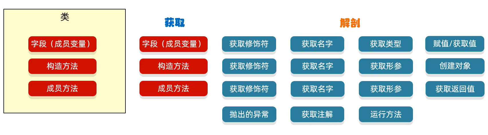
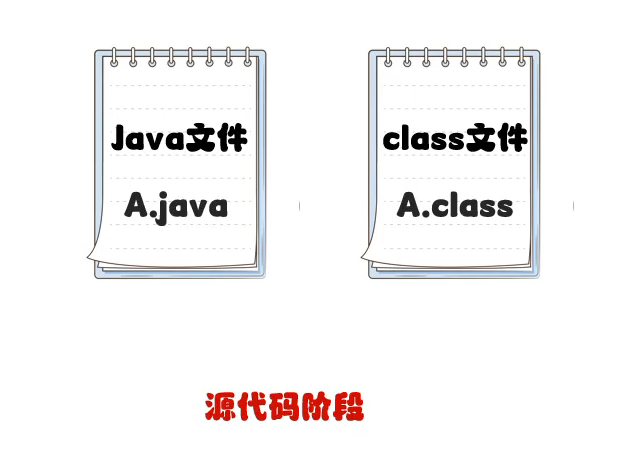
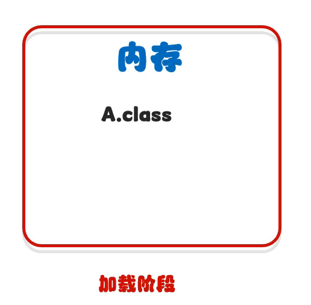
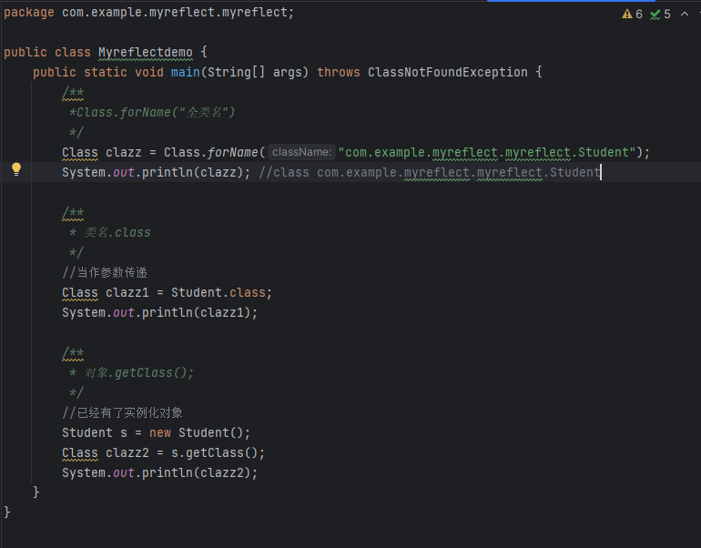
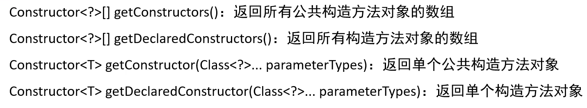
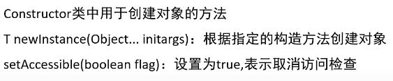
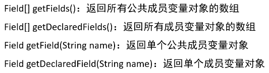
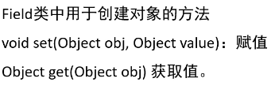
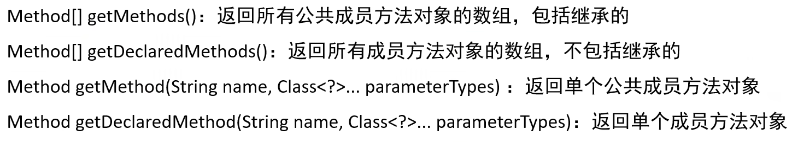
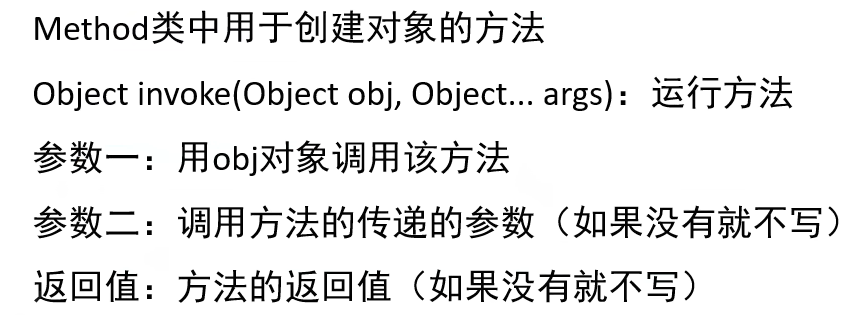

# 01 · 反射、类加载与 Unsafe

> 查阅区 · **只查不读**，不进学习路径。原文拆自 `JAVA安全-全本`，正文一字未改，仅调标题层级与图片相对路径。
> 什么时候翻：看 sink 为什么能被间接调用（Class.forName / ClassLoader / Unsafe）

## 反射

- 作用

  - 获取类中的成员变量、成员方法或构造方法，也就是一个类中的所有信息（在字节码文件class中获取）（综合练习1）
  - 结合配置文件动态创建对象（综合练习2）

  

  - 获取class对象（Class类）

    - Class.forName("全类名")

      

    - 类名.class

      

    - 对象.getClass();

      

  - 效果展示

    

  - 获取构造方法（Constructor）

    

    - 

  - 获取成员变量（Field）

    

    - 

  - 获取成员方法（Method）

    

    - 

- 综合练习

  - 保存任意对象数据
  - 利用反射动态创建对象和运行

## ClassLoader

- 作用
  - 加载任意Java类文件
  - 通过自定义ClassLoader实现自定义类加载行为
- 分类
  - Bootstrap ClassLoader 
    - 加载 JDK 的核心类
  - Extension ClassLoader(Java9后被 Platform ClassLoader取代)
    - 加载平台特定的扩展和 JDK 模块系统中的类
  - App ClassLoader
    - 从应用的类路径加载类
- 双亲委派模型
  - 模型过程
    - JVM从底层加载器`App ClassLoader`开始
    - `App ClassLoader`先检查类是否已加载，若没有则委派给`Extension ClassLoader`
    - `Extension ClassLoader`同理委派给`Bootstrap ClassLoader`
    - 从`Bootstrap ClassLoader `开始寻找并加载类，若找不到则由`Extension ClassLoader`执行同样过程，同理由顶层向下加载
    - 若所有加载器都失败则抛出`ClassNotFoundException`

  - 功能原则
    - 委派原则
      - 子类加载器总是先将类加载请求委派给父类加载器，保证如核心类由`Bootstrap ClassLoader `加载，也就是各类由相应的加载器加载

    - 可见性原则
      - 子类可见父类加载器的类，反之则不然

    - 唯一性原则
      - 保证同一类只被加载一次

- 核心方法
  - `loadClass(String name, boolean resolve)`：加载指定的类，如果 resolve 为 true，则解析类。
  - `defineClass()`：将字节数组定义为类实例，如果字节码格式错误，抛出 ClassFormatError（该方法为 final，不可重写）。
  - `findClass(String name)`：查找但不加载类，通常由自定义类加载器重写。
  - `findLoadedClass(String name)`：检查类是否已加载。
  - `Class.forName(String name, boolean initialize, ClassLoader loader)`：加载并初始化类，如果加载器为 null，使用引导类加载器。

### 子类加载器

- 自定义ClassLoader
  - 作用
    - 在webshell中实现加载并调用自己编译的类对象
- URLClassLoader
  - 作用
    - 加载远程的jar来实现远程类方法调用

### 可利用的漏洞加载器

#### JSP自定义类加载器后门

#### BCEL ClassLoader

#### Xalan ClassLoader

## Unsafe类

`sun.misc.Unsafe`类提供涉及底层的`内存、CAS、线程调度、类、对象`等操作的方法

### 通过反射获取Unsafe对象

- 获取theUnsafe成员变量

```java
// 反射获取Unsafe的theUnsafe成员变量
Field theUnsafeField = Unsafe.class.getDeclaredField("theUnsafe");

// 反射设置theUnsafe访问权限
theUnsafeField.setAccessible(true);

// 反射获取theUnsafe成员变量值
Unsafe unsafe = (Unsafe) theUnsafeField.get(null);
```

- 获取实例化Unsafe对象

```java
// 获取Unsafe无参构造方法
Constructor constructor = Unsafe.class.getDeclaredConstructor();

// 修改构造方法访问权限
constructor.setAccessible(true);

// 反射创建Unsafe类实例，等价于 Unsafe unsafe1 = new Unsafe();
Unsafe unsafe1 = (Unsafe) constructor.newInstance();
```

### Unsafe类中可利用的方法

#### allocateInstance无视构造方法创建类实例

- 作用
  - 绕过不能使用反射创建类实例的限制

#### defineClass直接调用JVM创建类对象

若ClassLoader类被限制，不能调用defineClass0/1/2方法在JVM注册类，可以使用该方法

- 方式

```java
//方式一适用Java8以前版本
public native Class defineClass(String var1, byte[] var2, int var3, int var4);

//方式二适用Java8版本
public native Class defineClass(String var1, byte[] var2, int var3, int var4, ClassLoader var5, ProtectionDomain var6);
```

- 例子

```java
Class helloWorldClass = unsafe1.defineClass(TEST_CLASS_NAME, TEST_CLASS_BYTES, 0, TEST_CLASS_BYTES.length);


// 获取系统的类加载器
ClassLoader classLoader = ClassLoader.getSystemClassLoader();

// 创建默认的保护域
ProtectionDomain domain = new ProtectionDomain(
    new CodeSource(null, (Certificate[]) null), null, classLoader, null
);

// 使用Unsafe向JVM中注册com.anbai.sec.classloader.TestHelloWorld类
Class helloWorldClass = unsafe1.defineClass(
    TEST_CLASS_NAME, TEST_CLASS_BYTES, 0, TEST_CLASS_BYTES.length, classLoader, domain
);
```
