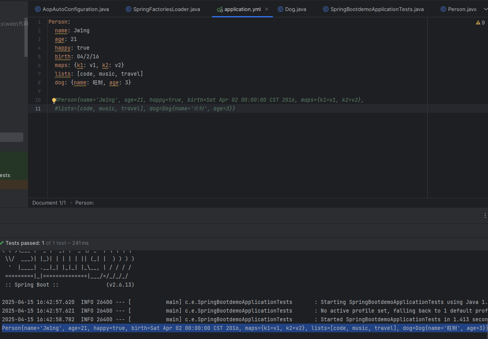

# 09 · SpringBoot 配置文件与校验

> 查阅区 · **只查不读**，不进学习路径。原文拆自 `JAVA安全-全本`，正文一字未改，仅调标题层级与图片相对路径。
> 什么时候翻：查配置文件位置与内容（口令、开关、多环境）

## 配置文件

SpringBoot使用的全局配置文件，名称默认为`application.properties`，用于修改SpringBoot自动配置的默认值

### ymal配置注入

全局的配置文件，**以数据作为中心，而不是以标记语言为重点**，结构类似python

- 键值对

  ```yaml
  Person:
  	name: Jw1ng
  	age: 21
  ```

- 数组

  ```yaml
  pets:
  	- cat
  	- dog
  	- pig
  	
  pets: [cat,dog,pig]
  ```

- 注入值

  - `@Component`：注册bean
  - `@ConfigurationProperties(prefix = "person")`：映射配置文件配置的属性值到组件中

  

  ```yaml
  Person:
    name: Jw1ng
    age: 21
    happy: true
    birth: 04/2/16
    maps: {k1: v1, k2: v2}
    lists: [code, music, travel]
    dog: {name: 旺财, age: 3}
  ```

  - 配置文件占位符

    ```yaml
    Person:
      name: Jw1ng${random.uuid}
      age: ${random.int}
      happy: true
      birth: 04/2/16
      maps: {k1: v1, k2: v2}
      lists: [code, music, travel]
      dog:
        name: ${person.hello:other}_旺财
        age: 3
        
    #Person{name='Jw1ng12dc3a3c-7f6c-4b66-a628-1a19de8d334a', age=-985356247, happy=true, birth=Sat Apr 02 00:00:00 CST 2016, maps={k1=v1, k2=v2}, lists=[code, music, travel], dog=Dog{name='other_旺财', age=3}}
    
    ```

  - `@PropertySource`：加载非默认的指定配置文件

- 松散绑定

  - yaml中写`last-name`对应类中的`lastName`

### JSR303数据校验

`@Validated`

```java
@NotNull(message="名字不能为空")
private String userName;
@Max(value=120,message="年龄最大不能查过120")
private int age;
@Email(message="邮箱格式错误")
private String email;

空检查
@Null       验证对象是否为null
@NotNull    验证对象是否不为null, 无法查检长度为0的字符串
@NotBlank   检查约束字符串是不是Null还有被Trim的长度是否大于0,只对字符串,且会去掉前后空格.
@NotEmpty   检查约束元素是否为NULL或者是EMPTY.
    
Booelan检查
@AssertTrue     验证 Boolean 对象是否为 true  
@AssertFalse    验证 Boolean 对象是否为 false  
    
长度检查
@Size(min=, max=) 验证对象（Array,Collection,Map,String）长度是否在给定的范围之内  
@Length(min=, max=) string is between min and max included.

日期检查
@Past       验证 Date 和 Calendar 对象是否在当前时间之前  
@Future     验证 Date 和 Calendar 对象是否在当前时间之后  
@Pattern    验证 String 对象是否符合正则表达式的规则
```

### 多环境配置

`application.properties`

```java
//application-test.properties 代表测试环境配置
//application-dev.properties 代表开发环境配置

spring.profiles.active=dev
```

`application.yml`

```yaml
server:
  port: 8081
#选择要激活那个环境块
spring:
  profiles:
    active: prod

---
server:
  port: 8083
spring:
  profiles: dev #配置环境的名称

---
server:
  port: 8084
spring:
  profiles: prod  #配置环境的名称
```
