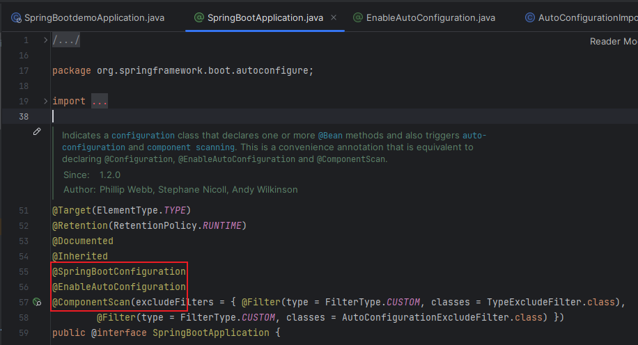
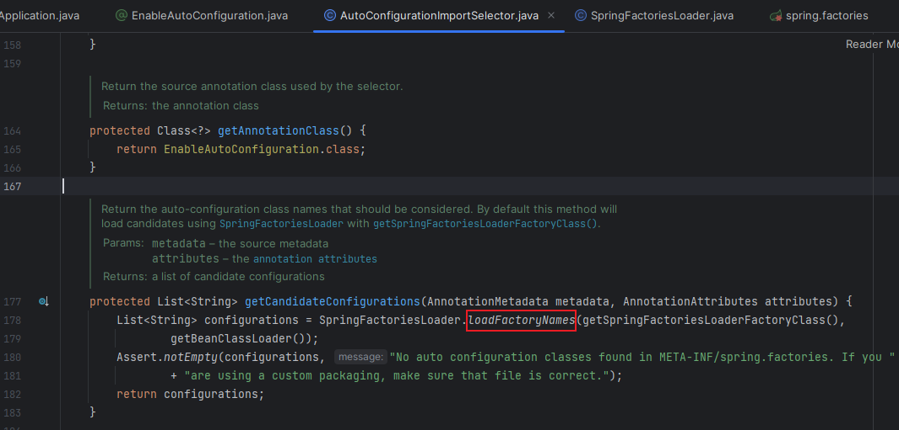
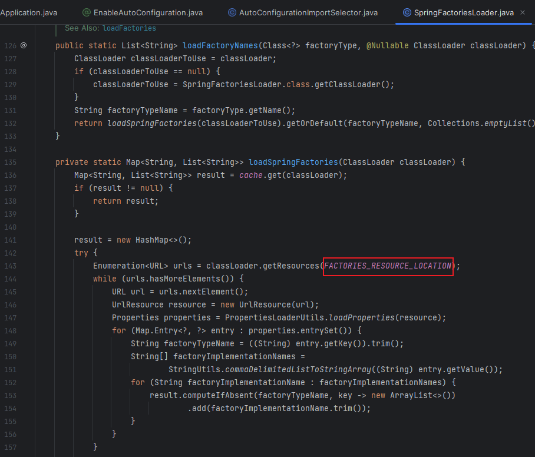
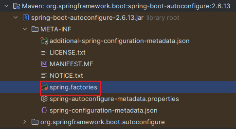
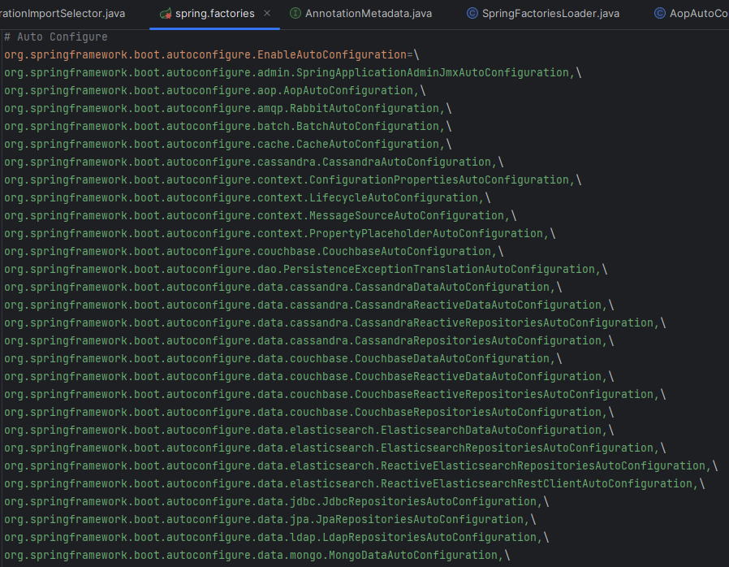
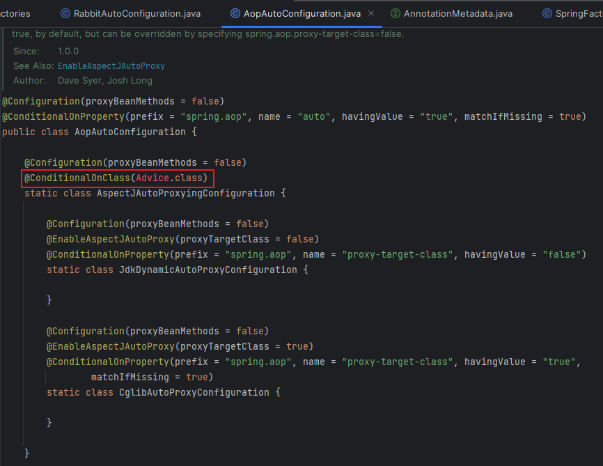
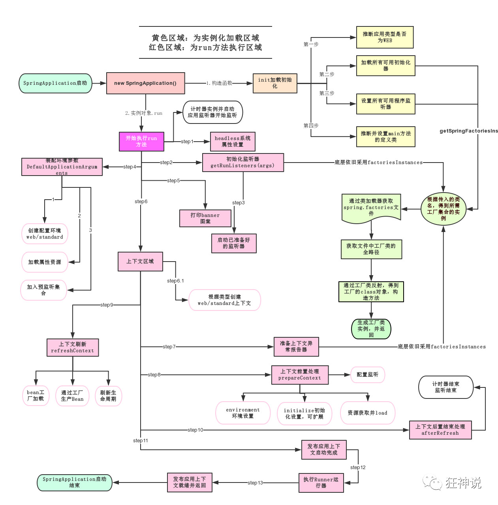

# 08 · SpringBoot 自动配置与启动

> 查阅区 · **只查不读**，不进学习路径。原文拆自 `JAVA安全-全本`，正文一字未改，仅调标题层级与图片相对路径。
> 什么时候翻：判断组件是否被引入、自动配置类是否生效（版本→前置的第二步）

# SpringBoot

Javaweb开发框架

- Spring
  - 轻量级Java开发框架，为解决企业级应用开发的复杂性而创建，简化开发
  - 关键策略
    - IOC
    - AOP
- 微服务
  - 架构风格
  - 把功能模块独立动态组合

## 自动配置

pom.xml

- 核心依赖在父工程中
- 有版本仓库

启动器

- Springboot的启动场景，如加载web启动器配置了web环境

主程序

```java
package com.example;

import org.springframework.boot.SpringApplication;
import org.springframework.boot.autoconfigure.SpringBootApplication;

//标识SpringBoot程序
@SpringBootApplication
public class SpringBootdemoApplication {

    public static void main(String[] args) {
        //启动SpringBoot
        SpringApplication.run(SpringBootdemoApplication.class, args);
    }

}
```

- 注解

  

  - @ComponentScan：自动扫描并加载符合条件的组件或者bean，将bean定义加载到IOC容器中

  - @SpringBootConfiguration：标注SpringBoot配置类

    ```java
    @Configuration：SpringBoot配置类
    		@Component：启动应用的SpringBoot组件
    ```

  - @EnableAutoConfiguration：开启自动配置

    ```java
    @AutoConfigurationPackage：自动配置包
        	@Import({AutoConfigurationPackages.Registrar.class})
    	@Import({AutoConfigurationImportSelector.class})
    ```

  - `AutoConfigurationImportSelector`类：自动配置导入选择器

    

    - 调用`SpringFactoriesLoader.loadFactoryNames`，以及`loadSpringFactories`

      

    - 读取自动配置文件`spring.factories`

      

      

    - 也就是说在创建springboot项目时很多组件就已经自动配置了，那为什么还要在依赖中添加启动器呢，随便在`spring.factories`选择一个自动配置的类，如`AopAutoConfiguration`，可以看到有注解`@ConditionalOnClass`，也就是说虽然导入了，但是要配置生效需要通过启动器满足条件

      

    - `@Conditional`，Spring的底层注解用来判断当前配置是否生效

  - 结论
    - SpringBoot在启动的时候会从`META-INF/spring.factories`获取`EnableAutoConfigurationd`的值
    - 这些值会作为自动配置类导入容器，通过反射得到class对象
    - 通过启动器使这些组件生效

- run()

  - 推断应用的类型是普通的项目还是Web项目
  - 推断并设置main方法的定义类，找到运行的主类

  
