# 10 · SpringBoot Web 路由与 MVC

> 查阅区 · **只查不读**，不进学习路径。原文拆自 `JAVA安全-全本`，正文一字未改，仅调标题层级与图片相对路径。
> 什么时候翻：入口建模（W1）：路由怎么注册、静态资源与模板引擎的落点

## Web程序

### 路由

可在下看`WebMvcAutoConfiguration`类下看

```java
@Override
public void addResourceHandlers(ResourceHandlerRegistry registry) {
    if (!this.resourceProperties.isAddMappings()) {
        logger.debug("Default resource handling disabled");
        return;
    }
    Duration cachePeriod = this.resourceProperties.getCache().getPeriod();
    CacheControl cacheControl = this.resourceProperties.getCache().getCachecontrol().toHttpCacheControl();
    //第一种路由
    if (!registry.hasMappingForPattern("/webjars/**")) {
        customizeResourceHandlerRegistration(registry.addResourceHandler("/webjars/**")
                                             .addResourceLocations("classpath:/META-INF/resources/webjars/")
                                             .setCachePeriod(getSeconds(cachePeriod)).setCacheControl(cacheControl));
    }
    String staticPathPattern = this.mvcProperties.getStaticPathPattern();
    //第二种路由
    if (!registry.hasMappingForPattern(staticPathPattern)) {
        customizeResourceHandlerRegistration(registry.addResourceHandler(staticPathPattern)
                                             .addResourceLocations(getResourceLocations(this.resourceProperties.getStaticLocations()))
                                             .setCachePeriod(getSeconds(cachePeriod)).setCacheControl(cacheControl));
    }
}
```

- 两种路由
  - webjars
  
    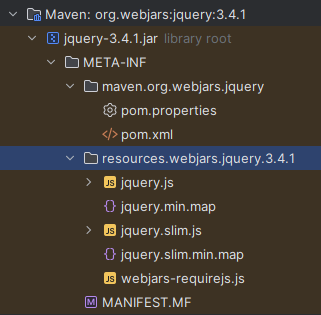
  
    - 例如：localhost:8080/webjars/jquery/3.4.1/jquery.js
  
  - resources/public；resources/static；resources/resources
    
    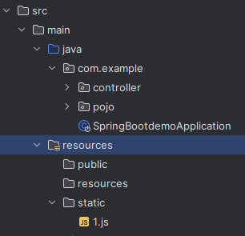
    
    - localhost:8080/1.js
    - 优先级
      - resources>static>public

### 首页

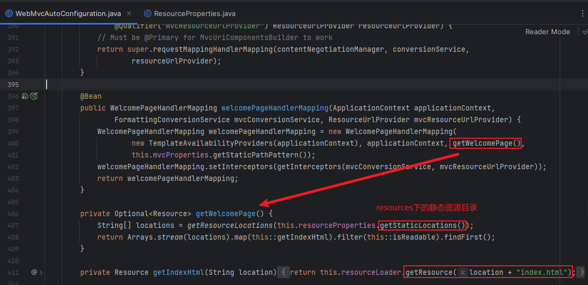

在resources下的静态目录放置index.html作为首页目录，路由为根目录

### 模板引擎

Thymeleaf

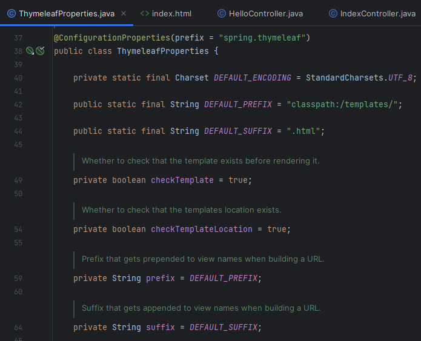

- 前缀后缀默认，只需将要渲染的html文件放在类路径的`templates`目录中即可，然后通过Controller跳转访问

  - 需要在html文件中导入命名空间的约束

    ```java
    <!DOCTYPE html>
    <html lang="en" xmlns:th="http://www.thymeleaf.org">
    <head>
        <meta charset="UTF-8">
        <title>首页</title>
    </head>
    <body>
    //修改指定值，输出文本
    <div th:text="${msg1}"></div>
    //输出未转义文本
    <div th:utext="${msg2}"></div>
    //遍历输出
    <div th:each="user:${users}" th:text="${user}"></div>
    </body>
    </html>
    ```

  - Controller

    ```java
    package com.example.controller;
    
    import org.springframework.stereotype.Controller;
    import org.springframework.ui.Model;
    import org.springframework.web.bind.annotation.RequestMapping;
    import java.util.Arrays;
    
    @Controller
    public class IndexController {
        @RequestMapping("/index")
        public String index(Model model) {
            model.addAttribute("msg1", "<h1>Thymeleaf Test Page</h1>");
            model.addAttribute("msg2", "<h1>Thymeleaf</h1>");
            model.addAttribute("users", Arrays.asList("Jw1ng", "Dog"));
            return "index";
        }
    }
    
    ```

    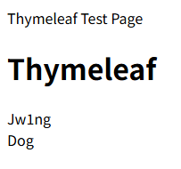

## MVC自动配置原理

此处以`ViewResolver`的自动配置为例

在`WebMvcAutoConfiguration`类中找到`ContentNegotiatingViewResolver`类

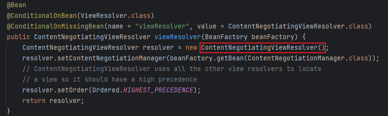

- 跟进这个类找到`resolveViewName`

  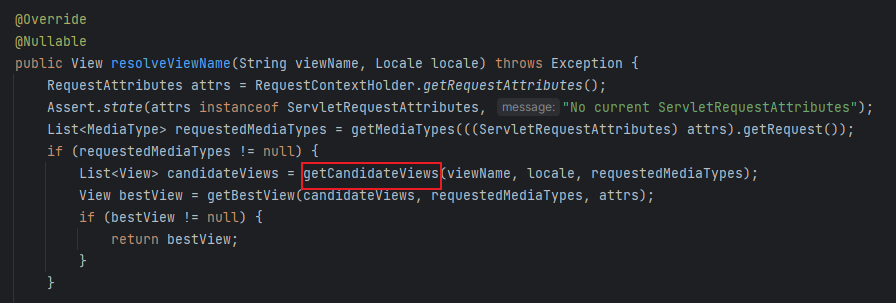

  - 循环遍历加载视图解析器

    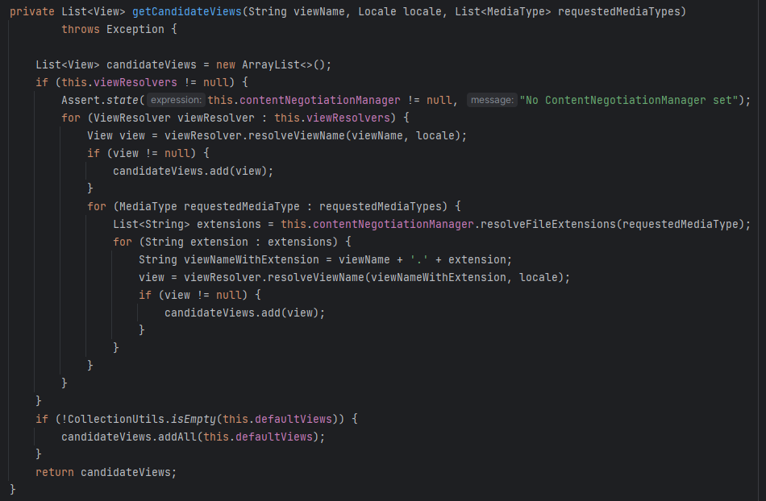

- 尝试写一个视图解析器

  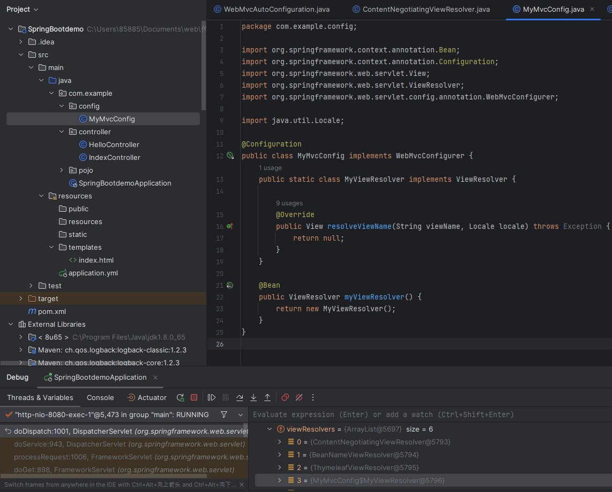

- 并打断点调试

  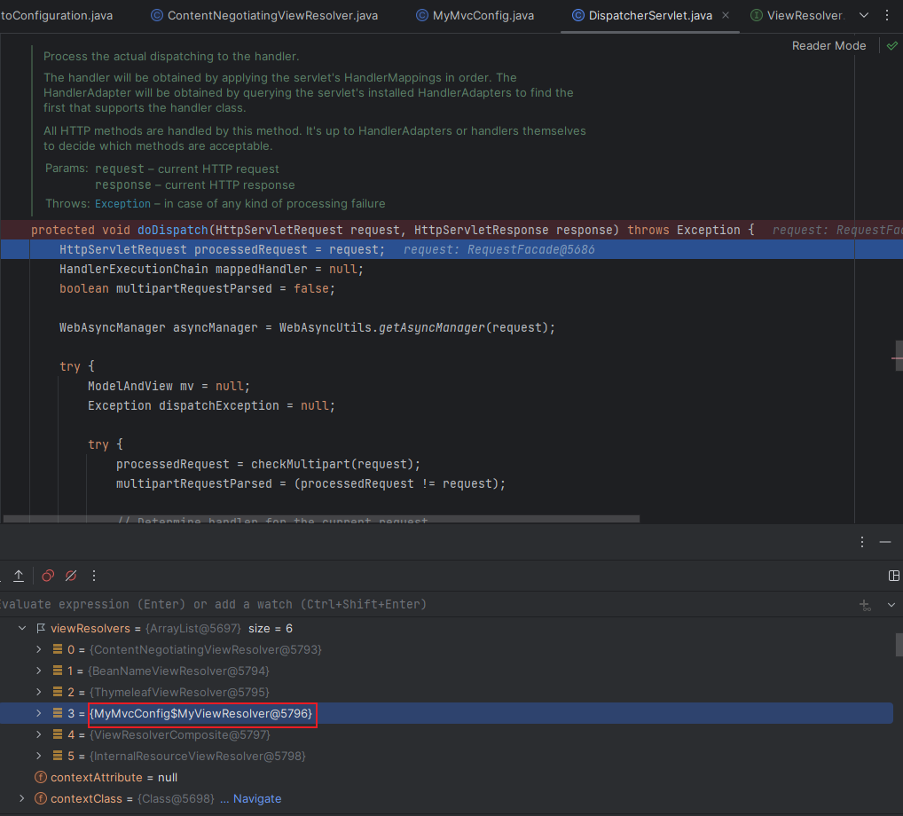

- 鉴于SpringBoot有MVC自动配置的功能，如果要定制化功能只需重写方法后添加进容器即可

- 另外要自定义MVC则不能加上`@EnableWebMvc`

  - 跟进该注解，发现导入了`DelegatingWebMvcConfiguration`类

    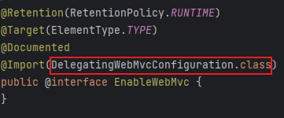

  - 继续跟进，发现该类继承了`WebMvcConfigurationSupport`

    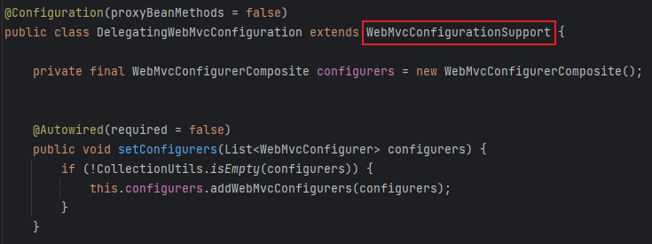

  - 而自定义实现类`WebMvcAutoConfiguration` 的生效条件之一便是不能存在`WebMvcConfigurationSupport`类

    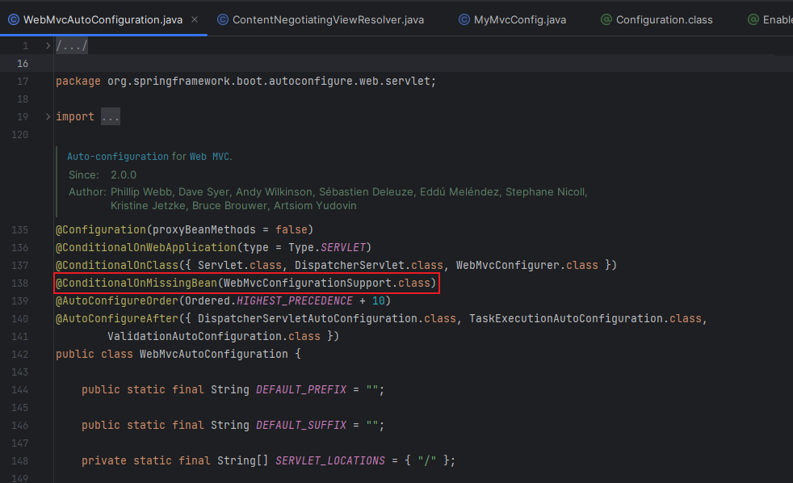


## 员工管理系统

### 静态页面实现

将静态资源页面(html中的默认路径改为js或css等)通过**模板引擎渲染**

### 国际化页面

在`resources`下配置`i18n`，分别配置不同语言的properties

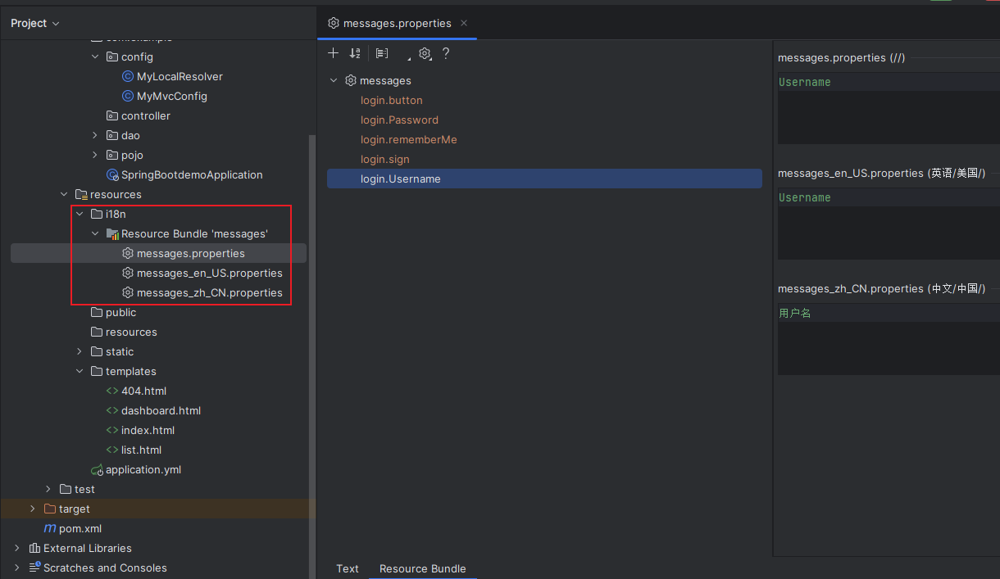

- 在`MessageSourceAutoConfiguration`类中导入i18n配置

  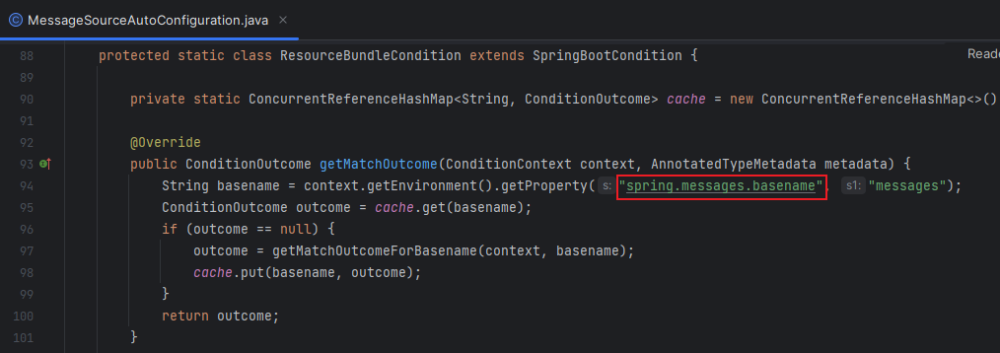

  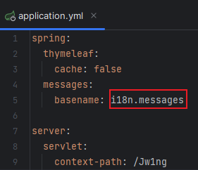

在`WebMvcAutoConfiguration`类中有处理不同语言的分解器`LocalResolver`，所以要重写这个类

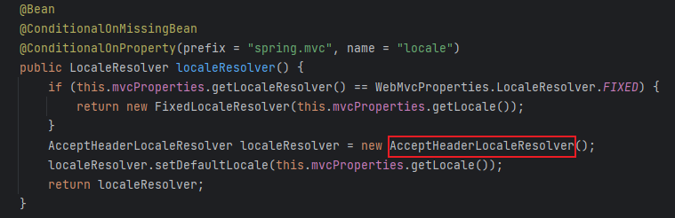

- 重写`AcceptHeaderLocaleResolver`类中的`resolveLocale`方法

  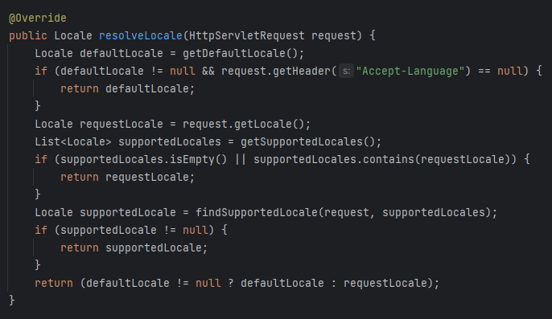

- 创建`MyLocalResolver`重写方法

  ```java
  package com.example.config;
  
  import org.springframework.web.servlet.LocaleResolver;
  import org.thymeleaf.util.StringUtils;
  
  import javax.servlet.http.HttpServletRequest;
  import javax.servlet.http.HttpServletResponse;
  import java.util.Locale;
  
  public class MyLocalResolver implements LocaleResolver {
      @Override
      public Locale resolveLocale(HttpServletRequest request) {
          String language = request.getParameter("l");
          Locale locale = Locale.getDefault();
          if(!StringUtils.isEmpty(language)) {
              String[] split = language.split("_");
              locale  = new Locale(split[0], split[1]);
          }
          return locale;
      }
  
      @Override
      public void setLocale(HttpServletRequest request, HttpServletResponse response, Locale locale) {
  
      }
  }
  ```

  - 导入容器

    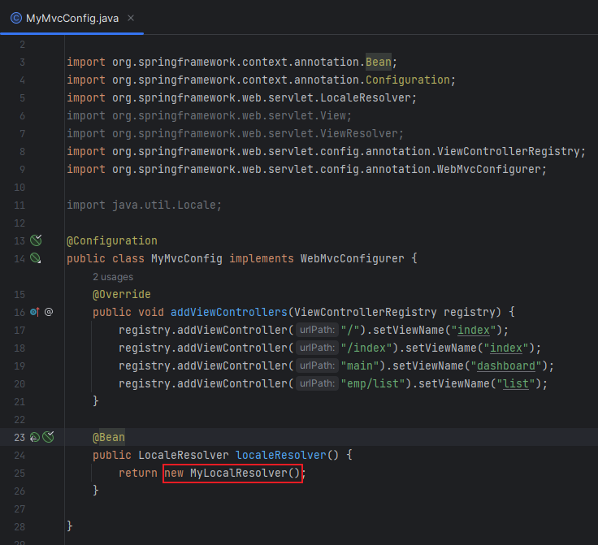

- 最后再配置一下模板即可，使用#{}

  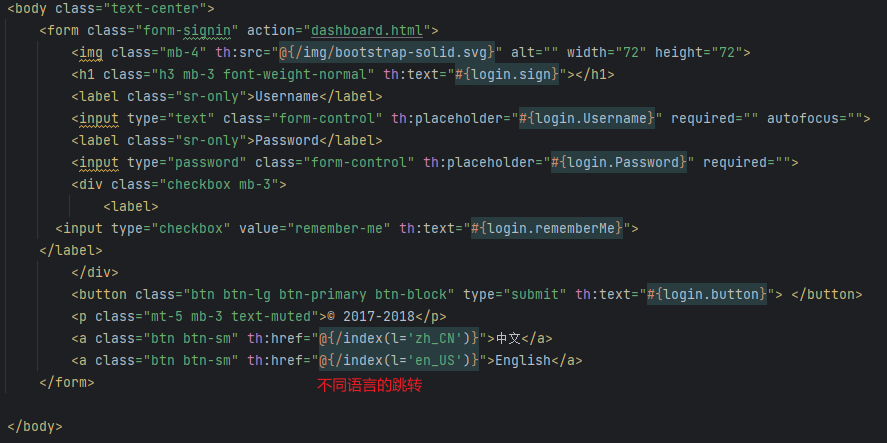

### 首页登录


### 登录拦截器
